# Customer User Manual

**Item Management System — store owner, manager and billing staff**

This manual covers the screens that exist in the current release. Screenshots were captured from the
running application on **2026-11-01** at 1440 × 900 unless the caption says otherwise. Where a screen
was not captured, a clearly marked placeholder explains how to capture it.

> **Placeholder convention:** a box labelled **SCREENSHOT PLACEHOLDER** is not a real screenshot.
> It is a deliberate marker so no reader mistakes an illustration for verified output.

---

## 1. Signing in

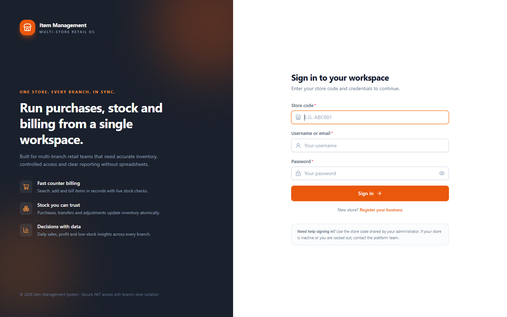

1. Open the website address provided by your administrator.
2. Enter the **store code** you received when your store was registered (for example `ABC001`).
3. Enter your **username or e-mail** and **password**.
4. Select **Sign in**.

Notes:

- The store code is required. It selects your tenant; a username from another store cannot sign in
  here.
- If the account or store is disabled you will see a message asking you to contact the
  administrator.
- Forgot your password? Ask your platform administrator to reset it. They will give you a one-time
  temporary password; sign in with it and you will be asked to choose a new password immediately.
  The application does not have a self-service “forgot password” link.
- After 12 hours (default) the session expires. You will be returned to the login screen.
- Five failed attempts in a short period temporarily lock sign-in. Wait for the lockout to pass
  (15 minutes by default) before trying again.

---

## 2. Dashboard

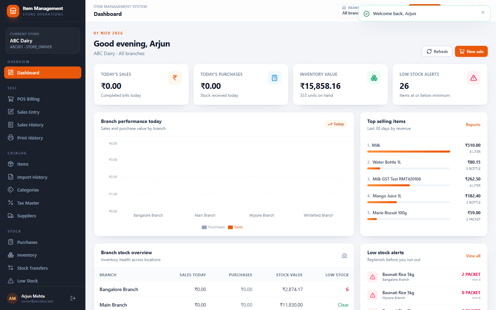

The dashboard is the home screen (`/`).

- Sales and purchase totals for the current period.
- Low-stock count and the first low-stock items.
- Per-branch summary when you can access more than one branch.
- Use the branch selector to focus on one branch.

On a phone the same information stacks into a single column:

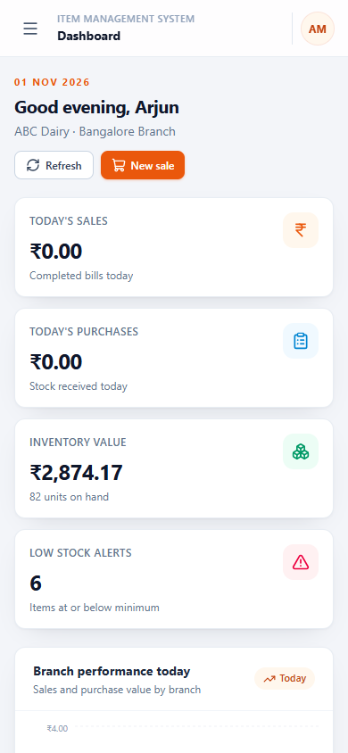

---

## 3. Items and barcodes

### 3.1 Finding an item

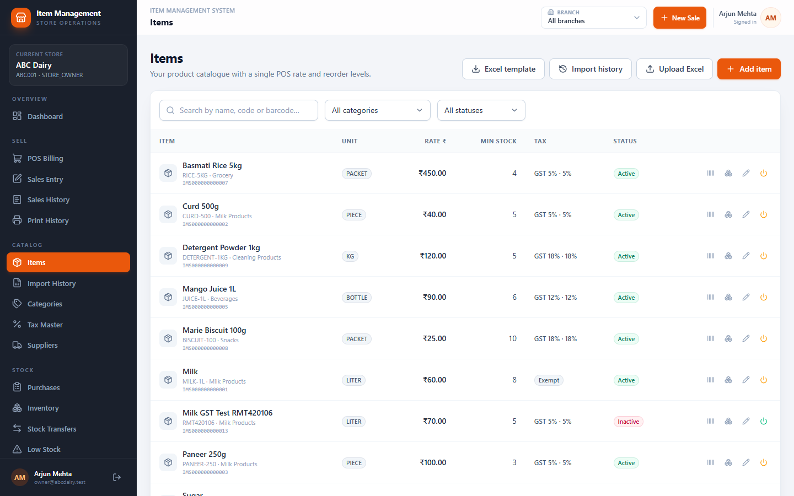

1. Open **Items** in the sidebar.
2. Search by **name, item code or barcode**.
3. Filter by category and status.
4. Each row shows the item code, barcode, category, unit, rate, stock status and minimum level.

### 3.2 Adding an item

1. Select **Add item**.
2. Fill in:
   - **Item code** — 2–50 letters/numbers/`.`/`_`/`-`, unique in your store.
   - **Item name** and optional description.
   - **Category** and **tax** (create them first if they are missing).
   - **Base unit** — litre, ml, kg, gram, piece, packet, box, bottle or dozen.
   - **Rate** — the single selling rate used by POS.
   - **Minimum stock** — used for low-stock alerts.
   - **Barcode** — leave blank to generate a unique Code 128 automatically, or type your own and
     choose Code 128 / EAN-13.
3. Select **Save**.

Barcode rules:

- Code 128 accepts 1–64 letters, numbers, dot, underscore or hyphen.
- EAN-13 accepts exactly 13 digits and checks the final check digit.
- A barcode must be unique inside your store. Reusing another item’s barcode is rejected.
- Inactive items cannot be bought, sold or transferred, but remain visible in old documents.

### 3.3 Printing or downloading a barcode label

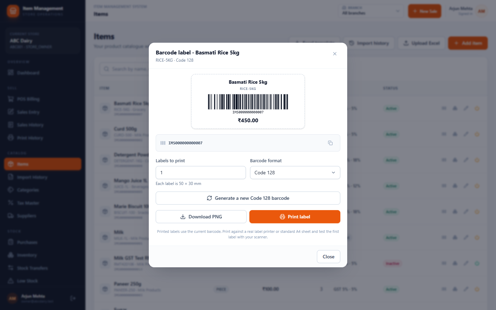

1. On the item row, press the **barcode** button.
2. The dialog previews a 50 × 30 mm label with:
   - item name,
   - item code,
   - scannable barcode,
   - selling price.
3. Set **Labels to print** (1–100).
4. Choose **Print labels** to open the browser print dialog, or **Download PNG** to save one label
   image.
5. **Regenerate barcode** (requires item-management permission) creates a new value. Confirm the
   warning: labels already printed with the old barcode will no longer scan.

> **Tip:** Print one test label and scan it before printing a full sheet.

---

## 4. Scanning barcodes

Barcode scanning is available on POS, normal sales entry and purchase entry.

### USB or Bluetooth scanner

1. Click the **scan field** (placeholder “Scan barcode…”).
2. Scan the label. The scanner behaves like a keyboard and sends the value plus Enter.
3. The item is added to the document. Scanning the same item again increases its quantity.

### Phone or tablet camera

1. Press **Camera** next to the scan field.
2. Allow camera access when the browser asks.
3. Point the rear camera at the barcode and hold steady.
4. The first detected value is submitted automatically.

If the camera cannot be used, the dialog tells you why (unsupported browser, permission denied, no
camera, camera busy). Chrome, Edge and Chrome on Android support barcode detection; iOS Safari does
not, so use a USB/Bluetooth scanner or type the value there.

---

## 5. POS billing

### Desktop

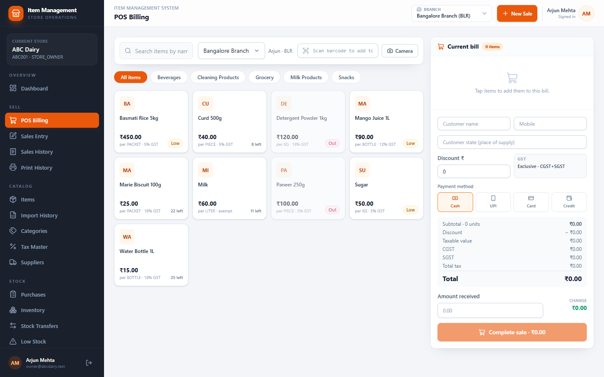

1. Open **POS**.
2. Select the branch (if you have more than one).
3. Add items by tapping the item card, searching, or scanning a barcode.
4. Adjust quantity with +/−. The line shows the master rate and tax.
5. Choose the payment method: cash, UPI, card or credit.
6. Enter the paid amount if it differs from the total.
7. Select **Complete sale**.

The server recalculates everything. In POS it always uses the item’s current master rate; a rate
displayed by an old page cannot override it. If stock is insufficient, the sale is rejected and
nothing is deducted.

### Phone

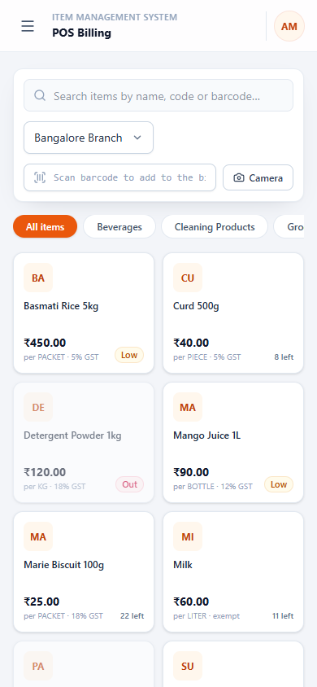

On small screens:

- The item grid is above; the bill is below.
- A fixed bar shows the cart total and **Review & bill**. It scrolls to the bill.
- The bar and the Complete sale button do not overlap; the page adds bottom spacing so every button
  remains reachable.

### Tablet

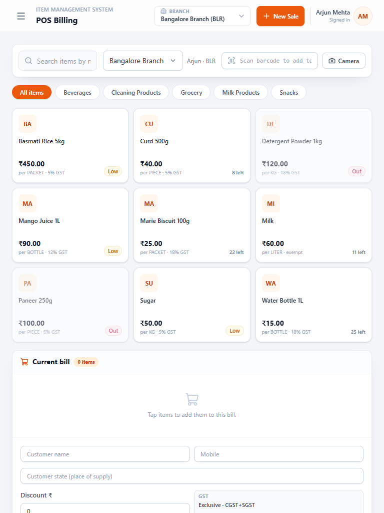

The tablet layout uses two columns with a sticky bill panel.

---

## 6. Normal sales entry

1. Open **Sales → New sale** (permission required).
2. Select branch and date.
3. Enter customer name, mobile and state (optional). State controls CGST+SGST vs IGST.
4. Add lines manually, by scan, and enter the negotiated selling rate and discount.
5. Optional header discount and paid amount.
6. Save. The receipt can be printed immediately.

Use this screen when the selling rate differs from the master rate. POS is for the standard rate.

---

## 7. Sales history, receipts and cancellation

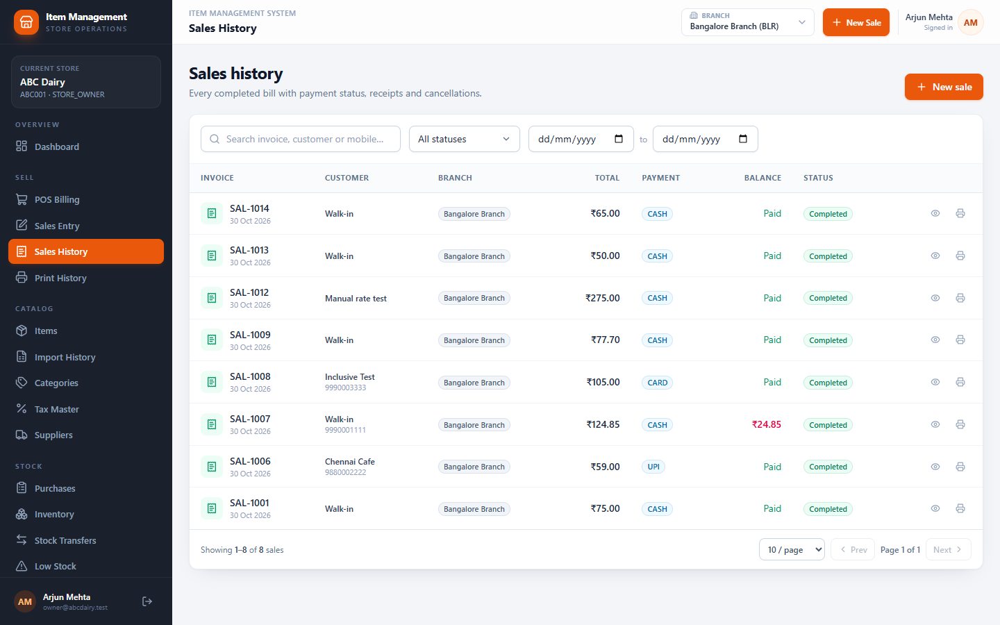

1. Open **Sales**.
2. Search by invoice number, customer name or mobile; filter by status and date.
3. **View** opens the invoice and GST breakdown.
4. **Print receipt** sends the receipt to the configured thermal printer (or the browser on other
   devices).
5. **Cancel sale** (completed bills only) reverses the stock. The invoice stays in history marked
   Cancelled and is excluded from reports.
6. On a narrow phone the filters wrap and the page has no horizontal scrolling:

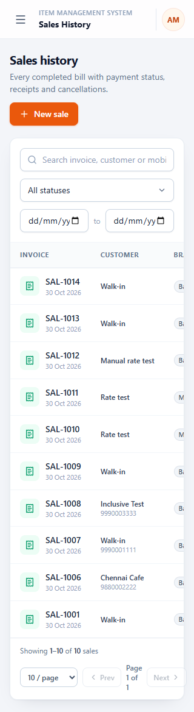

---

## 8. Purchases

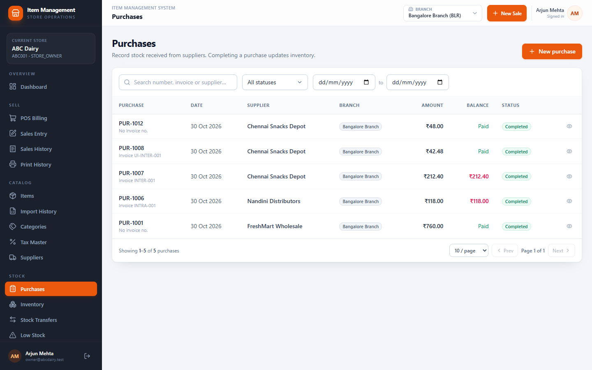

1. Open **Purchases → New purchase**.
2. Choose supplier, branch, invoice number and date.
3. Add lines by item or barcode; enter quantity, unit, purchase rate and discount.
4. Save as **Draft** if the invoice is not final, or **Completed** to add stock.
5. A completed purchase increases stock, updates average cost and writes the ledger.
6. **Cancel** a completed purchase only if that stock is still available. The reversal is recorded;
   partial returns are not supported.

---

## 9. Inventory and stock adjustments

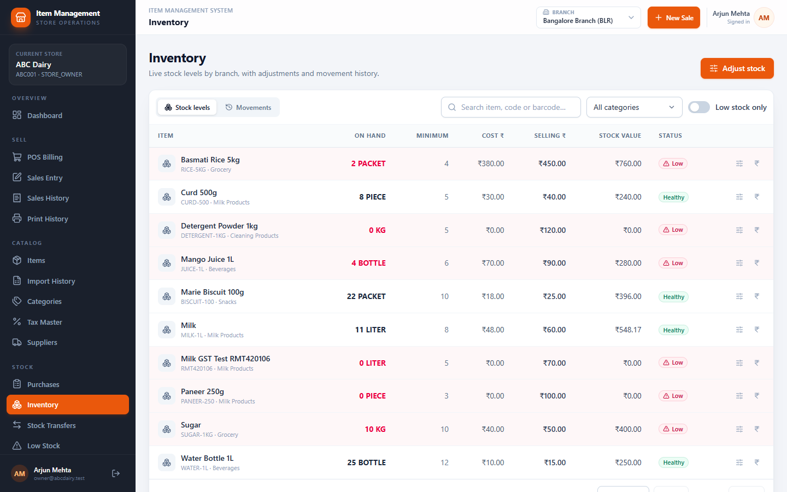

1. Open **Inventory**.
2. Filter by branch, category, search and **low stock only**.
3. The table shows current stock, minimum, purchase price, selling price, average cost and value.
4. **Adjust stock**: choose IN or OUT, quantity, unit and a reason. The adjustment is immediate and
   audited.
5. **Edit pricing** changes the branch selling price and minimum stock for one item.
6. Open the transactions tab/dialog to see every stock movement and its reference.

---

## 10. Stock transfers

**SCREENSHOT PLACEHOLDER — Transfers list and New transfer dialog**

> Capture: sign in as owner, open `/transfers`, take a 1440 × 900 screenshot; then open **New
> transfer** and capture the dialog. Replace this block with
> ``.

1. Open **Transfers → New transfer**.
2. Choose source and destination branches (they must differ).
3. Add items and quantities.
4. Save (status Pending). No stock moves yet.
5. A user with approval permission selects **Approve**.
6. At the source, **Dispatch** removes stock.
7. At the destination, **Receive** adds stock.
8. Reject before dispatch, or cancel before dispatch. A dispatched transfer must be received.

---

## 11. Low stock

1. Open **Low stock** or use the dashboard widget.
2. The rule is “current stock is less than or equal to the minimum”.
3. Adjust the minimum on the inventory screen or replenish through a purchase/transfer.

---

## 12. Reports

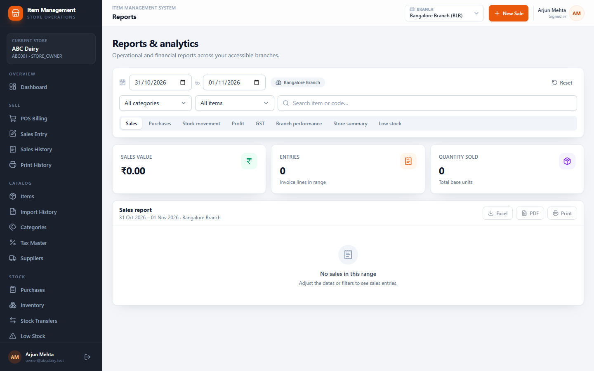

1. Open **Reports**.
2. Choose Sales, Purchases, GST, Stock, Low stock, Profit, Store or Branches.
3. Set the date range (defaults to this month) and filters.
4. Review the table/chart.
5. Export to Excel or PDF.

Notes:

- Cancelled documents are excluded.
- Profit uses the cost captured when the sale was posted; later price changes do not rewrite history.
- The GST report covers output tax on sales.

---

## 13. Categories, taxes and suppliers

**SCREENSHOT PLACEHOLDER — Categories, Taxes, Suppliers**

> Capture each list at 1440 × 900 and one Add dialog. Suggested names:
> `categories-desktop.png`, `taxes-desktop.png`, `suppliers-desktop.png`.

- **Categories:** name must be unique in the store. Delete only when no item uses the category.
- **Taxes:** enter name, GST %, and GST/EXEMPT. The system derives CGST, SGST and IGST. Five standard
  slabs are created for a new store.
- **Suppliers:** name, mobile, address, state and GSTIN. Supplier state controls inter-state GST.

---

## 14. Team, roles and store settings

**SCREENSHOT PLACEHOLDER — Settings tabs (Store profile, Branches, Users, Roles)**

> Capture `/settings?tab=store`, `branches`, `users`, `roles` at 1440 × 900.

1. **Store profile** — name, owner, contact, address, GSTIN and tax-inclusive billing. Changes affect
   future documents and receipts.
2. **Branches** — add/edit branches, set state and status. Branch codes are unique in the store. The
   subscription’s branch limit is enforced.
3. **Users** — create users, assign one role and the branches they may use, and activate/deactivate.
   Passwords are hashed and never shown.
4. **Roles & permissions** — choose from the 30 permission codes. Permission changes apply on the
   user’s next sign-in.
5. **Security** — shows the application build/version and lets you change your own password. Enter
   your current password, then a new one: 8–72 characters with upper-case, lower-case, number and a
   special character. Other sessions are signed out after the change.

If you forget your password, the platform administrator can reset it and you must choose a new one
at your next sign-in. You can change a password you still remember yourself under
**Settings → Security**.

---

## 15. Printers and printing

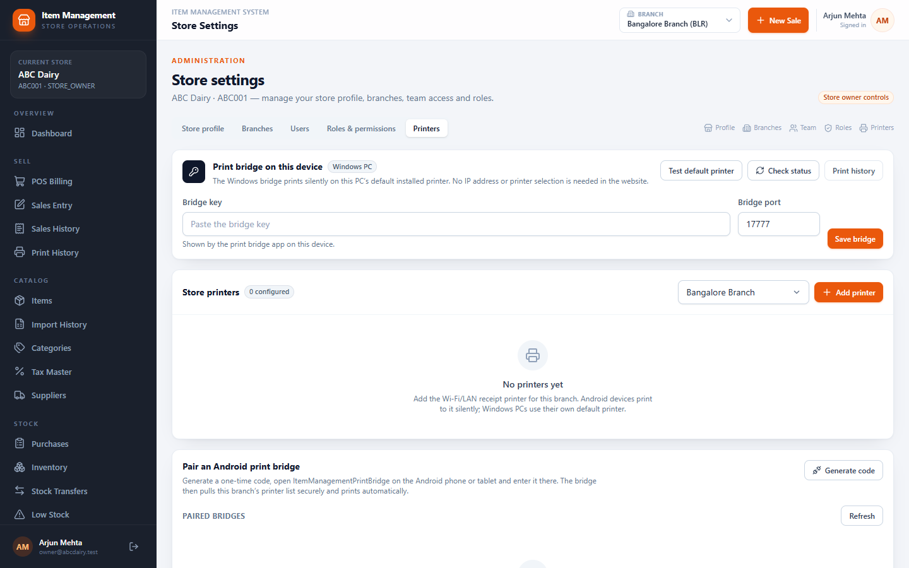

### Windows PC

1. Install **Item Management Print Bridge** from the installer supplied by your administrator.
2. Set your thermal receipt printer as the Windows **default printer**.
3. Open the bridge tray menu and copy the **bridge key**.
4. In **Settings → Printers**, paste the key under *Print bridge on this device* and save.
5. Press **Check status**; it should show the bridge version and default printer.
6. Press **Test default printer** and confirm paper output.

### Android phone/tablet

1. Install the **ItemManagementPrintBridge** APK.
2. In **Settings → Printers**, choose the branch and press **Generate code**.
3. In the Android app, enter the website address, the code and a device name, then pair.
4. Add the LAN printer in Settings → Printers: name, IP/hostname, port 9100, paper width and purpose.
5. Paste the Android bridge key in Settings → Printers and save.
6. Press **Test connection** from the Android device.
7. Keep the bridge running and allow it to start with Android so billing works after a reboot.

### Printing a receipt

- A completed sale prints automatically when a bridge is configured.
- Manual printing is available in Sales, Sales History and the sale detail.
- Buttons are disabled while a job is running and show a spinner; repeated clicks do not duplicate an
  automatic job.
- If the bridge is offline, an error explains what to check; the job is recorded as FAILED.

### Print History

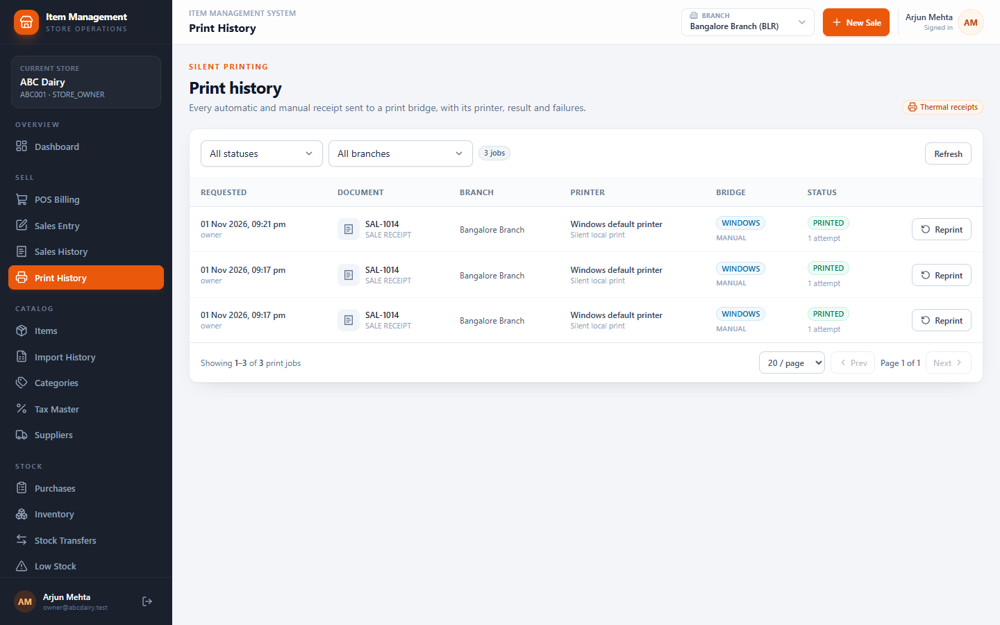

Open **Print History** to see every job, status, attempts, printer and error. **Reprint** creates a new
manual job.

---

## 16. Platform administrator screens

These screens are only for platform administrators (sign in with store code `PLATFORM`).

### Stores

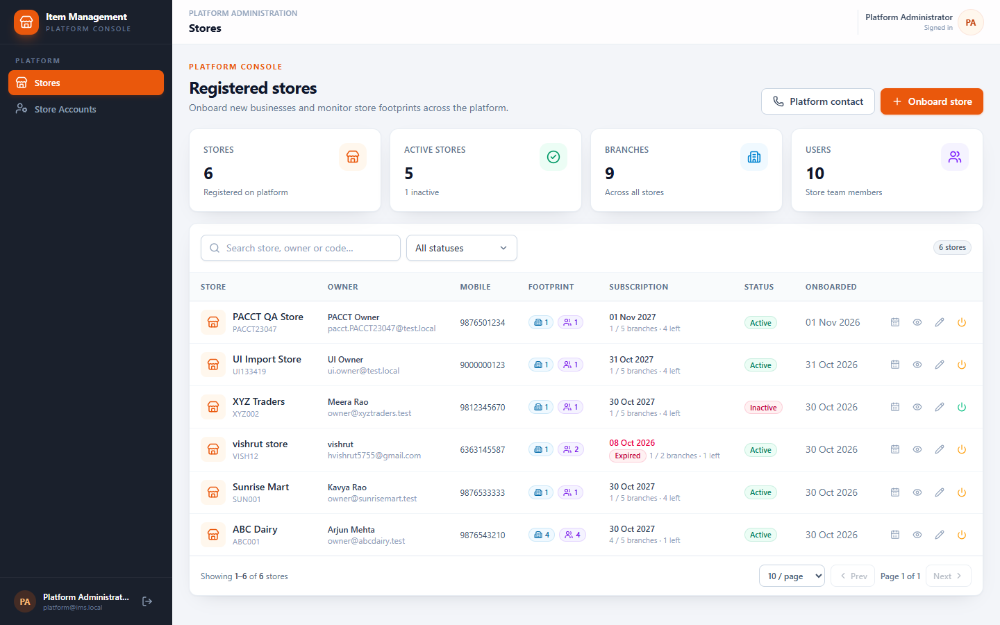

- See every store, status, owner contact, branch usage and subscription dates.
- Register a new store.
- Suspend/activate a store.
- Edit the subscription start/end dates and branch limit; changes are recorded in history.

### Store login accounts

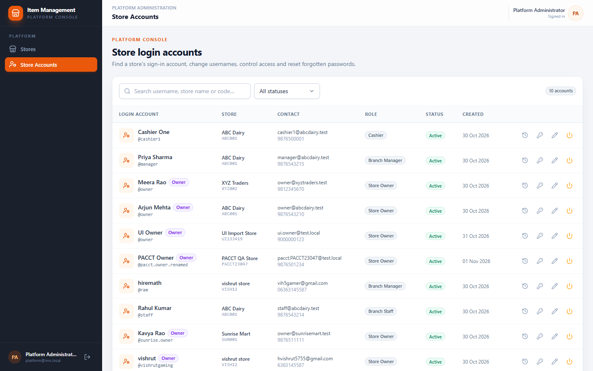

- Search by store name, store code, username, full name, e-mail or mobile.
- See the login username, roles, owner flag and account status. Platform users are excluded.
- Change a username (unique per store).
- Disable/enable a login account.
- **Reset password**: confirm, then copy the one-time temporary password shown. It is displayed once
  and stored only as a hash. Deliver it securely and ask the user to keep it private.
- Open **History** to see password resets, username changes and enable/disable events. Passwords and
  hashes are never shown.

---

## 17. Common messages and what to do

| Message | Meaning / action |
|---|---|
| `Invalid store code, username or password` | Check the store code; the same message appears for a wrong store, user or password. |
| `You do not have access to this branch` | Ask an owner/admin to assign the branch to your user, then sign in again. |
| `Insufficient stock for …` | Receive/purchase/transfer stock; the sale was not saved. |
| `This barcode is already used by another item` | Use a unique barcode or let the system generate one. |
| `This category is used by N item(s)` | Move the items to another category before deleting. |
| `A unique barcode could not be generated` | Retry; the generator retried 20 collisions. |
| `Cannot reach the Windows print bridge…` | Start the tray app, confirm port 17777 and the saved bridge key. |
| `Cannot reach the Android print bridge…` | Open the APK, confirm port 17778 and the saved key. |
| `No receipt printer is configured…` | Add an active RECEIPT/ALL printer for the branch and refresh the bridge. |
| `Subscription expired` screen | Contact the platform administrator using the displayed contact details. |

---

## 18. What this release does not do

- No purchase returns or partial returns.
- No customer master screen.
- No split payments, stored change or offline billing.
- No audit-log viewer for store users; platform administrators have a separate platform audit screen.
- No Bluetooth/USB receipt printer support (Windows default printer or Android LAN ESC/POS only).
- No iPhone camera scanning (browser limitation).

Report anything unexpected with the time, store code, invoice/job number and a screenshot to your
administrator.
