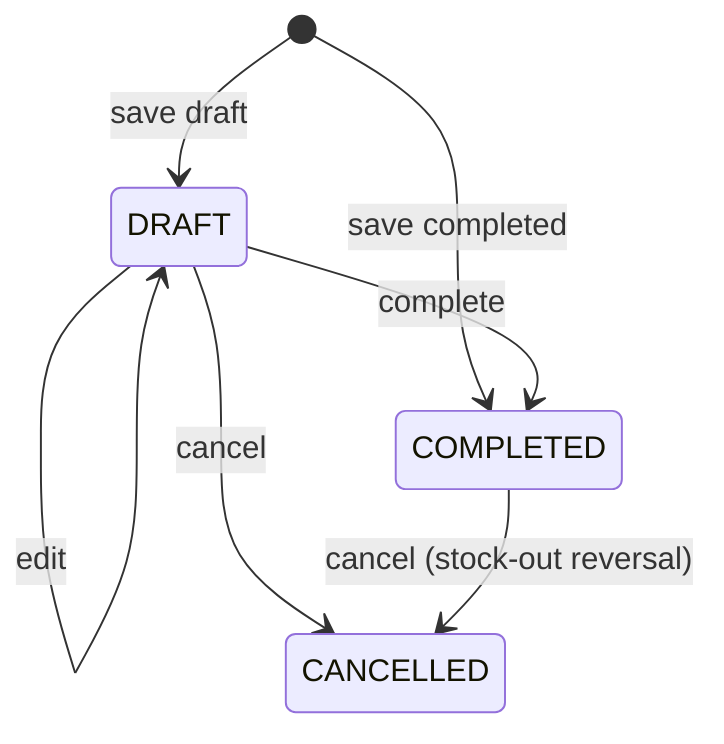
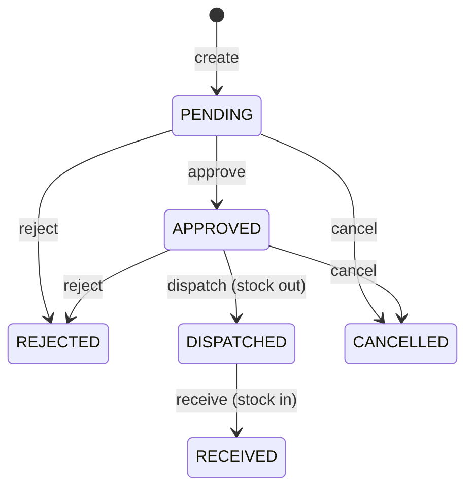

# End-to-End Workflows

> Every workflow below is implemented in this repository and was traced through the React page, the
> REST controller, the transactional service and the tables it writes. Anything not implemented is
> named at the end rather than described as if it worked.
>
> The common request path is documented in
> [`SYSTEM_ARCHITECTURE.md`](SYSTEM_ARCHITECTURE.md#5-request-lifecycle). In every store workflow the
> tenant comes from the JWT, so the browser never sends `storeId`.

---

## 0. Workflow index

| # | Workflow | Entry point | Main permission |
|---|---|---|---|
| 1 | Store registration | `/register` → `POST /api/auth/register-store` | public |
| 2 | Sign in / session | `/login` → `POST /api/auth/login` | public |
| 3 | Store profile | Settings → Store profile | `STORE_VIEW` / `STORE_MANAGE` |
| 4 | Branches | Settings → Branches | `BRANCH_VIEW` / `BRANCH_MANAGE` |
| 5 | Users and branches | Settings → Users | `USER_VIEW` / `USER_MANAGE` |
| 6 | Roles and permissions | Settings → Roles & permissions | `ROLE_VIEW` / `ROLE_MANAGE` |
| 7 | Categories | `/categories` | `CATEGORY_VIEW` / `CATEGORY_MANAGE` |
| 8 | Tax master | `/taxes` | `TAX_VIEW` / `TAX_MANAGE` |
| 9 | Suppliers | `/suppliers` | `SUPPLIER_VIEW` / `SUPPLIER_MANAGE` |
| 10 | Items and barcodes | `/items` | `ITEM_VIEW` / `ITEM_MANAGE` |
| 11 | Barcode labels and scanning | `/items`, POS, sales entry, purchases | `ITEM_MANAGE` for regenerate |
| 12 | Excel item import | `/items/imports` | `ITEM_MANAGE` + `INVENTORY_ADJUST` |
| 13 | Purchases | `/purchases` | `PURCHASE_VIEW` / `PURCHASE_MANAGE` |
| 14 | Normal sales | `/sales/new` | `SALES_MANAGE` |
| 15 | POS billing | `/pos` | `SALES_MANAGE` |
| 16 | Sales history and cancellation | `/sales` | `SALES_VIEW` / `SALES_MANAGE` |
| 17 | Stock transfers | `/transfers` | `TRANSFER_*` |
| 18 | Inventory and adjustments | `/inventory` | `INVENTORY_VIEW` / `INVENTORY_ADJUST` |
| 19 | Low stock | dashboard, `/low-stock`, reports | `INVENTORY_VIEW` / `REPORT_VIEW` |
| 20 | Reports | `/reports` | `REPORT_VIEW` |
| 21 | Thermal receipt printing | POS, sales, Print History | `SALES_*` + printer permissions |
| 22 | Platform store and subscription management | `/platform/stores` | `PLATFORM_MANAGE` |
| 23 | Platform store-account recovery | `/platform/accounts` | `PLATFORM_MANAGE` |
| 24 | Audit trail | write-only | — |
| 25 | Subscription expiry | automatic | — |

---

## 1. Store registration (tenant onboarding)

**Status: Implemented.**

1. Open `/register`.
2. Enter store code, store name, owner details, address, GST number (optional), state (optional),
   first branch name (optional), login username and password.
3. Submit. The server performs **one transaction**:
   - trims/upper-cases the store code, rejects `PLATFORM` and duplicates (`409`);
   - inserts `stores` (ACTIVE, `tax_inclusive = false`);
   - inserts branch `MAIN` (or the supplied name) with the store address/mobile/state;
   - inserts the five GST slabs (0 % exempt, 5 %, 12 %, 18 %, 28 %);
   - creates `STORE_OWNER`, `STORE_ADMIN`, `BRANCH_MANAGER`, `BRANCH_STAFF` with their permission
     sets;
   - creates the owner user (BCrypt), assigns `STORE_OWNER` and the first branch;
   - writes a `REGISTER_STORE / STORE` audit row.
4. The success message contains the store code; the user signs in at `/login`.

Failure: any step throws → nothing is left behind (no orphan store/branch/user). Validation errors
return `400` with the first message.

---

## 2. Sign-in, session and tenant selection

**Status: Implemented.**

1. `/login` asks for **store code + username or e-mail + password**. Platform administrators use
   store code `PLATFORM`.
2. The server resolves the user inside that store only, verifies BCrypt, and requires both user and
   store to be `ACTIVE`.
3. The JWT embeds user id, store id/code, roles, union of permissions, branch ids and
   `allBranches`. Owners/admins get all branches; other users get only assigned active branches.
4. The frontend persists the session (`ims-auth`) and builds the navigation from permissions.
5. `GET /api/auth/me` refreshes the profile; `POST /api/auth/refresh` rotates the token;
   `POST /api/auth/logout` blacklists the current `jti`.
6. Any `401` triggers `SessionWatcher`: local session is cleared, a toast appears and the user is sent
   to `/login`.

Failure behaviour: wrong store/user/password → identical `401` (no account enumeration); disabled
user/store → `403`; disabled user token → rejected on the next request.

---

## 3. Store profile

**Status: Implemented.**

1. Settings → **Store profile** (`STORE_VIEW`).
2. Fields: store name, owner name, e-mail, mobile, address, GST number, tax-inclusive flag.
3. Save (`STORE_MANAGE`, `PUT /api/stores/current`).
4. The tax-inclusive flag changes how GST is back-calculated for **new** purchase/sales lines;
   existing documents keep their snapshots. The change is audited.
5. Changing the store name/GSTIN changes what is printed on future receipts.

---

## 4. Branches

**Status: Implemented.**

1. Settings → **Branches**.
2. **Add branch**: code (2–30), name, address, contact, state. Code is unique per store.
3. The server checks the subscription’s `max_branches` under a lock, so concurrent creations cannot
   exceed the limit.
4. New branches are ACTIVE. **State** is used for place-of-supply: purchases compare supplier state,
   sales compare customer state; equal/blank → CGST+SGST, different → IGST.
5. Deactivate an unused branch to hide it from POS, reports and new transactions. Historical rows
   keep the id and name. There is no delete endpoint.
6. Assign branch-scoped users on Users. Branch changes apply on the user’s next login or token
   refresh; deactivation applies immediately.

---

## 5. Users and branch assignments

**Status: Implemented.**

1. Settings → **Users** (`USER_VIEW`).
2. **Add user**: username, full name, e-mail, mobile, password, role, branches. Password is hashed;
   the hash is never returned.
3. `BRANCH_MANAGER` and `BRANCH_STAFF` require at least one branch selection; owner/admin roles use
   all branches.
4. Edit: profile, role, branches, status, and optionally a new password (blank keeps the current).
5. Deactivate: marks the user INACTIVE; the JWT filter rejects their next request immediately.
6. Platform administrators can reset a forgotten store password from `/platform/accounts`
   (workflow 23); there is no store-side “forgot password” screen.

---

## 6. Roles and permissions

**Status: Implemented.**

1. Settings → **Roles & permissions** (`ROLE_VIEW`).
2. The list shows system and custom roles with their permission codes.
3. **Add/Edit role** (`ROLE_MANAGE`): code, name, description and a checkbox set of the 30
   permissions.
4. Saving updates `roles` / `role_permissions`; users holding the role receive the new permission set
   on their next login or token refresh.
5. System roles are created with each store; changing them is a privileged operation and should be
   restricted to the owner.

---

## 7. Categories

**Status: Implemented.**

1. `/categories` → **Add category**: name + description.
2. Name is unique per store (`409` on duplicate).
3. The list shows the item count. **Delete** is allowed only when no item references the category;
   otherwise `400` instructs the operator to move items first.
4. Prefer deactivation for categories that are no longer used.

---

## 8. Tax master

**Status: Implemented.**

1. `/taxes` → **Add tax**: name, GST percentage, type (`GST` / `EXEMPT`), description.
2. Server derivation: `cgst = gst / 2`, `sgst = gst − cgst`, `igst = gst`; EXEMPT forces 0 %.
3. Names are unique per store.
4. Items choose a tax. A tax cannot be deleted if items, purchase lines or sales lines reference it;
   deactivate instead.
5. Rate changes do **not** rewrite history: each purchase/sales line stores the tax name and all GST
   percentages at posting time. Reports read those snapshots.

---

## 9. Suppliers

**Status: Implemented.**

1. `/suppliers` → **Add supplier**: name, mobile, address, state, GSTIN, e-mail.
2. Supplier state drives intra/inter-state GST on purchases.
3. Edit or deactivate; there is no delete (purchases reference suppliers).
4. The supplier detail view shows the latest 20 purchases from accessible branches.

---

## 10. Items and barcodes

**Status: Implemented.**

1. `/items` → **Add item**: item code, name, description, category, tax, base unit, single **rate**,
   minimum stock, status, and barcode (optional).
2. If the barcode is blank, the server generates a unique Code 128 (`IMS` + 10 digits). Choosing
   EAN-13 without a value generates a valid 13-digit EAN-13.
3. Manual barcodes are validated (Code 128 charset/length or EAN-13 check digit) and must be unique
   inside the store (`409`).
4. Saving an item seeds no stock; stock enters through opening import, purchases, adjustments or
   transfers.
5. Item code is unique per store. Inactive items cannot be purchased/sold/transferred/adjusted, but
   remain in history.
6. The list supports search by name, code or barcode and shows the barcode value under the name.
7. **Barcode label** (workflow 11) is available from each row.

---

## 11. Barcode labels and scanning

**Status: Implemented. Physical scanner/label-printer output is hardware-dependent (see test report).**

### Label printing

1. Click the barcode button on an item row.
2. The dialog previews a 50 × 30 mm label: item name, item code, scannable symbol and selling price.
3. Choose **1–100 copies**. “Print labels” opens the browser print dialog with a paginated label
   sheet; “Download PNG” saves a 600 × 360 label image.
4. A user with `ITEM_MANAGE` can regenerate the barcode as Code 128 or EAN-13. A confirmation warns
   that previously printed labels will stop scanning; the change is audited.
5. The barcode value can be copied to the clipboard.

### Scanning

1. **USB/Bluetooth scanner:** focus the scan field on POS, sales entry or purchase; scanning sends the
   value followed by `Enter`. The app looks up `GET /api/items/barcode/{value}` and adds/increments
   the line.
2. **Phone/tablet camera:** press **Camera** in the scan bar, allow camera access. When the browser
   supports `BarcodeDetector`, frames are decoded every 350 ms and a detected value is submitted.
3. Unsupported browser, denied permission, no camera or camera-in-use each produce a specific
   message; the field remains usable.
4. Unknown/foreign-store barcode → “No item uses this barcode”; no line is added.
5. The same item scanned twice increments the existing line rather than duplicating it.

---

## 12. Excel item import

**Status: Implemented.**

1. `/items/imports` → **Download template** (`GET /api/item-imports/template`).
2. Fill the sheet. Columns: Item Code, Item Name, Category, Unit, Rate, Tax, Opening Stock, Minimum
   Stock, Description. File ≤ 10 MB.
3. Choose the destination **branch**, upload the file and press **Preview**.
   - The whole workbook is parsed and validated; no master data is written.
   - A preview shows new categories/items, existing matches, stock updates, duplicates, invalid rows
     and already-imported rows.
4. Review the rows. Any invalid/duplicate row blocks confirmation; fix the file and re-upload.
5. **Confirm** creates missing categories and items, generates barcodes for new items, and posts
   opening stock **per branch** as `OPENING_STOCK` ledger rows in one transaction.
6. The batch is marked COMPLETED. The same file hash cannot be confirmed twice for the same
   store+branch (`409`).
7. History lists every batch with counts and failure reasons; a failed transaction rolls back all
   master and stock writes and marks the batch FAILED.

Matching rules: an existing item is matched by code; without a code, by name + category. Duplicate
names within the file without codes block the import.

---

## 13. Purchases

**Status: Implemented (no partial returns; cancellation is the only reversal).**

1. `/purchases` → **New purchase**.
2. Choose branch, supplier, invoice number, date, notes and lines.
3. Scan or select an item; enter quantity, unit, purchase rate and line discount. GST is shown from
   the item’s tax master and is not editable.
4. Optional header discount, paid amount (cannot exceed grand total) and status (Draft/Completed).
5. **Draft** stores the header/lines only.
6. **Complete** computes line totals, allocates the header discount proportionally (last line takes
   the remainder), calculates GST and, in the same transaction:
   - locks/creates `branch_inventory`;
   - adds stock (`PURCHASE_IN`);
   - updates weighted average cost and `purchase_price`;
   - writes the ledger row and audit entry.
7. **Cancel** on a draft only changes status. Cancelling a completed purchase posts
   `PURCHASE_REVERSAL` outs; it fails if stock has been sold/transferred (whole cancel rolls back).
8. Purchase numbers are `PUR-…`, unique per store.

---

## 14. Normal sales

**Status: Implemented.**

1. `/sales/new` → choose branch, date, customer name/mobile/state, payment method and lines.
2. Scan/select items; enter quantity, unit, **selling rate** and line discount. GST comes from the
   item tax master.
3. Header discount is allocated proportionally; totals are previewed but recomputed on the server.
4. Submit (`POST /api/sales`, `pos` absent/false). The server:
   - validates active branch/items and access;
   - computes gross, discount and GST (intra/inter-state);
   - locks each inventory row in ascending item-id order;
   - snapshots `cost_rate = avg_cost`;
   - rejects the sale if any line has insufficient stock (`Insufficient stock for …`);
   - writes the sale, lines, stock-out ledger rows and audit entry.
5. On success the receipt can be printed (workflow 21) and stock is immediately reduced.
6. A failed line rolls back the whole sale — no partial billing.

---

## 15. POS billing

**Status: Implemented.**

1. `/pos` → choose an accessible active branch.
2. Search, tap a category or **scan a barcode** to add items. The cart shows quantity controls, the
   master rate, tax and totals.
3. Payment: cash, UPI, card or credit. Paid amount defaults to the grand total for cash/UPI/card and
   to 0 for credit; it cannot exceed the total.
4. **Complete sale** posts `POST /api/sales` with `pos: true`.
   - The server **ignores any client selling rate** and uses `items.rate` at posting time.
   - Stock, cost snapshot and ledger behave exactly as a normal sale.
5. After success, the receipt is auto-printed when a bridge is configured, and the cart is cleared.
6. On a phone, the cart is reachable through the fixed **Review & bill** bar; the bar no longer covers
   the Complete sale button (verified at 390 × 844 and in a 527 × 473 viewport).

Not implemented in POS: split payments, change calculation storage, offline queue, round-to-rupee.

---

## 16. Sales history and cancellation

**Status: Implemented.**

1. `/sales` lists completed/cancelled bills with search (invoice, customer, mobile), status and date
   filters.
2. **View** opens the invoice with lines, GST split, payment and balance; the footer offers
   **Print receipt** and, for completed bills, **Cancel sale**.
3. **Cancel** asks for confirmation and calls `POST /api/sales/{id}/cancel`.
   - The server posts `SALE_REVERSAL` stock-in for every line.
   - The sale row is kept with status `CANCELLED`; reports exclude it.
4. Row-level **Print** is disabled while another print is in progress and shows a spinner for the
   active row, preventing duplicate clicks.

---

## 17. Stock transfers

**Status: Implemented (cost is read at receive time; no in-transit resolution).**

1. `/transfers` → **New transfer**.
2. Choose source and destination branch (must differ) and add lines (item, quantity, unit).
3. Create (`PENDING`) writes no stock. The number is `TRF-…`.
4. **Approve** (permission `TRANSFER_APPROVE`) moves to APPROVED.
5. **Dispatch** requires source access and sufficient stock; it posts `TRANSFER_OUT` for each line
   atomically. Failure leaves status APPROVED.
6. **Receive** requires destination access; it reads the source branch’s current average cost and
   posts `TRANSFER_IN` at destination.
7. **Reject** works before dispatch. **Cancel** works before dispatch only; a dispatched transfer must
   be received.
8. Stock quantities always balance; the destination cost can differ from dispatch-time cost if the
   source average changes in between (documented limitation).

---

## 18. Inventory and manual adjustments

**Status: Implemented.**

1. `/inventory` shows per-branch stock, minimum, purchase price, selling price, average cost and
   value. Filters: branch, category, search, low-only.
2. **Adjust stock** (`INVENTORY_ADJUST`): type IN/OUT, quantity > 0, unit (defaults to base) and a
   required reason.
   - IN increases quantity; average cost is unchanged.
   - OUT decreases quantity and cannot go below zero.
   - An `ADJ-…` document and ledger row are written; the action is audited.
3. **Edit pricing**: set branch selling price and minimum stock for one item.
4. The transactions tab/ledger shows every movement with reference number and balance.

---

## 19. Low stock

**Status: Implemented.**

- Rule: `current_stock <= minimum_stock` (inclusive). Minimum comes from the branch inventory row,
  falling back to the item’s minimum.
- Visible on the dashboard (count + first rows + per-branch), `/inventory?lowOnly=true`,
  `/low-stock`, and the low-stock report.
- Only accessible, active branches are included.

---

## 20. Reports

**Status: Implemented.**

1. `/reports` → choose a tab: Sales, Purchases, GST, Stock, Low stock, Profit, Store, Branches.
2. Set the period (default first day of month → today), branch and optional category/item/search.
3. The server returns computed rows; the UI renders tables and charts.
4. Export the current report to Excel or PDF from the toolbar.
5. Totals exclude cancelled documents. Profit uses the sale-time cost snapshot. GST reports output
   tax on sales only (purchase input tax is not reported).

---

## 21. Thermal receipt printing

**Status: Implemented. Windows bridge verified live; Android verified on an emulator with captured
ESC/POS bytes. Physical paper output was not visually inspected.**

### One-time setup

1. **Windows:** install `ItemManagementPrintBridgeSetup.exe`, set the thermal printer as the Windows
   default, copy the bridge key from the tray app, paste it in Settings → Printers and save.
2. **Android:** install the APK, generate a pairing code on the website, pair the app, add the LAN
   printer (IP, port 9100, paper width, purpose), paste the Android bridge key in Settings →
   Printers and save.
3. Use **Check status** and **Test default printer** / **Test connection** to confirm the path.

### Printing a receipt

1. Complete a sale in POS or normal sales, or press **Print receipt** in Sales/Sales History.
2. The website creates a print job in the backend.
3. It sends the 32/48-column receipt lines to the local bridge with the bridge key.
4. The bridge prints (Windows default printer or Android TCP ESC/POS) and the website records
   `PRINTED` or `FAILED`.
5. Print History shows document, branch, printer, bridge, status, attempts and error. **Reprint**
   creates an explicit manual job.
6. If the bridge is missing/unreachable, the page shows an actionable error and the job is FAILED;
   no browser print dialog opens on Windows/Android.

On other platforms (`OTHER`), the app falls back to the browser print dialog.

---

## 22. Platform store and subscription management

**Status: Implemented.**

1. Sign in with store code `PLATFORM` and a platform account; the app redirects to
   `/platform/stores`.
2. The list shows store code/name, status, owner contact, branch usage/limit and subscription dates.
3. **Register store** uses the same provisioning flow as workflow 1.
4. **Suspend/activate** a store (`PUT /api/stores/{id}/status`). Suspension is enforced immediately by
   the JWT filter.
5. **Edit subscription** (`PUT /api/stores/{id}/subscription`): start date, end date, branch limit and
   note. The change is written to `subscription_change_history`.
6. Expired stores receive `403 SUBSCRIPTION_EXPIRED` on all business APIs; the SPA shows the expiry
   screen with the platform contact from `platform_settings`.

---

## 23. Platform store-account recovery

**Status: Implemented.**

1. Sign in as a platform administrator and open `/platform/accounts`.
2. Search by **store name, store code, username, full name, e-mail or mobile**; filter by account
   status. The list shows the store, login username, roles, owner flag and status. Platform users are
   excluded.
3. **Change username:** 3–80 characters; unique per store. Confirmation is inline; the audit history
   records old → new.
4. **Disable/Enable:** confirmation dialog; a disabled account is rejected on its next request.
5. **Reset password:**
   - confirmation is mandatory (`confirm: true`);
   - the server generates a 14-character temporary password, stores only its BCrypt hash, and
     returns the plain value **once**;
   - the UI shows it with a copy button and instructs the operator to deliver it securely;
   - the audit row records `PASSWORD_RESET` but never the password/hash.
6. **History** lists password resets, username changes and enable/disable events with actor, details
   and timestamp. No password or hash is ever returned, logged or rendered.
7. Every endpoint is class-level `PLATFORM_MANAGE` **and** re-checks `isPlatformAdmin`; a store user
   receives `403`, and store accounts of other tenants cannot be reached because the query is
   platform-wide only for platform admins and never returns platform users.

---

## 24. Audit trail

**Status: Implemented as write-only** (`audit_logs`).

- Registration, login, master-data create/update/status, purchases, sales, transfers, inventory
  adjustments/pricing, barcode regeneration, printer pairing/revocation and platform credential
  actions are written with actor, action, entity, details and timestamp.
- Audit failures are logged at WARN and never fail the business transaction.
- The only read API is platform credential history. There is no general audit viewer or retention
  policy.

---

## 25. Subscription expiry

**Status: Implemented.**

1. Every store has a start/end date and a branch limit.
2. `SubscriptionAccessFilter` allows `/api/auth/**`, `OPTIONS`, `/error` and
   `/api/subscription/summary`; all other API calls return `403 SUBSCRIPTION_EXPIRED` after expiry.
3. The SPA shows the expiry screen with the platform contact.
4. Renewal (`PUT /api/stores/{id}/subscription`) restores access immediately; no restart is needed.

---

## 26. Not implemented (do not document as working)

- Purchase returns / partial returns / debit notes
- Customer master UI/API
- Split payments, stored change, offline POS
- Self-service password change for store users (platform reset only)
- General audit-log viewer or retention
- Bluetooth/USB receipt printers (only Windows default and LAN ESC/POS are supported)
- Android physical-device + physical LAN printer verification (emulator only)
- Physical label printing/scanning verification (browser print/PNG generation only)
