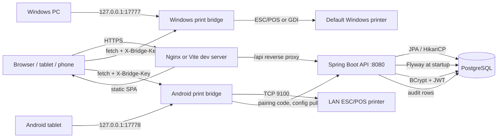
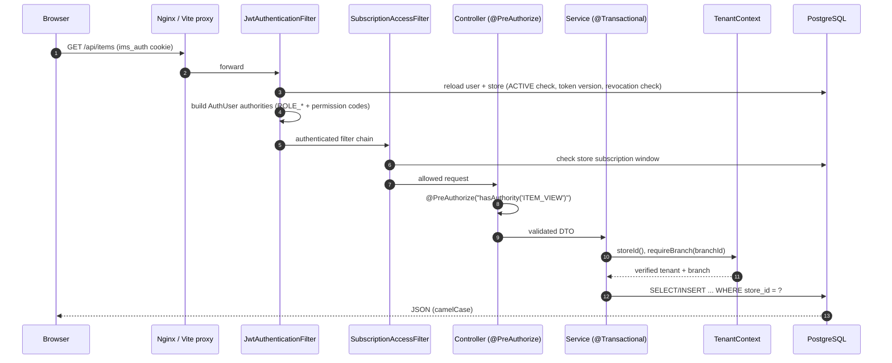

# System Architecture

> Verified against the repository on **2026-11-01** (branch `main`, commit `01567eb`, plus the
> uncommitted V7 barcode, platform-account and V8 authentication-hardening work described in
> [`IMPLEMENTATION_SUMMARY.md`](IMPLEMENTATION_SUMMARY.md)).
>
> Status labels: **Implemented** = code path exists and is wired to the UI; **Partial** = exists with
> a documented limitation; **Not implemented** = does not exist. Nothing in this document was
> inferred from a different product or from Vyapar.

---

## 1. Purpose and scope

The Item Management System is a multi-store, multi-branch inventory, purchase, sales/POS, GST and
thermal-printing application. One deployment serves many independent stores (**tenants**) from one
PostgreSQL database.

Implemented business capabilities:

- Store registration, platform administration, store login-account recovery
- Branches, users, roles and permission management
- Categories, items (single POS rate), barcodes, taxes, suppliers
- Bulk item import from Excel with automatic category creation and opening stock
- Purchases (draft/complete/cancel) with GST and stock posting
- Normal sales and a POS billing screen
- Per-branch inventory, manual adjustments, low-stock monitoring
- Two-step stock transfers between branches
- Dashboard and eight report families with Excel/PDF export
- HttpOnly cookie authentication (bearer still accepted), BCrypt password hashes, login lockout,
  persistent token revocation, forced password change, tenant/branch enforcement, audit logging
- Subscriptions with branch limits and an expired-subscription block
- Silent thermal receipt printing through a Windows or Android print bridge
- Barcode label preview, multi-copy label printing and PNG download
- USB/Bluetooth keyboard-wedge scanning and browser camera scanning
- Public health/version endpoints and a platform audit viewer with CSV export

Not implemented (see [`KNOWN_ISSUES_AND_RECOMMENDATIONS.md`](KNOWN_ISSUES_AND_RECOMMENDATIONS.md)):
purchase returns/partial returns, split payments, offline POS, a customer master UI, MFA, and physical
label/printer output verification.

---

## 2. Actors and tenancy

| Actor | Store scope | Branch scope | Typical actions |
|---|---|---|---|
| Platform Admin (`PLATFORM_ADMIN`) | none (`store_id = NULL`) | none | List stores, register/suspend stores, manage subscriptions, list/reset store login accounts. Cannot call store business APIs. |
| Store Owner (`STORE_OWNER`) | own store | all branches | Everything in the store, including store profile, users, roles and branches. |
| Store Admin (`STORE_ADMIN`) | own store | all branches | Day-to-day operations; no `ROLE_MANAGE` / `STORE_MANAGE`. |
| Branch Manager (`BRANCH_MANAGER`) | own store | assigned branches | Purchases, inventory, transfers, sales, reports. |
| Branch Staff (`BRANCH_STAFF`) | own store | assigned branches | POS/normal billing, catalogue and stock viewing. |
| Custom roles | own store | per `user_branches` | Any subset of the 30 permission codes. |

Tenancy rules:

1. A **store** is the tenant key. Every tenant-owned table carries `store_id`.
2. Branch-owned tables carry `store_id` and `branch_id`. Composite `UNIQUE (store_id, id)` keys and
   composite foreign keys prevent cross-store references at the database level.
3. The tenant is derived from the verified JWT (from the `ims_auth` cookie or bearer header)
   (`TenantContext.storeId()`), never from a request parameter. Platform users have no store and receive
   `403 Platform administrators cannot access store business data` from store services.
4. Branch access is checked server-side (`TenantContext.requireBranch`). Owners/admins have
   `allBranches = true`; other users only access branches assigned in `user_branches`.
5. Permissions are enforced with `@PreAuthorize("hasAuthority('…')")`. Hiding a UI control is not a
   security boundary.

---

## 3. Technology stack (verified)

| Layer | Technology | Version / detail |
|---|---|---|
| Frontend | React + TypeScript | React 19.3.1, TypeScript ~7.0.2 (strict) |
| Build/dev | Vite | 8.3.5, dev server `:5173`, proxy `/api → :8080` |
| Styling | Tailwind CSS | 4.3.3 |
| Routing | React Router | 7.18.5 |
| State | Zustand | 5.0.16, persisted key `ims-auth` |
| HTTP | Axios | 1.21.0, `baseURL: '/api'` |
| Barcodes | JsBarcode | 3.12.3 (Code 128 / EAN-13 SVG) |
| Export | SheetJS, jsPDF + autotable | `xlsx` 0.20.3 vendor tarball, `jspdf` 4.2.1 |
| Backend | Spring Boot | 3.3.5 (web, data-jpa, security, validation) |
| Language | Java | 17 |
| Auth | Spring Security + JJWT | 0.12.6 |
| Persistence | JPA/Hibernate | `ddl-auto=validate`, `open-in-view=false` |
| Migrations | Flyway | `classpath:db/migration`, V1–V8 |
| Database | PostgreSQL | 14.10 embedded (dev, port 54329); 14+ standalone supported; declared production 18.6 |
| Embedded DB | `io.zonky.test:embedded-postgres` | 2.0.7 |
| Excel | Apache POI | 5.3.0 (`poi-ooxml`) |
| Passwords | Spring Security BCrypt | strength 10 |
| Tests | JUnit 5, Spring Boot Test, TestRestTemplate | 68 integration tests |
| Print bridges | .NET 10 WinForms / Android Kotlin | Windows `:17777`, Android `:17778` |

---

## 4. Runtime topology



- Development runs two processes: Vite (`npm run dev`) and the backend jar or `bootRun`.
- Production serves the built SPA from Nginx and proxies `/api` to the backend service.
- The browser talks to the local print bridge directly; the backend records jobs but never streams
  paper data.

---

## 5. Request lifecycle



Error contract (`GlobalExceptionHandler`): HTTP status + `{timestamp,status,error,message,path}`;
validation errors return `400` with the first field message. A deactivated user, deactivated store,
or missing/invalid token returns `401`; missing permission returns `403`; expired subscription
returns `403` with `SUBSCRIPTION_EXPIRED`.

---

## 6. Backend structure

```
backend/src/main/java/com/itemmanagement/
├─ config/        EmbeddedPostgresConfig, DataSeeder, DemoDataSeeder, CORS, security filters
├─ controller/    24 REST controllers
├─ dto/           auth, common, dashboard, imports, inventory, master, platform,
│                 printing, report, subscription, transaction records
├─ entity/        JPA entities + enums
├─ exception/     ApiException, GlobalExceptionHandler
├─ repository/    Spring Data repositories
├─ security/      JwtAuthenticationFilter, JwtService, AuthUser, TenantContext,
│                 SubscriptionAccessFilter, token revocation, cookie/CSRF handling
├─ service/       business logic (28 services)
├─ util/          GST calculator, unit conversion, numbering, PageResponse
└─ ItemManagementApplication.java
```

Key service responsibilities:

| Area | Services |
|---|---|
| Authentication / onboarding | `AuthService`, `StoreProvisioningService`, `JwtService`, `AuditService` |
| Platform | `StoreService`, `SubscriptionService`, `PlatformAccountService` |
| Master data | `BranchService`, `CategoryService`, `ItemService`, `BarcodeService`, `TaxMasterService`, `SupplierService`, `UserService`, `RoleService` |
| Transactions | `PurchaseService`, `SaleService`, `TransferService`, `InventoryService` |
| Reporting | `ReportService`, `DashboardService` |
| Import | `ItemImportService`, `ExcelImportParser` |
| Printing | `PrinterService`, `PrintDeviceService`, `PrintJobService`, `PrintJobWriter` |

Controllers are thin; store/branch verification is inside services. Writes are transactional.
Audit failures are logged and swallowed so they never abort a completed business action.

---

## 7. Frontend structure and routes

```
src/
├─ App.tsx                 routes, lazy pages, session watcher
├─ components/
│  ├─ barcode/             BarcodeSvg, BarcodeLabelDialog, BarcodeScanDialog, ScanBar
│  ├─ layout/              AppLayout, navigation, guards
│  └─ ui/                  Button, Card, DataTable, Modal, form fields, Toast, display states
├─ hooks/                  useApi, useDebounce
├─ lib/                    api, barcode, export, format
├─ pages/                  one file per module + reports/ and settings/ subfolders
├─ services/printerService.ts
├─ store/                  auth.ts, ui.ts (Zustand)
└─ types.ts
```

| Route | Page | Permission guard |
|---|---|---|
| `/login`, `/register` | Login / store registration | public-only |
| `/` | Dashboard (platform admin redirects to `/platform/stores`) | `DASHBOARD_VIEW` |
| `/pos` | POS billing | `SALES_MANAGE` |
| `/sales/new` | Normal sales entry | `SALES_MANAGE` |
| `/sales` | Sales history | `SALES_VIEW` |
| `/items` | Item master + barcode labels | `ITEM_VIEW` |
| `/items/imports` | Excel item import history/preview | `ITEM_VIEW` or `INVENTORY_VIEW` |
| `/categories` | Categories | `CATEGORY_VIEW` |
| `/taxes` | Tax master | `TAX_VIEW` |
| `/suppliers` | Suppliers | `SUPPLIER_VIEW` |
| `/purchases` | Purchases | `PURCHASE_VIEW` |
| `/inventory` | Stock, adjustments, pricing, transactions | `INVENTORY_VIEW` |
| `/transfers` | Branch transfers | `TRANSFER_VIEW` |
| `/low-stock` | Low stock | `INVENTORY_VIEW` |
| `/reports` | Eight report tabs | `REPORT_VIEW` |
| `/print-history` | Print jobs and reprint | `SALES_VIEW` |
| `/settings?tab=…` | Store, branches, users, roles, printers | any of the matching `*_VIEW` |
| `/platform/stores` | Platform store list/subscriptions | `PLATFORM_MANAGE` |
| `/platform/accounts` | Platform store-account recovery | `PLATFORM_MANAGE` |

The SPA never sends `storeId`. It sends `branchId` only where a branch must be chosen; the server
verifies access.

---

## 8. Barcode architecture (Implemented)

| Layer | Behaviour |
|---|---|
| Schema | `items.barcode VARCHAR(64) NOT NULL`, `items.barcode_format` (`CODE128`/`EAN13`), unique `(store_id, barcode)`. V7 backfills existing rows as `'IMS' || LPAD(id,12,'0')`. |
| Generation | `BarcodeService.generate` uses `SecureRandom`: Code 128 = `IMS` + 10 digits; EAN-13 = prefix `2` + 11 digits + check digit. Up to 20 attempts if the value collides. |
| Validation | Code 128: `^[A-Za-z0-9._-]{1,64}$`. EAN-13: exactly 13 digits with a valid mod-10 check digit. Reuse by another item in the same store → `409`. |
| API | `GET /api/items/barcode/{barcode}`; `POST /api/items/{id}/barcode` (regenerate, `ITEM_MANAGE`). Item create/update accepts optional `barcode`/`barcodeFormat`; blank means generate. |
| Rendering | JsBarcode renders SVG in the browser; the server stores only the value. Label sheet is 50 × 30 mm with name, code, symbol and selling price; 1–100 copies; PNG download at 600 × 360. |
| Scanning | USB/Bluetooth scanners act as keyboards: `ScanBar` focuses an input and reacts to `Enter`. Mobile camera uses the browser `BarcodeDetector` API (EAN/UPC/Code 128/39/QR) with explicit permission/unsupported errors. |
| Integrations | POS (scan adds/increments a cart line), normal sales entry, purchases (adds a line). Barcode is also part of item search and POS search. |
| Isolation | Lookup is `findByStoreIdAndBarcode`; a barcode from another store returns `404`. Regenerating requires `ITEM_MANAGE` and writes an audit row. |

Limitations: camera scanning depends on `BarcodeDetector` (Chrome/Edge/Chrome-on-Android); iOS
Safari does not expose it, so the field/USB path is required there. See
[`KNOWN_ISSUES_AND_RECOMMENDATIONS.md`](KNOWN_ISSUES_AND_RECOMMENDATIONS.md).

---

## 9. Printing architecture (Implemented)

| Element | Detail |
|---|---|
| Platforms | `detectPlatform()` → `WINDOWS` (UA contains Windows), `ANDROID`, or `OTHER`. `OTHER` uses the browser print dialog. |
| Windows bridge | .NET 10 WinForms tray app, `127.0.0.1:17777`, prints raw ESC/POS to the **default installed printer** (GDI fallback). No backend pairing. |
| Android bridge | Foreground-service APK, `127.0.0.1:17778`, prints over TCP to the branch printer configured on the website. Pairing uses a one-time code (10 min, SHA-256 stored) and returns an opaque device token. |
| Job lifecycle | `POST /api/printing/jobs` → bridge `/api/bridge/print` → `PUT /api/printing/jobs/{id}/status` (`PRINTED`/`FAILED`). Auto jobs use `AUTO:SALE_RECEIPT:<channel>:<branchId>:<saleId>` with a unique `(store_id, job_key)` so double clicks do not duplicate. |
| Security | JWT for website→backend; `X-Bridge-Key` (32 random bytes, SHA-256 digest, constant-time compare) and origin allowlist for website→bridge. Bridges listen on loopback only. |
| UI | Settings → Printers (per-branch printers, pairing, bridge key, status/test), Print History (jobs, errors, reprint). POS/normal sales/Sales History print buttons guard against concurrent submissions and show spinners. |
| Mobile layout | POS uses a fixed action bar on small screens with `env(safe-area-inset-bottom)`, a “Review & bill” scroll-to-bill action and bottom padding so the bar never covers the Complete sale button. Modal footers wrap and respect the safe area. |

---

## 10. Configuration

`backend/src/main/resources/application.yml` (defaults; production overrides via environment):

| Property | Default | Environment variable |
|---|---|---|
| `server.port` | `8080` | `SERVER_PORT` |
| `app.jwt.secret` | dev key (must be replaced) | `JWT_SECRET` |
| `app.jwt.expiration-ms` | `43200000` (12 h) | `JWT_EXPIRATION_MS` |
| `app.auth.cookie-name` | `ims_auth` | `AUTH_COOKIE_NAME` |
| `app.auth.cookie-secure` | `false` (set `true` behind HTTPS) | `AUTH_COOKIE_SECURE` |
| `app.auth.cookie-same-site` | `Strict` | `AUTH_COOKIE_SAME_SITE` |
| `app.auth.login-max-attempts` | `5` | `LOGIN_MAX_ATTEMPTS` |
| `app.auth.login-window-seconds` | `900` | `LOGIN_WINDOW_SECONDS` |
| `app.auth.login-lockout-seconds` | `900` | `LOGIN_LOCKOUT_SECONDS` |
| `app.auth.blacklist-cleanup-ms` | `3600000` | `TOKEN_BLACKLIST_CLEANUP_MS` |
| `app.platform-admin.provision` | `false` | `PROVISION_PLATFORM_ADMIN` |
| `app.platform-admin.username/password/email` | empty | `PLATFORM_ADMIN_USERNAME` / `PLATFORM_ADMIN_PASSWORD` / `PLATFORM_ADMIN_EMAIL` |
| `app.embedded-postgres.enabled` | `true` | `EMBEDDED_POSTGRES` |
| `app.embedded-postgres.port` | `54329` | `EMBEDDED_POSTGRES_PORT` |
| `app.embedded-postgres.data-dir` | `./.pgdata` | `EMBEDDED_POSTGRES_DATA_DIR` |
| `app.seed-demo` | `false` | `SEED_DEMO` |
| `app.cors.allowed-origins` | localhost 5173/4173 | `CORS_ORIGINS` |
| `spring.datasource.url` (`postgres` profile) | `jdbc:postgresql://localhost:5432/item_management_db` | `DB_URL` |
| `spring.datasource.username` / `password` | `postgres` / `postgres` | `DB_USERNAME` / `DB_PASSWORD` |
| Hikari pool size | `15` | `DB_POOL_SIZE` |
| `spring.servlet.multipart.max-file-size` | `10 MB` | — |
| `spring.jpa.hibernate.ddl-auto` | `validate` | — |
| `spring.flyway.enabled` | `true` | — |

`application.yml` must not be edited for production. Use `/etc/item-management.env` or the
deployment platform’s environment settings (see
[`ADMIN_DEPLOYMENT_GUIDE.md`](ADMIN_DEPLOYMENT_GUIDE.md)).

---

## 11. Public endpoints and security chain

Public (no JWT):

- `POST /api/auth/login`
- `POST /api/auth/register-store`
- `POST /api/printing/devices/pair` (one-time pairing code)
- `GET /api/printing/device/config` (`X-Device-Token`)
- `GET /api/health` (database reachability, `503` when down)
- `GET /api/version` (application version + build commit)
- `/error`

All other endpoints require a valid `ims_auth` cookie (or bearer token), an ACTIVE user and an
ACTIVE store. Unsafe methods from a foreign `Origin`/`Referer` are rejected with
`403 CSRF_ORIGIN_REJECTED`. The `SubscriptionAccessFilter` allows `/api/auth/**`, `/api/health`,
`/api/version`, `OPTIONS`, `/error` and `/api/subscription/summary`; expired subscriptions receive
`403 SUBSCRIPTION_EXPIRED` everywhere else.

---

## 12. Build and run (developer)

### Windows (PowerShell)

```powershell
cd D:\vishrut\Clone\ItemManagementSystem
npm install
npm run dev                                    # frontend :5173
cd backend
.\gradlew.bat test                             # 53 integration tests
.\gradlew.bat bootJar
java -jar build\libs\item-management-backend-1.0.0.jar
```

### Ubuntu

```bash
cd /opt/item-management
npm ci && npm run build                        # dist/
cd backend && ./gradlew test bootJar
java -jar build/libs/item-management-backend-1.0.0.jar
```

Development uses the embedded PostgreSQL cluster in `backend/.pgdata` when
`EMBEDDED_POSTGRES=true` (default outside the `postgres` profile). After an unclean stop, remove an
orphaned embedded PostgreSQL process and `backend/.pgdata/postmaster.pid` before restarting. For
standalone PostgreSQL, activate the `postgres` profile (`SPRING_PROFILES_ACTIVE=postgres`) and set
`DB_URL`, `DB_USERNAME`, `DB_PASSWORD`.

---

## 13. Cross-references

- Schema details: [`DATABASE_DOCUMENTATION.md`](DATABASE_DOCUMENTATION.md)
- Endpoint reference: [`API_DOCUMENTATION.md`](API_DOCUMENTATION.md)
- Module workflows: [`END_TO_END_WORKFLOW.md`](END_TO_END_WORKFLOW.md)
- Deployment and rollback: [`ADMIN_DEPLOYMENT_GUIDE.md`](ADMIN_DEPLOYMENT_GUIDE.md),
  [`DEPLOYMENT_CHECKLIST.md`](DEPLOYMENT_CHECKLIST.md), [`ROLLBACK_GUIDE.md`](ROLLBACK_GUIDE.md)
