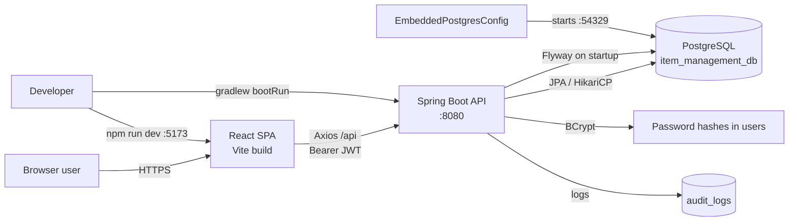
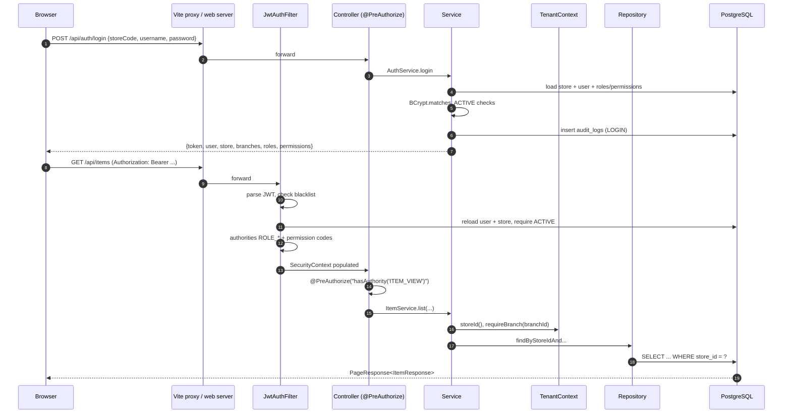

# 1–5. Project Overview, Architecture, Frontend, Backend and Embedded PostgreSQL

> **Historical snapshot 2026-10-30.** This file predates V6 printing, V7 barcodes and V8 authentication
> hardening (including the current permission count and controller count). Use
> `PROJECT_DOCUMENTATION/SYSTEM_ARCHITECTURE.md`, `API_DOCUMENTATION.md` and
> `ADMIN_DEPLOYMENT_GUIDE.md` as the current source of truth. This file is retained for historical
> context.

This file documents the application as it exists in the repository on 2026-10-30. It distinguishes **actual implementation** from **recommended improvements**; recommendations never appear as if they were already built.

---

## 1. Project Overview

### 1.1 Purpose

The Item Management System is a multi-store, multi-branch inventory, purchasing, sales/POS and GST application. One deployment serves many independent stores ("tenants") from a single PostgreSQL database, and each store operates one or more branches.

Core business capabilities:

- Store registration and platform administration
- Branch, user, role and permission management
- Category, item, tax, supplier and customer-reference masters
- Purchases (draft, complete, cancel) with GST and stock posting
- Normal sales and a fast POS billing screen
- Per-branch inventory, manual adjustments, low-stock monitoring
- Two-step stock transfers between branches
- Dashboard and eight report families with Excel/PDF export
- JWT authentication, BCrypt passwords, role/permission enforcement and audit logging

### 1.2 Actors

| Actor | Store scope | Branch scope | Typical actions |
|---|---|---|---|
| Platform Admin (`PLATFORM_ADMIN`) | none (null `store_id`) | none | Register stores, activate/deactivate stores, view store list. Cannot read store business data. |
| Store Owner (`STORE_OWNER`) | own store | all branches | Everything inside the store, including users, roles, branches and store settings. |
| Store Admin (`STORE_ADMIN`) | own store | all branches | Day-to-day operations across all branches; no role/status administration. |
| Branch Manager (`BRANCH_MANAGER`) | own store | assigned branches only | Purchases, inventory, transfers, sales, reports for assigned branches. |
| Branch Staff (`BRANCH_STAFF`) | own store | assigned branches only | POS/normal billing, view catalogue and stock. |
| Custom roles | own store | per permission set | Created by the owner/admin from the 28 permission codes; branch scope still comes from `user_branches`. |

### 1.3 Tenancy model

- **Store** = tenant. `stores.id` is the tenant key.
- **Branch** = operating location inside one store.
- Every tenant-owned table carries `store_id`; branch-owned tables also carry `branch_id`.
- Composite `UNIQUE (store_id, id)` keys and composite foreign keys make cross-store references impossible at the database level.
- The application additionally filters every query by the store from the verified JWT. The database does not implement row-level security; the service layer is the enforcement point.
- A platform administrator has `store_id = NULL` and is rejected by `TenantContext.storeId()`, so platform endpoints work but store business endpoints do not.

### 1.4 Technology stack (verified)

| Layer | Technology | Version |
|---|---|---|
| Frontend | React + TypeScript | React 19.3, TypeScript ~7.0 (strict) |
| Build/dev | Vite | 8.3 |
| Styling | Tailwind CSS | 4.3 |
| Routing | React Router | 7.18 |
| State | Zustand with `persist` (`ims-auth`) | 5.0 |
| HTTP | Axios, baseURL `/api` | 1.21 |
| Charts/icons | Recharts, lucide-react | 3.10 / 1.65 |
| Export | SheetJS `xlsx` 0.20.3 (vendor tarball), jsPDF + autotable | — |
| Backend | Spring Boot (web, data-jpa, security, validation) | 3.3.5 |
| Language | Java | 17 |
| Auth | Spring Security + JJWT | 0.12.6 |
| Persistence | JPA/Hibernate, `ddl-auto=validate` | Boot-managed |
| Migrations | Flyway (`classpath:db/migration`) | Boot-managed |
| Database | PostgreSQL | 14.10 embedded; 14+ supported standalone |
| Embedded DB | `io.zonky.test:embedded-postgres` | 2.0.7 |
| Password hashing | Spring Security BCrypt | strength 10 |
| Testing | JUnit 5, Spring Boot Test, TestRestTemplate | Boot-managed |

### 1.5 Repository layout

```
ItemManagementSystem/
├─ src/                         React SPA
│  ├─ components/               layout, ui, POS, reports
│  ├─ lib/                      api.ts, export.ts, documents.ts, format.ts
│  ├─ pages/                    one folder/file per module
│  ├─ store/                    Zustand auth store
│  └─ App.tsx                   routes and guards
├─ backend/
│  ├─ src/main/java/com/itemmanagement/
│  │  ├─ config/                embedded PG, data seeders, CORS
│  │  ├─ controller/            15 REST controllers
│  │  ├─ dto/                   request/response records
│  │  ├─ entity/                JPA entities + enums
│  │  ├─ repository/            Spring Data repositories
│  │  ├─ security/              JWT, principal, tenant context
│  │  ├─ service/               business logic
│  │  └─ util/                  GST calculator, unit converter, numbering, paging
│  ├─ src/main/resources/
│  │  ├─ application.yml
│  │  └─ db/migration/          V1, V2, V3
│  ├─ src/test/                 one 16-test integration class
│  └─ .pgdata/                  embedded PostgreSQL data directory (runtime)
├─ docs/                        this documentation package
└─ package.json, vite.config.ts
```

---

## 2. Existing Architecture

### 2.1 System context



### 2.2 Request lifecycle



Key properties:

- Stateless: no HTTP session; every request carries a bearer token.
- The token carries `storeId`, `roles`, `permissions`, `branchIds`, `allBranches` so normal authorization needs no database round trip, but `JwtAuthFilter` still reloads the user and store on every request to reject deactivated accounts and store suspensions immediately.
- Controllers are thin; store and branch verification happens in services through `TenantContext`.
- Writes are transactional (`@Transactional`). Reads that aggregate multiple repositories use `@Transactional(readOnly = true)`.

### 2.3 Runtime profiles and configuration

| Property | Default / embedded | `postgres` profile | Purpose |
|---|---|---|---|
| `server.port` | `8080` (`SERVER_PORT`) | same | API port |
| `spring.jpa.hibernate.ddl-auto` | `validate` | `validate` | Hibernate never creates/alters tables |
| `spring.jpa.open-in-view` | `false` | `false` | No lazy loading in the view layer |
| `spring.flyway.enabled` | `true` | `true` | Schema migrations |
| `app.jwt.secret` | dev default (`JWT_SECRET`) | env | HMAC key; must be replaced in production |
| `app.jwt.expiration-ms` | `43200000` (12 h) | env | Token lifetime |
| `app.embedded-postgres.enabled` | `true` (`EMBEDDED_POSTGRES`) | `false` | Start the embedded server |
| `app.embedded-postgres.port` | `54329` | — | Embedded port |
| `app.embedded-postgres.data-dir` | `./.pgdata` | — | Persistent cluster directory |
| `app.embedded-postgres.database` | `item_management_db` | — | Auto-created database |
| `app.embedded-postgres.clean` | `false` | — | Never clean development data by default |
| `app.seed-demo` | `true` (`SEED_DEMO`) | env | Seed ABC Dairy demo store |
| `app.cors.allowed-origins` | localhost 5173/4173 | env | Browser origins |
| `spring.datasource.url` | embedded Hikari URL | `${DB_URL:jdbc:postgresql://localhost:5432/item_management_db}` | Standalone connection |
| `DB_USERNAME` / `DB_PASSWORD` | embedded `postgres` / `postgres` | env | Standalone credentials |
| `DB_POOL_SIZE` | 15 | 15 | Hikari maximum pool |

Production overrides are environment variables, never edits to `application.yml`:

```bash
SPRING_PROFILES_ACTIVE=postgres
DB_URL=jdbc:postgresql://db-host:5432/item_management_db
DB_USERNAME=ims_app
DB_PASSWORD=<from secret manager>
JWT_SECRET=<32+ random bytes>
SEED_DEMO=false
CORS_ORIGINS=https://ims.example.com
```

### 2.4 Error contract

`GlobalExceptionHandler` returns a JSON object:

```json
{
  "timestamp": "2026-10-30T09:15:22.123Z",
  "status": 400,
  "error": "Bad Request",
  "message": "Please correct the highlighted fields",
  "fieldErrors": {
    "itemCode": "Item code is required"
  }
}
```

- `400` validation/business rule (`ApiException.badRequest`, `DataIntegrityViolationException`)
- `401` missing/invalid/expired token, wrong credentials, inactive user on login
- `403` missing permission, inactive store/user after login, platform admin accessing store data
- `404` resource outside tenant or missing
- `409` duplicate store code / username
- `500` unexpected error; details are logged, not returned

Validation is Bean Validation on request records. Messages shown in the UI come from these annotations.

### 2.5 Transaction and consistency boundaries

- Purchase create/complete/cancel, sale create/cancel, transfer transitions and adjustments are each one database transaction.
- Stock rows are locked with `SELECT ... FOR UPDATE` after `INSERT ... ON CONFLICT DO NOTHING`; the `branch_inventory.current_stock >= 0` CHECK is the database backstop.
- Inventory ledger rows are written in the same transaction as the stock update.
- Audit rows are written through `AuditService` in the same transaction for most sensitive actions.
- Document numbers come from PostgreSQL sequences; a rolled-back transaction leaves a gap, which is acceptable and prevents reuse.

---

## 3. Frontend

### 3.1 Stack and structure

- React 19 function components, strict TypeScript, Vite 8.
- Tailwind CSS 4 with a Petpooja-inspired shell: fixed sidebar on desktop, collapsible mobile navigation, top bar with branch selector and user menu.
- React Router 7 with lazy-loaded pages (`React.lazy` + `Suspense`).
- Zustand auth store persisted to `localStorage` under `ims-auth`. It stores the token, user, store, branches, roles, permissions, `allBranches`, `platformAdmin`, and the selected branch.
- `src/lib/api.ts` creates an Axios instance with `baseURL: '/api'`, injects `Authorization: Bearer <token>`, and dispatches an `ims:unauthorized` event on 401. `SessionWatcher` logs the user out and redirects to `/login`.
- `vite.config.ts` proxies `/api` to `http://localhost:8080` in development; production must serve the SPA and API behind the same origin or configure `CORS_ORIGINS`.

### 3.2 Routes and guards

| Route | Page | Guard (permission) |
|---|---|---|
| `/login` | Login | public only |
| `/register` | Store registration | public only |
| `/` | Dashboard or platform landing | authenticated |
| `/pos` | POS billing | `SALES_MANAGE` |
| `/sales/new` | Normal sales entry | `SALES_MANAGE` |
| `/sales` | Sales list/detail/cancel | `SALES_VIEW` |
| `/items` | Item master | `ITEM_VIEW` (manage buttons require `ITEM_MANAGE`) |
| `/categories` | Categories | `CATEGORY_VIEW` |
| `/taxes` | Tax master | `TAX_VIEW` |
| `/suppliers` | Suppliers | `SUPPLIER_VIEW` |
| `/purchases` | Purchases, draft/complete/cancel | `PURCHASE_VIEW` |
| `/inventory` | Branch stock, adjustments, pricing | `INVENTORY_VIEW` |
| `/transfers` | Transfers lifecycle | `TRANSFER_VIEW` |
| `/low-stock` | Low-stock report | `INVENTORY_VIEW` |
| `/reports` | Purchase/sales/GST/stock/branch/store/profit | `REPORT_VIEW` |
| `/settings` | Store, branches, users, roles | any of `STORE_VIEW`, `USER_VIEW`, `ROLE_VIEW`, `BRANCH_VIEW` |
| `/platform/stores` | Platform store management | `PLATFORM_MANAGE` |

The guards are UX only. Every backend endpoint re-checks the same permission with `@PreAuthorize`.

### 3.3 Modules

| Module | Page(s) | API used | Notes |
|---|---|---|---|
| Auth | Login, Register | `/auth/login`, `/auth/register-store`, `/auth/me`, `/auth/logout` | Store code + username/email + password; platform uses store code `PLATFORM`. |
| Dashboard | Home | `/dashboard` | KPIs, branch cards, recent purchases/sales, low stock, top items. |
| POS | PosPage | `/items/pos`, `/sales`, `/branches/my-branches` | Category tabs, search, cart, quantity/unit, customer, payment method, discount, GST display, item master rate auto-filled. |
| Normal sale | SalesEntryPage | `/items/options`, `/sales` | Manual selling rate, tax preview from item tax, payment split. |
| Sales history | SalesPage | `/sales`, `/sales/{id}`, `/sales/{id}/cancel` | Filters, detail drawer, cancel. |
| Items | ItemsPage | `/items`, `/categories/options`, `/taxes/options`, `/items/{id}/stock` | Single `rate`, tax slab, unit, minimum stock. |
| Categories | CategoriesPage | `/categories` | CRUD + status. |
| Taxes | TaxMasterPage | `/taxes` | GST %, type, status; derived CGST/SGST/IGST preview. |
| Suppliers | SuppliersPage | `/suppliers`, `/suppliers/{id}/purchases` | CRUD, state, purchase history. |
| Purchases | PurchasesPage | `/purchases`, `/purchases/{id}` | Manual purchase rate per line, draft/complete/cancel. |
| Inventory | InventoryPage | `/inventory`, `/inventory/transactions`, `/inventory/adjustments`, pricing | Branch/category filter, stock value, adjustment dialog, min/purchase/selling price. |
| Transfers | TransfersPage | `/transfers`, approve/dispatch/receive/reject/cancel | Assigned-branch aware. |
| Reports | ReportsPage + views | `/reports/*` | Tabs, filters, summary cards, Excel and PDF export. |
| Settings | StoreSettings, Branches, Users, Roles | `/stores/current`, `/branches`, `/users`, `/roles`, `/permissions` | Owner/admin administration. |
| Platform | PlatformStoresPage | `/stores` | Store list, create store, activate/deactivate. |

### 3.4 POS and billing UI (actual behaviour)

- POS loads items for the selected branch from `GET /api/items/pos?branchId=...`. The server returns the item master `rate`, `availableStock`, tax details and `taxInclusive`.
- Adding an item pre-fills the rate with the master rate and shows stock. The client sends `pos: true`; the server ignores any client-supplied `sellingRate` for POS and uses `items.rate`.
- Totals are a live preview. The authoritative totals, discount allocation, CGST/SGST/IGST split and stock deduction happen on the server; the response replaces the preview.
- Payment methods: CASH, UPI, CARD, CREDIT. `paidAmount` is optional; for non-credit the server defaults it to the grand total.
- Receipt: a printable/PDF document is generated client-side from the saved sale (`src/lib/documents.ts`); there is no server-side PDF service.
- Branch selection is limited to branches accessible to the user (`/api/branches/my-branches`). The server rejects a branch that is not assigned.

### 3.5 Exports and responsiveness

- `src/lib/export.ts` provides Excel (SheetJS), PDF (jsPDF + autotable) and HTML print helpers.
- Reports, low stock, sales and purchase detail views expose export buttons. Export is client-side and does not call a separate API.
- The layout was verified at desktop and narrow widths during implementation, including the reports page fix. Re-verify after any UI change.

### 3.6 Build commands

```bash
npm install
npm run dev        # http://localhost:5173
npm run lint       # oxlint
npm run build      # tsc -b && vite build
npm run preview    # http://localhost:4173
```

The production build is static; serve `dist/` from any web server and proxy `/api` to Spring Boot.

---

## 4. Backend

### 4.1 Package responsibilities

| Package | Responsibility |
|---|---|
| `config` | `EmbeddedPostgresConfig`, `DataSeeder`, `DemoDataSeeder`, CORS/security beans |
| `controller` | 15 REST controllers; permission annotations; request binding only |
| `dto` | Java records for requests/responses; Bean Validation; no entities exposed |
| `entity` | JPA entities and enums; `@PrePersist/@PreUpdate` timestamps |
| `repository` | Spring Data JPA; store-scoped finders and JPQL searches; pessimistic lock query |
| `security` | `JwtService`, `JwtAuthFilter`, `AuthUser`, `TenantContext`, `TokenBlacklistService`, `SecurityConfig` |
| `service` | Business rules, transactions, stock posting, GST, reports, audit, numbering |
| `util` | `GstCalculator`, `UnitConverter`, `NumberGenerator`, `PageResponse` |
| `exception` | `ApiException` + `GlobalExceptionHandler` |

### 4.2 Entities (23 tables)

`Store`, `Branch`, `User`, `Role`, `Permission`, `Category`, `TaxMaster`, `Item`, `Supplier`, `Customer` (unused), `BranchInventory`, `InventoryTransaction`, `StockAdjustment`, `Purchase`, `PurchaseDetail`, `Sale`, `SalesDetail`, `StockTransfer`, `StockTransferDetail`, `AuditLog`.

Enums: `StoreStatus`, `PurchaseStatus`, `SaleStatus`, `PaymentMethod`, `TransferStatus`, `TransactionType`, `AdjustmentType`, `TaxType`, `Unit`.

### 4.3 Services

| Service | Main responsibilities |
|---|---|
| `AuthService` | Login, current session, refresh, logout, store registration entry point |
| `StoreProvisioningService` | Store + MAIN branch + 5 tax slabs + 4 roles + owner user, transactionally |
| `StoreService` | Platform store list/create/update/status; current store read/update |
| `BranchService` | Branch CRUD/status, accessible-branch views |
| `UserService` | User CRUD, role assignment, branch assignment, status; prevents self-lockout patterns |
| `RoleService` | Role list/create/update, permission catalogue |
| `CategoryService` | Category CRUD, delete blocked when items exist |
| `TaxMasterService` | Tax CRUD, percentage derivation, usage-protected delete/status |
| `ItemService` | Item CRUD, tax/category validation, POS list, stock and transaction views |
| `SupplierService` | Supplier CRUD, purchase history |
| `PurchaseService` | Draft/complete/cancel, manual purchase rates, GST, discount allocation, stock in, reversal |
| `SaleService` | Normal/POS sale, manual/master rate, stock out, COGS snapshot, cancel/reversal |
| `InventoryService` | Locked stock rows, stock in/out, ledger, adjustments, branch pricing, low stock |
| `TransferService` | PENDING → APPROVED → DISPATCHED → RECEIVED / REJECTED / CANCELLED |
| `ReportService` | 8 reports + stock movement aggregation + profit |
| `DashboardService` | Today's KPI cards, branch summaries, recent transactions, top items |
| `AuditService` | Append-only audit rows; never read through the API |
| `NumberGenerator` | `PUR-`, `SAL-`, `TRF-`, `ADJ-` from sequences |

### 4.4 Money, quantity and tax rules

- Money: `BigDecimal`, scale 2 for amounts, `HALF_UP`.
- Quantities: base unit, scale 3. Unit conversion: LITER↔ML and KG↔GRAM by 1000, PIECE↔DOZEN by 12; PACKET, BOX, BOTTLE are standalone.
- Item master has exactly one `rate`. Purchase lines have a manually entered `purchase_rate`; normal sales lines have a manually entered `selling_rate`; POS lines use `items.rate` server-side. Historical lines keep their own rate forever.
- GST is calculated server-side from the item's tax slab and the branch/party state. Snapshots are written on every line and never recalculated.
- Weighted average cost is maintained per branch/item and snapshotted into `sales_details.cost_rate` for COGS.

### 4.5 Security summary

| Mechanism | Actual implementation |
|---|---|
| Password storage | BCrypt, strength 10 |
| Token | JJWT HMAC-SHA, 12 h default, subject = user id, claims include store/roles/permissions/branches |
| Token validation | Signature + expiry + in-memory blacklist + user/store reloaded and required ACTIVE |
| Logout | Current token id added to in-memory blacklist until expiry |
| Refresh | Re-issues a token and blacklists the old one; no refresh-token table |
| Authorization | `@PreAuthorize` permission codes; `ROLE_*` authorities also present |
| Tenant isolation | `TenantContext.storeId()` + every repository query scoped by store |
| Branch isolation | `TenantContext.requireBranch()` + `AuthUser.canAccessBranch` |
| Platform boundary | null store id rejected by `TenantContext.storeId()` |
| CORS | restricted origins from configuration |
| Auditing | Sensitive writes logged to `audit_logs`; no read API |

Details and gaps: [04-security.md](04-security.md).

### 4.6 Tests

One integration test class, `SystemInvariantIntegrationTest`, runs 16 tests against a real embedded PostgreSQL on port **54330** with `build/pgdata-test`, `clean=true`, demo seeding off. It covers:

1. missing/invalid tokens
2. wrong password
3. cross-store read/write isolation
4. platform admin boundary
5. purchase lifecycle stock posting
6. purchase cancellation after stock is sold
7. sale decrement and overselling block
8. concurrent sales overselling
9. negative adjustments and duplicate lines
10. payment above grand total
11. transfer dispatch/receive semantics
12. branch staff scope and permissions
13. deactivation revoking existing tokens
14. tax master store specificity and usage protection
15. server GST calculation and immutable snapshots
16. inclusive-tax back-calculation

Run:

```bash
cd backend
./gradlew test
```

### 4.7 Build and run

```bash
cd backend
./gradlew clean build
java -jar build/libs/item-management-backend-1.0.0.jar
```

- Default (embedded): starts PostgreSQL on 54329, uses `backend/.pgdata`, runs Flyway, seeds platform admin and demo store.
- Standalone: activate profile `postgres` and provide `DB_URL`, `DB_USERNAME`, `DB_PASSWORD`.

---

## 5. Embedded PostgreSQL

### 5.1 What is actually running

The project does **not** ship a PostgreSQL installation. `EmbeddedPostgresConfig` uses Zonky Embedded Postgres 2.0.7, which downloads/extracts a real PostgreSQL binary and starts a normal server process.

Verified runtime facts:

| Item | Actual value |
|---|---|
| PostgreSQL server version | **14.10** |
| Port | **54329** (`EMBEDDED_POSTGRES_PORT`) |
| Data directory | `D:\vishrut\Clone\ItemManagementSystem\backend\.pgdata` (resolved from `./.pgdata`) |
| Data directory size | ~53 MB at inspection |
| `PG_VERSION` | `14` |
| Database | `item_management_db`, created automatically if absent |
| Superuser inside embedded cluster | `postgres` / `postgres` |
| Authentication | `trust` for local/127.0.0.1/::1 in `pg_hba.conf` |
| Listen address | localhost only (default) |
| Hikari pool | 15 connections, 30 s timeout |
| Extracted binaries | `C:\Users\ss\AppData\Local\Temp\embedded-pg\PG-d82e1c10a286067facbb1bf90aa50494\bin` |
| `postmaster.opts` | `postgres.exe -D .../backend/./.pgdata -p 54329 -F -c synchronous_commit=off -c max_connections=300 -c timezone=UTC` |

The data directory is **persistent and project-relative**, not a temporary directory. The binaries are extracted to the OS temp directory; deleting that temp directory does not delete the database, but deleting `.pgdata` does.

### 5.2 Startup sequence

1. Spring evaluates `@ConditionalOnProperty(app.embedded-postgres.enabled=true)`.
2. `Files.createDirectories(./.pgdata)`.
3. Zonky starts `postgres` on port 54329 with `clean=false`.
4. The config connects to the `postgres` maintenance database with user/password `postgres`.
5. If `item_management_db` does not exist, it runs `CREATE DATABASE item_management_db`.
6. A primary Hikari `DataSource` is created for `item_management_db`.
7. Flyway runs V1 → V2 → V3.
8. Hibernate validates the schema.
9. `DataSeeder` creates the platform admin if missing and runs `DemoDataSeeder` when `app.seed-demo=true`.
10. Spring Boot serves `/api` on 8080.

On shutdown, `@PreDestroy` calls `postgres.close()`, stopping the server cleanly.

### 5.3 Demo data actually seeded

When `SEED_DEMO=true` (default):

- Store `ABC001` — **ABC Dairy**, owner login `owner` (the README's `SUN001`/Sunrise example does not match the code).
- Branches `MAIN`, `BLR`, `MYS`.
- Users: owner, manager, staff with the standard store roles.
- 5 categories, 9 items with master rates 60, 40, 100, 15, 90, 50, 450, 25, 120.
- 4 suppliers, one in Tamil Nadu to demonstrate inter-state IGST.
- Opening stock and `OPENING_STOCK` ledger rows.

Platform user (always created if absent): store code `PLATFORM`, username `platform`, password `Admin@123`. **This default must not survive into production.**

### 5.4 Data safety rules

- Do not delete `backend/.pgdata` unless you intend to destroy all embedded data.
- Do not set `EMBEDDED_POSTGRES_CLEAN=true` in normal development; it wipes the cluster.
- Do not run two backend instances against the same data directory. Zonky writes an `epg-lock`; a second instance can fail or corrupt startup.
- Stop the backend cleanly so PostgreSQL shuts down; after a crash, remove a stale lock only after confirming no `postgres` process is using the directory.
- `.pgdata` is inside the project and must never be committed to source control.
- The embedded server is for development only. It uses trust authentication and default credentials and must never be exposed to a network.

### 5.5 Embedded versus standalone

| Aspect | Embedded (default) | Standalone (`postgres` profile) |
|---|---|---|
| Install required | No | Yes, PostgreSQL 14+ |
| Server lifecycle | Managed by the JVM | Windows service / systemd |
| Port | 54329 | 5432 (typical) |
| Data location | `backend/.pgdata` | PostgreSQL data directory (e.g. `C:\Program Files\PostgreSQL\14\data`) |
| Credentials | fixed `postgres`/`postgres`, trust | dedicated `ims_app` + strong password + scram-sha-256 |
| Network exposure | localhost only | must be localhost or private network |
| Backups | `pg_dump` against 54329 | `pg_dump` against 5432 |
| Production use | No | Yes |
| Migration | Disable embedded, import dump | — |

Migration steps: [06-postgresql-setup.md §19](06-postgresql-setup.md#19-migrate-embedded-postgresql-to-standalone).

### 5.6 Inspecting the embedded database (read-only)

```bash
# While the backend is running
psql -h localhost -p 54329 -U postgres -d item_management_db
```

Useful read-only commands:

```sql
SELECT version();
SELECT current_database(), current_user;
\dt
SELECT version, description, success FROM flyway_schema_history ORDER BY installed_rank;
SELECT store_code, store_name, status FROM stores;
```

The `psql` binary must match the server major version (14) or be newer. If `psql` is not installed, use pgAdmin or install the PostgreSQL client tools (for example the EDB installer). The embedded distribution under `%LOCALAPPDATA%\Temp\embedded-pg\...` contains only server binaries (`postgres.exe`, `pg_ctl.exe`, `initdb.exe`) — no `psql`, `pg_dump` or `pg_restore`.

---

## Feature status matrix

| # | Feature | Status | Evidence / gap |
|---|---|---|---|
| 1 | Store registration (public) | **Implemented** | `POST /api/auth/register-store`, store + MAIN + taxes + roles + owner in one transaction |
| 2 | Platform store management | **Implemented** | `StoreController` list/create/update/status, permission `PLATFORM_MANAGE` |
| 3 | Platform vs store boundary | **Implemented** | Null store id rejected by `TenantContext.storeId`; tested |
| 4 | Branch CRUD and status | **Implemented** | `BranchController`, `user_branches`, accessible-branch filtering |
| 5 | User management | **Implemented** | Create/update/status/branch assignment; one role per user in the service |
| 6 | Role and permission management | **Implemented** | 28 permissions, store-scoped custom roles, system roles |
| 7 | Category master | **Implemented** | CRUD + status; delete blocked when items exist |
| 8 | Tax master | **Implemented** | Store-specific slabs, derived CGST/SGST/IGST, usage-protected delete |
| 9 | Item master with one rate | **Implemented** | `items.rate`, mandatory tax, unit, minimum stock; V3 removed old price columns |
| 10 | Branch-level pricing | **Implemented** | `branch_inventory.purchase_price/selling_price/minimum_stock` via inventory API |
| 11 | Supplier master | **Implemented** | CRUD, state, purchase history |
| 12 | Purchase workflow | **Implemented** | DRAFT/COMPLETED/CANCELLED, manual rate, GST, stock posting, reversal |
| 13 | Normal sales | **Implemented** | Manual `selling_rate`, GST, stock out, COGS snapshot, cancellation |
| 14 | POS billing | **Implemented** | `pos=true` forces `items.rate`; stock validation; payment methods |
| 15 | Server-side GST | **Implemented** | `GstCalculator`; intra/inter-state; inclusive/exclusive; immutable line snapshots |
| 16 | Inventory locking / oversell prevention | **Implemented** | `INSERT ... ON CONFLICT`, `SELECT FOR UPDATE`, `current_stock >= 0`; concurrency test |
| 17 | Stock adjustments | **Implemented** | IN/OUT with reason, ledger, negative-stock validation |
| 18 | Stock transfers | **Implemented** | PENDING→APPROVED→DISPATCHED→RECEIVED, reject/cancel rules |
| 19 | Low-stock monitoring | **Implemented** | `stock <= minimum`, per branch, dashboard + report + page |
| 20 | Inventory ledger | **Implemented** | Append-only `inventory_transactions`, 9 movement types |
| 21 | Dashboard | **Implemented** | Today's sales/purchases, branch summary, top items, recent docs |
| 22 | Reports | **Implemented** (with caveats) | 8 endpoints; GST is output-tax only; stock opening is derived |
| 23 | Excel/PDF export | **Implemented** | Client-side SheetJS/jsPDF |
| 24 | Receipt/bill document | **Implemented** | Client-side document generation from sale response |
| 25 | Audit logging | **Partially implemented** | Rows written for sensitive actions; no read API/UI; no retention policy |
| 26 | Logout/refresh token revocation | **Partially implemented** | In-memory blacklist only; lost on restart, not shared across instances |
| 27 | Payments / payment ledger | **Not implemented** | Only header `paid_amount`, `balance_amount`, `payment_method` |
| 28 | Customer master | **Not implemented** | `customers` table exists but no service/controller; sales use snapshots |
| 29 | Credit notes / sales returns | **Partially implemented** | Only full-sale cancellation with stock reversal; no partial return |
| 30 | Purchase returns / debit notes | **Not implemented** | Only full-purchase cancellation |
| 31 | Batch, expiry, serial tracking | **Not implemented** | No columns or tables |
| 32 | Multi-currency | **Not implemented** | Amounts are unqualified `NUMERIC`; INR assumed |
| 33 | Notifications / email / SMS | **Not implemented** | No code |
| 34 | File attachments | **Not implemented** | No storage layer |
| 35 | Row-level DB security | **Not implemented** | Isolation is enforced in services; any direct DB client with credentials can read all stores |
| 36 | Refresh-token persistence across restarts | **Not implemented** | Blacklist is a `ConcurrentHashMap` |
| 37 | Item code uniqueness metadata | **Needs correction** | The database correctly enforces `(store_id, item_code)`, but `Item.itemCode` is annotated `@Column(unique = true)`, which declares a global constraint. With `ddl-auto=validate` it has no runtime effect today, but it is misleading and would create the wrong constraint if schema generation were enabled. |
| 38 | Transfer DRAFT state | **Needs correction / unused** | Enum and CHECK allow DRAFT, but no service path creates it; no in-transit stock bucket |
| 39 | Purchase/sale lock ordering | **Needs correction** | Lines are locked in request order, transfers by item id; concurrent multi-item documents can deadlock |
| 40 | Demo default password | **Needs correction** | `platform/Admin@123` is created automatically; must be changed or disabled |

Detailed defects and recommendations: [08-known-issues.md](08-known-issues.md).
