# 6–8. Database Tables, ERD and Relationships

This document describes the **actual** PostgreSQL schema after Flyway V1, V2 and V3. It does not describe an intended future schema. The consolidated DDL is in [sql/02_create_tables.sql](sql/02_create_tables.sql).

---

## 6. Database Tables

### 6.0 Conventions and inventory of objects

- **Database:** one database, `item_management_db`, for every store and branch.
- **Schema:** `public`.
- **Tables:** 23 application tables + `flyway_schema_history` (managed by Flyway). There are **no** payment, batch, serial, attachment or refresh-token tables.
- **Identity:** `BIGSERIAL` (`BIGINT` + sequence).
- **Tenant key:** `store_id` on every tenant-owned table.
- **Branch key:** `branch_id` on branch-scoped tables.
- **Money:** `NUMERIC(14,2)` unless noted; `items.rate` is `NUMERIC(12,2)`; `avg_cost`/`cost_rate` are `NUMERIC(18,4)`.
- **Quantity:** `NUMERIC(18,3)` in the item's base unit.
- **Timestamps:** `TIMESTAMPTZ`, database default `now()`, Hibernate JVM timezone UTC. `purchase_date`, `sales_date`, `transfer_date` are `DATE`.
- **Soft state:** `status` columns use `ACTIVE/INACTIVE` or document-specific values; there is no generic `deleted_at`.
- **No hard-delete policy:** purchases, sales, transfers, inventory rows, ledger rows and audit rows are never deleted by the application. Categories and tax slabs may be deleted only when unreferenced; otherwise they are deactivated.
- **Sequences:** `purchase_number_seq`, `sales_number_seq`, `transfer_number_seq`, `adjustment_number_seq`, all `START 1001`.
- **Enums in the database:** stored as `VARCHAR` with `CHECK` constraints, mapped to Java enums.

Table ownership by scope:

| Scope | Tables |
|---|---|
| Cluster/platform | `permissions`, `roles` with `store_id IS NULL` (`PLATFORM_ADMIN`) |
| Store-level | `stores`, `roles`, `users`, `categories`, `tax_master`, `items`, `suppliers`, `customers`, `audit_logs` |
| Branch-level | `branches`, `user_branches`, `branch_inventory`, `inventory_transactions`, `stock_adjustments`, `purchases`, `purchase_details`, `sales`, `sales_details`, `stock_transfers`, `stock_transfer_details` |
| Join tables | `role_permissions`, `user_roles`, `user_branches` |

---

### 6.1 `stores`

**Module:** Platform / Store settings  
**Purpose:** Tenant root; one row per registered business. Holds the store code used at login, GST settings and the tax-inclusive flag.  
**Rows created:** `POST /api/auth/register-store` or platform `POST /api/stores` (via `StoreProvisioningService`).  
**Rows updated:** store settings (`PUT /api/stores/current`, `PUT /api/stores/{id}`), status (`PUT /api/stores/{id}/status`).  
**Deletability:** Never through the application. Deactivating a store blocks all its users at login and on the next request.

| Column | Type | Null | Default | Key / constraint | Description |
|---|---|---|---|---|---|
| `id` | BIGSERIAL | no | seq | PK | Tenant id |
| `store_code` | VARCHAR(30) | no | — | UNIQUE | Login tenant code; uppercased; `PLATFORM` reserved |
| `store_name` | VARCHAR(150) | no | — | — | Display name |
| `owner_name` | VARCHAR(150) | no | — | — | Business owner name |
| `email` | VARCHAR(150) | no | — | — | Contact email |
| `mobile` | VARCHAR(20) | no | — | — | Contact mobile |
| `address` | TEXT | no | — | — | Registered address |
| `gst_number` | VARCHAR(30) | yes | null | — | GSTIN, optional |
| `tax_inclusive` | BOOLEAN | no | false | — | If true, line rates include GST |
| `status` | VARCHAR(20) | no | `'ACTIVE'` | CHECK ACTIVE/INACTIVE | Store status |
| `created_at` | TIMESTAMPTZ | no | `now()` | — | Creation time |
| `updated_at` | TIMESTAMPTZ | no | `now()` | — | Last update time |

**Relationships:** 1:N to branches, roles, users, categories, tax_master, items, suppliers, customers, branch_inventory, inventory_transactions, stock_adjustments, purchases, sales, stock_transfers, audit_logs.  
**Sample record:**

```
id=1, store_code='ABC001', store_name='ABC Dairy', owner_name='Ravi Kumar',
email='owner@abcdairy.example', mobile='9876500001',
address='14 Market Road, Bengaluru, Karnataka 560001', gst_number='29ABCDE1234F1Z5',
tax_inclusive=false, status='ACTIVE', created_at='2026-10-01 09:00:00+00'
```

---

### 6.2 `branches`

**Module:** Branch management  
**Purpose:** Operating location inside one store. `state` is the registered place of supply used to choose CGST+SGST versus IGST.  
**Rows created:** registration creates `MAIN`; later branches via `POST /api/branches`.  
**Rows updated:** `PUT /api/branches/{id}`, `PUT /api/branches/{id}/status`.  
**Deletability:** No delete endpoint. Deactivate instead. Branches referenced by inventory/history cannot be removed.

| Column | Type | Null | Default | Key / constraint | Description |
|---|---|---|---|---|---|
| `id` | BIGSERIAL | no | seq | PK | Branch id |
| `store_id` | BIGINT | no | — | FK stores(id) | Owning store |
| `branch_code` | VARCHAR(30) | no | — | UNIQUE (store_id, branch_code) | Code unique within the store |
| `branch_name` | VARCHAR(150) | no | — | — | Display name |
| `address` | TEXT | no | — | — | Branch address |
| `contact_number` | VARCHAR(20) | no | — | — | Contact phone |
| `state` | VARCHAR(80) | yes | null | — | Place of supply |
| `status` | VARCHAR(20) | no | `'ACTIVE'` | CHECK ACTIVE/INACTIVE | Branch status |
| `created_at` | TIMESTAMPTZ | no | `now()` | — | Creation time |
| `updated_at` | TIMESTAMPTZ | no | `now()` | — | Last update time |
| — | — | — | — | UNIQUE (store_id, id) | Composite FK target |

**Relationships:** store 1:N; branch 1:N to user_branches, branch_inventory, inventory_transactions, stock_adjustments, purchases, sales, stock_transfers (from/to).  
**Sample record:**

```
id=1, store_id=1, branch_code='MAIN', branch_name='Main Branch',
address='14 Market Road, Bengaluru, Karnataka 560001', contact_number='9876500001',
state='Karnataka', status='ACTIVE', created_at='2026-10-01 09:00:00+00'
```

---

### 6.3 `roles`

**Module:** Access control  
**Purpose:** A role belongs to one store; `store_id IS NULL` marks the platform role. Permissions are attached through `role_permissions`.  
**Rows created:** `StoreProvisioningService` creates `STORE_OWNER`, `STORE_ADMIN`, `BRANCH_MANAGER`, `BRANCH_STAFF`; platform seed creates `PLATFORM_ADMIN`; custom roles via `POST /api/roles`.  
**Rows updated:** `PUT /api/roles/{id}` replaces name/description/permissions.  
**Deletability:** No delete endpoint. System roles are marked `is_system=true`.

| Column | Type | Null | Default | Key / constraint | Description |
|---|---|---|---|---|---|
| `id` | BIGSERIAL | no | seq | PK | Role id |
| `store_id` | BIGINT | yes | null | FK stores(id) ON DELETE CASCADE | Null for platform role |
| `code` | VARCHAR(50) | no | — | UNIQUE `(COALESCE(store_id,0), code)` | Stable code used in JWT |
| `name` | VARCHAR(100) | no | — | — | Display name |
| `description` | VARCHAR(255) | yes | null | — | Description |
| `is_system` | BOOLEAN | no | false | — | Provisioned role flag |
| `created_at` | TIMESTAMPTZ | no | `now()` | — | Creation time |

**Relationships:** store 1:N (nullable); role M:N users via `user_roles`; role M:N permissions via `role_permissions`.  
**Sample record:**

```
id=5, store_id=1, code='STORE_OWNER', name='Store Owner',
description='Owns the store and can manage every branch and setting',
is_system=true, created_at='2026-10-01 09:00:02+00'
```

---

### 6.4 `permissions`

**Module:** Access control  
**Purpose:** Global catalogue of 28 permission codes. Seeded by V1 + V2; not editable through the API except by assigning them to roles.  
**Rows created:** Flyway V1/V2, or `04_insert_initial_data.sql`.  
**Rows updated:** Never.  
**Deletability:** Never.

| Column | Type | Null | Default | Key / constraint | Description |
|---|---|---|---|---|---|
| `id` | BIGSERIAL | no | seq | PK | Permission id |
| `code` | VARCHAR(60) | no | — | UNIQUE | Authority string, e.g. `ITEM_VIEW` |
| `name` | VARCHAR(120) | no | — | — | Human label |
| `description` | VARCHAR(255) | yes | null | — | Explanation |

**Relationships:** M:N roles via `role_permissions`.  
**Sample record:** `id=13, code='ITEM_VIEW', name='View items', description='View items'`.

The full catalogue:

| Group | Codes |
|---|---|
| Platform/store | `PLATFORM_MANAGE`, `STORE_VIEW`, `STORE_MANAGE`, `DASHBOARD_VIEW` |
| Branch/user/role | `BRANCH_VIEW`, `BRANCH_MANAGE`, `USER_VIEW`, `USER_MANAGE`, `ROLE_VIEW`, `ROLE_MANAGE` |
| Catalogue | `CATEGORY_VIEW`, `CATEGORY_MANAGE`, `ITEM_VIEW`, `ITEM_MANAGE`, `TAX_VIEW`, `TAX_MANAGE`, `SUPPLIER_VIEW`, `SUPPLIER_MANAGE` |
| Purchasing | `PURCHASE_VIEW`, `PURCHASE_MANAGE` |
| Inventory | `INVENTORY_VIEW`, `INVENTORY_ADJUST`, `TRANSFER_VIEW`, `TRANSFER_MANAGE`, `TRANSFER_APPROVE` |
| Sales | `SALES_VIEW`, `SALES_MANAGE` |
| Reporting | `REPORT_VIEW` |

---

### 6.5 `role_permissions`

**Module:** Access control  
**Purpose:** M:N join between roles and permissions.  
**Rows created:** provisioning, role create/update, Flyway seeds.  
**Rows updated:** Replaced when a role's permission set changes.  
**Deletability:** Rows are removed when the role is updated or the role/permission is deleted (CASCADE).

| Column | Type | Null | Default | Key / constraint | Description |
|---|---|---|---|---|---|
| `role_id` | BIGINT | no | — | PK, FK roles(id) ON DELETE CASCADE | Role |
| `permission_id` | BIGINT | no | — | PK, FK permissions(id) ON DELETE CASCADE | Permission |

**Relationships:** resolves roles M:N permissions.  
**Sample record:** `role_id=5, permission_id=13` (STORE_OWNER has ITEM_VIEW).

---

### 6.6 `users`

**Module:** Authentication / user management  
**Purpose:** Login identities. Store users have `store_id`; platform administrators have `store_id = NULL`.  
**Rows created:** store registration (owner), `POST /api/users`, platform seeder.  
**Rows updated:** `PUT /api/users/{id}`, status, branch assignment.  
**Deletability:** No delete. Deactivate (`status=INACTIVE`); existing tokens are rejected on the next request.

| Column | Type | Null | Default | Key / constraint | Description |
|---|---|---|---|---|---|
| `id` | BIGSERIAL | no | seq | PK | User id |
| `store_id` | BIGINT | yes | null | FK stores(id) | Null = platform admin |
| `username` | VARCHAR(80) | no | — | UNIQUE (store_id, username) | Login name |
| `email` | VARCHAR(150) | no | — | — | Email; also accepted at login |
| `password_hash` | VARCHAR(255) | no | — | — | BCrypt hash |
| `full_name` | VARCHAR(150) | no | — | — | Display name |
| `mobile` | VARCHAR(20) | yes | null | — | Phone |
| `status` | VARCHAR(20) | no | `'ACTIVE'` | CHECK ACTIVE/INACTIVE | Account status |
| `created_at` | TIMESTAMPTZ | no | `now()` | — | Creation time |
| `updated_at` | TIMESTAMPTZ | no | `now()` | — | Last update time |

**Indexes:** `ix_users_email`, `ix_users_store`.  
**Relationships:** store 1:N; user M:N roles (`user_roles`); user M:N branches (`user_branches`); 1:N created purchases/sales/transfers/ledger rows (nullable `created_by`).  
**Sample record:**

```
id=2, store_id=1, username='owner', email='owner@abcdairy.example',
password_hash='$2a$10$<bcrypt-hash-placeholder>', full_name='Ravi Kumar',
mobile='9876500001', status='ACTIVE', created_at='2026-10-01 09:00:02+00'
```

The hash is illustrative; real hashes are 60 characters generated by BCrypt.

---

### 6.7 `user_roles`

**Module:** Access control  
**Purpose:** M:N join between users and roles. The application currently assigns one role per user, but the schema supports several.  
**Rows created:** user create/update.  
**Rows updated:** Replaced on role change.  
**Deletability:** CASCADE with user or role.

| Column | Type | Null | Default | Key / constraint | Description |
|---|---|---|---|---|---|
| `user_id` | BIGINT | no | — | PK, FK users(id) ON DELETE CASCADE | User |
| `role_id` | BIGINT | no | — | PK, FK roles(id) ON DELETE CASCADE | Role |

**Sample record:** `user_id=2, role_id=5`.

**Invariant:** a store user must not be linked to another store's role. This is enforced in the service, not by a database constraint. See validation query 8.

---

### 6.8 `user_branches`

**Module:** Branch access  
**Purpose:** Branch assignments for managers/staff. Owners and admins do not need rows because `allBranches=true` is derived from their role.  
**Rows created:** user creation with `branchIds`, or `POST /api/users/{id}/branches`.  
**Rows updated:** Replaced on assignment.  
**Deletability:** CASCADE with user or branch.

| Column | Type | Null | Default | Key / constraint | Description |
|---|---|---|---|---|---|
| `user_id` | BIGINT | no | — | PK, FK users(id) ON DELETE CASCADE | User |
| `branch_id` | BIGINT | no | — | PK, FK branches(id) ON DELETE CASCADE | Accessible branch |

**Sample record:** `user_id=3, branch_id=2` (manager assigned to the BLR branch).

---

### 6.9 `categories`

**Module:** Item master  
**Purpose:** Store-owned item grouping, unique by name within a store.  
**Rows created:** `POST /api/categories`.  
**Rows updated:** `PUT /api/categories/{id}`, status.  
**Deletability:** `DELETE /api/categories/{id}` only when no item references it; otherwise deactivate.

| Column | Type | Null | Default | Key / constraint | Description |
|---|---|---|---|---|---|
| `id` | BIGSERIAL | no | seq | PK | Category id |
| `store_id` | BIGINT | no | — | FK stores(id) | Owning store |
| `category_name` | VARCHAR(120) | no | — | UNIQUE (store_id, category_name) | Name |
| `description` | VARCHAR(255) | yes | null | — | Description |
| `status` | VARCHAR(20) | no | `'ACTIVE'` | CHECK ACTIVE/INACTIVE | Status |
| `created_at` | TIMESTAMPTZ | no | `now()` | — | Creation time |
| `updated_at` | TIMESTAMPTZ | no | `now()` | — | Last update time |
| — | — | — | — | UNIQUE (store_id, id) | Composite FK target |

**Relationships:** store 1:N; category 1:N items.  
**Sample record:**

```
id=1, store_id=1, category_name='Dairy', description='Milk, curd and chilled dairy',
status='ACTIVE', created_at='2026-10-01 09:10:00+00'
```

---

### 6.10 `tax_master`

**Module:** GST / Tax Master  
**Purpose:** Store-specific GST slabs. Every store is seeded with 0% (EXEMPT), 5%, 12%, 18% and 28%. Items reference one slab.  
**Rows created:** store provisioning, `POST /api/taxes`; V2 backfilled existing stores.  
**Rows updated:** `PUT /api/taxes/{id}` recomputes CGST/SGST/IGST from the GST percentage; status endpoint.  
**Deletability:** `DELETE /api/taxes/{id}` only when no item, purchase line or sales line references it; otherwise deactivate.

| Column | Type | Null | Default | Key / constraint | Description |
|---|---|---|---|---|---|
| `id` | BIGSERIAL | no | seq | PK | Tax id |
| `store_id` | BIGINT | no | — | FK stores(id) | Owning store |
| `tax_name` | VARCHAR(120) | no | — | UNIQUE (store_id, tax_name) | e.g. `GST 5%` |
| `description` | VARCHAR(255) | yes | null | — | Description |
| `gst_percentage` | NUMERIC(5,2) | no | — | CHECK 0–100 | Total GST |
| `cgst_percentage` | NUMERIC(5,2) | no | 0 | CHECK 0–100 | Central share |
| `sgst_percentage` | NUMERIC(5,2) | no | 0 | CHECK 0–100 | State share |
| `igst_percentage` | NUMERIC(5,2) | no | 0 | CHECK 0–100 | Integrated rate |
| `tax_type` | VARCHAR(20) | no | `'GST'` | CHECK GST/EXEMPT | Exempt overrides rate to zero |
| `status` | VARCHAR(20) | no | `'ACTIVE'` | CHECK ACTIVE/INACTIVE | Status |
| `created_at` | TIMESTAMPTZ | no | `now()` | — | Creation time |
| `updated_at` | TIMESTAMPTZ | no | `now()` | — | Last update time |
| — | — | — | — | UNIQUE (store_id, id) | Composite FK target |

**Indexes:** `ix_tax_master_store_status`, `ix_items_tax` (on items).  
**Relationships:** store 1:N; tax 1:N items; tax 1:N purchase_details and sales_details (nullable `tax_id` for legacy rows).  
**Sample record:**

```
id=3, store_id=1, tax_name='GST 5%', description='Standard 5% GST slab',
gst_percentage=5.00, cgst_percentage=2.50, sgst_percentage=2.50,
igst_percentage=5.00, tax_type='GST', status='ACTIVE'
```

**Derivation rule:** `cgst = gst / 2` rounded HALF_UP to 2 decimals; `sgst = gst - cgst`; `igst = gst`. Updates do not change historical transaction snapshots.

---

### 6.11 `items`

**Module:** Item master / POS catalogue  
**Purpose:** One row per sellable/purchasable item, with a single master rate used by POS, a mandatory tax slab, base unit and minimum stock.  
**Rows created:** `POST /api/items`.  
**Rows updated:** `PUT /api/items/{id}`, status.  
**Deletability:** No delete. Deactivate. Historical purchase/sales lines reference the item.

| Column | Type | Null | Default | Key / constraint | Description |
|---|---|---|---|---|---|
| `id` | BIGSERIAL | no | seq | PK | Item id |
| `store_id` | BIGINT | no | — | FK stores(id) | Owning store |
| `category_id` | BIGINT | no | — | FK (category_id, store_id) → categories | Category |
| `tax_id` | BIGINT | no | — | FK (tax_id, store_id) → tax_master | Default GST slab |
| `item_code` | VARCHAR(50) | no | — | UNIQUE (store_id, item_code) | SKU/code |
| `item_name` | VARCHAR(150) | no | — | — | Name |
| `base_unit` | VARCHAR(20) | no | — | CHECK 9 units | Stock unit |
| `rate` | NUMERIC(12,2) | no | — | CHECK >= 0 | Single master rate used by POS |
| `min_stock_level` | NUMERIC(18,3) | no | 5 | CHECK >= 0 | Default low-stock threshold |
| `status` | VARCHAR(20) | no | `'ACTIVE'` | CHECK ACTIVE/INACTIVE | Status |
| `created_at` | TIMESTAMPTZ | no | `now()` | — | Creation time |
| `updated_at` | TIMESTAMPTZ | no | `now()` | — | Last update time |
| — | — | — | — | UNIQUE (store_id, id) | Composite FK target |

**Indexes:** `ix_items_store_category`, `ix_items_name`, `ix_items_tax`.  
**Relationships:** store 1:N; category 1:N; tax 1:N; item 1:N branch_inventory, inventory_transactions, stock_adjustments, purchase_details, sales_details, stock_transfer_details.  
**Sample record:**

```
id=10, store_id=1, category_id=1, tax_id=3, item_code='MILK-1L',
item_name='Milk 1L', base_unit='LITER', rate=60.00, min_stock_level=10,
status='ACTIVE', created_at='2026-10-01 09:12:00+00'
```

**Rate model:** the master `rate` is the POS price. Purchases enter `purchase_rate` per line; normal sales enter `selling_rate` per line. Historical rates live on the lines, so changing `items.rate` never rewrites history. V3 removed the old `default_purchase_price` and `default_selling_price` columns.

**Known metadata mismatch:** the entity annotates `itemCode` with `@Column(unique = true)`, while the database enforces uniqueness per store. With `ddl-auto=validate` this annotation has no runtime effect, but it should be corrected to avoid a future global constraint.

---

### 6.12 `suppliers`

**Module:** Purchasing  
**Purpose:** Store-owned supplier master, including the state used for inter-state GST.  
**Rows created:** `POST /api/suppliers`.  
**Rows updated:** `PUT /api/suppliers/{id}`, status.  
**Deletability:** No delete. Deactivate.

| Column | Type | Null | Default | Key / constraint | Description |
|---|---|---|---|---|---|
| `id` | BIGSERIAL | no | seq | PK | Supplier id |
| `store_id` | BIGINT | no | — | FK stores(id) | Owning store |
| `supplier_name` | VARCHAR(150) | no | — | — | Name |
| `mobile` | VARCHAR(20) | no | — | — | Phone |
| `address` | TEXT | no | — | — | Address |
| `gst_number` | VARCHAR(30) | yes | null | — | GSTIN |
| `email` | VARCHAR(150) | yes | null | — | Email |
| `state` | VARCHAR(80) | yes | null | — | Place of supply |
| `status` | VARCHAR(20) | no | `'ACTIVE'` | CHECK ACTIVE/INACTIVE | Status |
| `created_at` | TIMESTAMPTZ | no | `now()` | — | Creation time |
| `updated_at` | TIMESTAMPTZ | no | `now()` | — | Last update time |
| — | — | — | — | UNIQUE (store_id, id) | Composite FK target |

**Relationships:** store 1:N; supplier 1:N purchases.  
**Sample record:**

```
id=4, store_id=1, supplier_name='Nandini Distributors', mobile='9988776655',
address='Industrial Area, Bengaluru', gst_number='29AAACD1234E1Z2',
email='sales@nandini.example', state='Karnataka', status='ACTIVE'
```

---

### 6.13 `customers`

**Module:** Reserved customer master  
**Purpose:** Table exists for a future customer master. **It is not used by any service or controller.** Sales store `customer_name`, `customer_mobile` and `customer_state` as snapshots; `sales.customer_id` is nullable and nothing writes it.  
**Rows created/updated:** Never by the current application.  
**Deletability:** Not applicable.

| Column | Type | Null | Default | Key / constraint | Description |
|---|---|---|---|---|---|
| `id` | BIGSERIAL | no | seq | PK | Customer id |
| `store_id` | BIGINT | no | — | FK stores(id) | Owning store |
| `name` | VARCHAR(150) | no | — | — | Name |
| `mobile` | VARCHAR(20) | yes | null | — | Phone |
| `created_at` | TIMESTAMPTZ | no | `now()` | — | Creation time |
| — | — | — | — | UNIQUE (store_id, id) | Composite FK target |

**Relationships:** store 1:N; customer 1:N sales (optional FK; currently unused).  
**Sample record (hypothetical, not produced by the app):**

```
id=1, store_id=1, name='Walk-in Customer', mobile=null, created_at='2026-10-01 09:00:00+00'
```

---

### 6.14 `branch_inventory`

**Module:** Inventory  
**Purpose:** Current stock, low-stock threshold and costing per `(store, branch, item)`. The row is the concurrency control point for stock changes.  
**Rows created:** lazily by `InventoryService.lockOrCreate` on first purchase/sale/transfer/adjustment/pricing edit; demo opening stock also inserts rows.  
**Rows updated:** every stock movement; pricing endpoint; purchase sets `purchase_price`; weighted average cost recalculated on stock in.  
**Deletability:** Never.

| Column | Type | Null | Default | Key / constraint | Description |
|---|---|---|---|---|---|
| `id` | BIGSERIAL | no | seq | PK | Row id |
| `store_id` | BIGINT | no | — | FK stores(id) | Owning store |
| `branch_id` | BIGINT | no | — | FK (branch_id, store_id) → branches | Branch |
| `item_id` | BIGINT | no | — | FK (item_id, store_id) → items | Item |
| `current_stock` | NUMERIC(18,3) | no | 0 | CHECK >= 0 | Quantity on hand (base unit) |
| `minimum_stock` | NUMERIC(18,3) | no | 5 | CHECK >= 0 | Low-stock threshold |
| `purchase_price` | NUMERIC(14,2) | no | 0 | CHECK >= 0 | Last purchase price (informational) |
| `selling_price` | NUMERIC(14,2) | no | 0 | CHECK >= 0 | Branch selling price (informational; POS uses items.rate) |
| `avg_cost` | NUMERIC(18,4) | no | 0 | CHECK >= 0 | Weighted average cost |
| `updated_at` | TIMESTAMPTZ | no | `now()` | — | Last movement/pricing time |
| — | — | — | — | UNIQUE (store_id, branch_id, item_id) | One row per branch+item |

**Indexes:** `ix_inventory_item`, `ix_inventory_branch`.  
**Relationships:** store 1:N; branch 1:N; item 1:N. Logically 1:1 for each branch+item pair.  
**Sample record:**

```
id=21, store_id=1, branch_id=1, item_id=10, current_stock=118.000,
minimum_stock=10.000, purchase_price=48.00, selling_price=60.00,
avg_cost=46.0000, updated_at='2026-10-30 10:45:00+00'
```

---

### 6.15 `inventory_transactions`

**Module:** Inventory ledger / audit  
**Purpose:** Append-only record of every quantity change. Used for stock history, opening-stock derivation, transfer verification and audit.  
**Rows created:** every stock in/out, adjustment, cancellation reversal, transfer, and opening stock seed.  
**Rows updated:** Never.  
**Deletability:** Never.

| Column | Type | Null | Default | Key / constraint | Description |
|---|---|---|---|---|---|
| `id` | BIGSERIAL | no | seq | PK | Ledger id |
| `store_id` | BIGINT | no | — | FK stores(id) | Owning store |
| `branch_id` | BIGINT | no | — | FK (branch_id, store_id) → branches | Branch |
| `item_id` | BIGINT | no | — | FK (item_id, store_id) → items | Item |
| `transaction_type` | VARCHAR(30) | no | — | CHECK 9 types | Movement reason |
| `reference_type` | VARCHAR(30) | yes | null | — | PURCHASE, SALE, TRANSFER, ADJUSTMENT, OPENING |
| `reference_id` | BIGINT | yes | null | — | Parent document id (polymorphic, no FK) |
| `reference_number` | VARCHAR(50) | yes | null | — | Human document number |
| `quantity_in` | NUMERIC(18,3) | no | 0 | CHECK >= 0 | Quantity added |
| `quantity_out` | NUMERIC(18,3) | no | 0 | CHECK >= 0 | Quantity removed |
| `balance_after` | NUMERIC(18,3) | no | — | CHECK >= 0 | Stock after movement |
| `notes` | VARCHAR(255) | yes | null | — | Reason/notes |
| `transaction_date` | TIMESTAMPTZ | no | `now()` | — | Movement time |
| `created_by` | BIGINT | yes | null | FK users(id) | Actor |

**Indexes:** `ix_txn_store_date`, `ix_txn_branch_item`, `ix_txn_reference`.  
**Movement types:** `OPENING_STOCK`, `PURCHASE_IN`, `SALE_OUT`, `TRANSFER_IN`, `TRANSFER_OUT`, `ADJUSTMENT_IN`, `ADJUSTMENT_OUT`, `PURCHASE_REVERSAL`, `SALE_REVERSAL`.  
**Relationships:** store/branch/item 1:N; `created_by` N:1 user; parent document by `reference_type` + `reference_id` only (no FK).  
**Sample record:**

```
id=501, store_id=1, branch_id=1, item_id=10, transaction_type='SALE_OUT',
reference_type='SALE', reference_id=88, reference_number='SAL-1042',
quantity_in=0.000, quantity_out=10.000, balance_after=118.000,
notes='Normal sale', transaction_date='2026-10-30 10:44:00+00', created_by=2
```

---

### 6.16 `stock_adjustments`

**Module:** Inventory  
**Purpose:** Manual stock correction with a mandatory reason. The corresponding ledger row is `ADJUSTMENT_IN` or `ADJUSTMENT_OUT`.  
**Rows created:** `POST /api/inventory/adjustments`.  
**Rows updated:** Never.  
**Deletability:** Never.

| Column | Type | Null | Default | Key / constraint | Description |
|---|---|---|---|---|---|
| `id` | BIGSERIAL | no | seq | PK | Adjustment id |
| `store_id` | BIGINT | no | — | FK stores(id) | Owning store |
| `branch_id` | BIGINT | no | — | FK (branch_id, store_id) → branches | Branch |
| `item_id` | BIGINT | no | — | FK (item_id, store_id) → items | Item |
| `adjustment_number` | VARCHAR(50) | no | — | UNIQUE (store_id, adjustment_number) | `ADJ-<sequence>` |
| `adjustment_type` | VARCHAR(20) | no | — | CHECK IN/OUT | Direction |
| `quantity` | NUMERIC(18,3) | no | — | CHECK > 0 | Entered quantity |
| `base_quantity` | NUMERIC(18,3) | no | — | CHECK > 0 | Converted base quantity |
| `unit` | VARCHAR(20) | no | — | — | Entered unit |
| `reason` | VARCHAR(255) | no | — | — | Mandatory reason |
| `created_by` | BIGINT | yes | null | FK users(id) | Actor |
| `created_at` | TIMESTAMPTZ | no | `now()` | — | Creation time |

**Relationships:** store/branch/item 1:N; actor N:1 user; 1:N ledger rows via reference (not FK).  
**Sample record:**

```
id=9, store_id=1, branch_id=1, item_id=10, adjustment_number='ADJ-1007',
adjustment_type='OUT', quantity=2.000, base_quantity=2.000, unit='LITER',
reason='Spillage during handling', created_by=2
```

---

### 6.17 `purchases`

**Module:** Purchasing  
**Purpose:** Purchase header. A DRAFT does not move stock; COMPLETED does. CANCELLED reverses stock.  
**Rows created:** `POST /api/purchases` (DRAFT or COMPLETED).  
**Rows updated:** `PUT /api/purchases/{id}` only while DRAFT (lines replaced); `complete`; `cancel` (status only).  
**Deletability:** Never. Cancellation is the reversal path. Details cascade only if a parent is deleted outside the application.

| Column | Type | Null | Default | Key / constraint | Description |
|---|---|---|---|---|---|
| `id` | BIGSERIAL | no | seq | PK | Purchase id |
| `store_id` | BIGINT | no | — | FK stores(id) | Owning store |
| `branch_id` | BIGINT | no | — | FK (branch_id, store_id) → branches | Receiving branch |
| `supplier_id` | BIGINT | no | — | FK (supplier_id, store_id) → suppliers | Supplier |
| `purchase_number` | VARCHAR(50) | no | — | UNIQUE (store_id, purchase_number) | `PUR-<sequence>` |
| `invoice_number` | VARCHAR(80) | yes | null | — | Supplier invoice |
| `purchase_date` | DATE | no | — | — | Business date |
| `subtotal` | NUMERIC(14,2) | no | 0 | — | Sum of line gross amounts |
| `discount` | NUMERIC(14,2) | no | 0 | — | Total discount (line + header) |
| `tax` | NUMERIC(14,2) | no | 0 | — | Total GST |
| `grand_total` | NUMERIC(14,2) | no | 0 | — | Payable total |
| `taxable_amount` | NUMERIC(14,2) | no | 0 | — | GST taxable value |
| `cgst_amount` | NUMERIC(14,2) | no | 0 | — | Total CGST |
| `sgst_amount` | NUMERIC(14,2) | no | 0 | — | Total SGST |
| `igst_amount` | NUMERIC(14,2) | no | 0 | — | Total IGST |
| `paid_amount` | NUMERIC(14,2) | no | 0 | — | Amount paid |
| `balance_amount` | NUMERIC(14,2) | no | 0 | — | Outstanding |
| `notes` | VARCHAR(500) | yes | null | — | Notes |
| `status` | VARCHAR(20) | no | `'COMPLETED'` | CHECK DRAFT/COMPLETED/CANCELLED | Lifecycle |
| `created_by` | BIGINT | yes | null | FK users(id) | Creator |
| `created_at` | TIMESTAMPTZ | no | `now()` | — | Creation time |
| `updated_at` | TIMESTAMPTZ | no | `now()` | — | Last update time |
| — | — | — | — | UNIQUE (store_id, id) | Composite FK target |

**Indexes:** `ix_purchases_store_date`, `ix_purchases_branch`.  
**Relationships:** store/branch/supplier/creator N:1; purchase 1:N purchase_details.  
**Sample record:**

```
id=41, store_id=1, branch_id=1, supplier_id=4, purchase_number='PUR-1004',
invoice_number='ND-7781', purchase_date='2026-10-30', subtotal=2400.00,
discount=0.00, tax=120.00, grand_total=2520.00, taxable_amount=2400.00,
cgst_amount=60.00, sgst_amount=60.00, igst_amount=0.00,
paid_amount=2520.00, balance_amount=0.00, status='COMPLETED', created_by=2
```

---

### 6.18 `purchase_details`

**Module:** Purchasing  
**Purpose:** Purchase lines. `purchase_rate` is entered manually. Tax values are server-computed snapshots so later tax-master edits do not change history.  
**Rows created:** with the purchase (DRAFT/COMPLETED).  
**Rows updated:** only by replacing all lines of a DRAFT (`deleteByPurchaseId` then insert).  
**Deletability:** Only as part of a DRAFT line replacement or parent cascade; never for a COMPLETED purchase.

| Column | Type | Null | Default | Key / constraint | Description |
|---|---|---|---|---|---|
| `id` | BIGSERIAL | no | seq | PK | Line id |
| `store_id` | BIGINT | no | — | FK stores(id) | Owning store |
| `purchase_id` | BIGINT | no | — | FK (purchase_id, store_id) → purchases ON DELETE CASCADE | Parent |
| `item_id` | BIGINT | no | — | FK (item_id, store_id) → items | Item |
| `quantity` | NUMERIC(18,3) | no | — | CHECK > 0 | Entered quantity |
| `unit` | VARCHAR(20) | no | — | — | Entered unit |
| `base_quantity` | NUMERIC(18,3) | no | — | CHECK > 0 | Converted base quantity |
| `purchase_rate` | NUMERIC(14,2) | no | — | CHECK >= 0 | Negotiated purchase rate |
| `discount` | NUMERIC(14,2) | no | 0 | — | Line discount |
| `tax` | NUMERIC(14,2) | no | 0 | — | Legacy/total tax column |
| `total_amount` | NUMERIC(14,2) | no | — | — | Line payable (taxable + tax) |
| `tax_id` | BIGINT | yes | null | FK (tax_id, store_id) → tax_master | Slab used (nullable for legacy) |
| `tax_name_snapshot` | VARCHAR(120) | no | `'GST 0% (Exempt)'` | — | Frozen slab name |
| `gst_percentage` | NUMERIC(5,2) | no | 0 | — | Frozen GST % |
| `cgst_percentage` | NUMERIC(5,2) | no | 0 | — | Frozen CGST % |
| `sgst_percentage` | NUMERIC(5,2) | no | 0 | — | Frozen SGST % |
| `igst_percentage` | NUMERIC(5,2) | no | 0 | — | Frozen IGST % |
| `taxable_amount` | NUMERIC(14,2) | no | 0 | — | Taxable value |
| `cgst_amount` | NUMERIC(14,2) | no | 0 | — | CGST amount |
| `sgst_amount` | NUMERIC(14,2) | no | 0 | — | SGST amount |
| `igst_amount` | NUMERIC(14,2) | no | 0 | — | IGST amount |
| `tax_amount` | NUMERIC(14,2) | no | 0 | — | Total tax |

**Index:** `ix_purchase_details_purchase`.  
**Relationships:** purchase N:1; item N:1; tax N:1 (optional); 1:N ledger rows via reference (not FK).  
**Sample record:**

```
id=101, store_id=1, purchase_id=41, item_id=10, quantity=50.000,
unit='LITER', base_quantity=50.000, purchase_rate=48.00, discount=0.00,
tax=120.00, total_amount=2520.00, tax_id=3, tax_name_snapshot='GST 5%',
gst_percentage=5.00, cgst_percentage=2.50, sgst_percentage=2.50,
igst_percentage=5.00, taxable_amount=2400.00, cgst_amount=60.00,
sgst_amount=60.00, igst_amount=0.00, tax_amount=120.00
```

---

### 6.19 `sales`

**Module:** Sales / POS  
**Purpose:** Sales invoice header. Customer identity is a snapshot; there is no customer master dependency. Payments are header fields only.  
**Rows created:** `POST /api/sales` (normal or POS).  
**Rows updated:** only `cancel` (status). No line editing.  
**Deletability:** Never. Cancellation restores stock and adds `SALE_REVERSAL` ledger rows.

| Column | Type | Null | Default | Key / constraint | Description |
|---|---|---|---|---|---|
| `id` | BIGSERIAL | no | seq | PK | Sale id |
| `store_id` | BIGINT | no | — | FK stores(id) | Owning store |
| `branch_id` | BIGINT | no | — | FK (branch_id, store_id) → branches | Selling branch |
| `sales_number` | VARCHAR(50) | no | — | UNIQUE (store_id, sales_number) | `SAL-<sequence>` |
| `sales_date` | DATE | no | — | — | Business date |
| `customer_id` | BIGINT | yes | null | FK (customer_id, store_id) → customers | Reserved; unused |
| `customer_name` | VARCHAR(150) | yes | null | — | Snapshot |
| `customer_mobile` | VARCHAR(20) | yes | null | — | Snapshot |
| `customer_state` | VARCHAR(80) | yes | null | — | Place of supply snapshot |
| `subtotal` | NUMERIC(14,2) | no | 0 | — | Sum of line gross amounts |
| `discount` | NUMERIC(14,2) | no | 0 | — | Total discount |
| `tax` | NUMERIC(14,2) | no | 0 | — | Total GST |
| `grand_total` | NUMERIC(14,2) | no | 0 | — | Amount due |
| `taxable_amount` | NUMERIC(14,2) | no | 0 | — | GST taxable value |
| `cgst_amount` | NUMERIC(14,2) | no | 0 | — | Total CGST |
| `sgst_amount` | NUMERIC(14,2) | no | 0 | — | Total SGST |
| `igst_amount` | NUMERIC(14,2) | no | 0 | — | Total IGST |
| `paid_amount` | NUMERIC(14,2) | no | 0 | — | Paid amount |
| `balance_amount` | NUMERIC(14,2) | no | 0 | — | Outstanding |
| `payment_method` | VARCHAR(20) | no | `'CASH'` | CHECK CASH/UPI/CARD/CREDIT | Payment type |
| `status` | VARCHAR(20) | no | `'COMPLETED'` | CHECK COMPLETED/CANCELLED | Lifecycle |
| `created_by` | BIGINT | yes | null | FK users(id) | Cashier |
| `created_at` | TIMESTAMPTZ | no | `now()` | — | Creation time |
| — | — | — | — | UNIQUE (store_id, id) | Composite FK target |

**Indexes:** `ix_sales_store_date`, `ix_sales_branch`.  
**Relationships:** store/branch/creator N:1; optional customer N:1; sale 1:N sales_details.  
**Sample record:**

```
id=88, store_id=1, branch_id=1, sales_number='SAL-1042',
sales_date='2026-10-30', customer_name='Walk-in Customer',
customer_mobile=null, customer_state='Karnataka', subtotal=700.00,
discount=0.00, tax=35.00, grand_total=735.00, taxable_amount=700.00,
cgst_amount=17.50, sgst_amount=17.50, igst_amount=0.00,
paid_amount=735.00, balance_amount=0.00, payment_method='CASH',
status='COMPLETED', created_by=2
```

---

### 6.20 `sales_details`

**Module:** Sales / POS  
**Purpose:** Sale lines with the rate actually charged, the cost snapshot for COGS, and immutable tax snapshots.  
**Rows created:** with the sale.  
**Rows updated:** Never (sale lines are immutable).  
**Deletability:** Only parent cascade; the application never deletes them.

| Column | Type | Null | Default | Key / constraint | Description |
|---|---|---|---|---|---|
| `id` | BIGSERIAL | no | seq | PK | Line id |
| `store_id` | BIGINT | no | — | FK stores(id) | Owning store |
| `sales_id` | BIGINT | no | — | FK (sales_id, store_id) → sales ON DELETE CASCADE | Parent |
| `item_id` | BIGINT | no | — | FK (item_id, store_id) → items | Item |
| `quantity` | NUMERIC(18,3) | no | — | CHECK > 0 | Entered quantity |
| `unit` | VARCHAR(20) | no | — | — | Entered unit |
| `base_quantity` | NUMERIC(18,3) | no | — | CHECK > 0 | Converted base quantity |
| `selling_rate` | NUMERIC(14,2) | no | — | CHECK >= 0 | Manual rate, or master rate for POS |
| `cost_rate` | NUMERIC(18,4) | no | 0 | — | Weighted average cost at sale time |
| `discount` | NUMERIC(14,2) | no | 0 | — | Line discount |
| `tax` | NUMERIC(14,2) | no | 0 | — | Legacy/total tax column |
| `total_amount` | NUMERIC(14,2) | no | — | — | Line payable (taxable + tax) |
| `tax_id` | BIGINT | yes | null | FK (tax_id, store_id) → tax_master | Slab used |
| `tax_name_snapshot` | VARCHAR(120) | no | `'GST 0% (Exempt)'` | — | Frozen slab name |
| `gst_percentage` | NUMERIC(5,2) | no | 0 | — | Frozen GST % |
| `cgst_percentage` | NUMERIC(5,2) | no | 0 | — | Frozen CGST % |
| `sgst_percentage` | NUMERIC(5,2) | no | 0 | — | Frozen SGST % |
| `igst_percentage` | NUMERIC(5,2) | no | 0 | — | Frozen IGST % |
| `taxable_amount` | NUMERIC(14,2) | no | 0 | — | Taxable value |
| `cgst_amount` | NUMERIC(14,2) | no | 0 | — | CGST amount |
| `sgst_amount` | NUMERIC(14,2) | no | 0 | — | SGST amount |
| `igst_amount` | NUMERIC(14,2) | no | 0 | — | IGST amount |
| `tax_amount` | NUMERIC(14,2) | no | 0 | — | Total tax |

**Index:** `ix_sales_details_sale`.  
**Relationships:** sale N:1; item N:1; tax N:1 (optional); 1:N ledger rows via reference (not FK).  
**Sample record:**

```
id=301, store_id=1, sales_id=88, item_id=10, quantity=10.000,
unit='LITER', base_quantity=10.000, selling_rate=70.00, cost_rate=46.0000,
discount=0.00, tax=35.00, total_amount=735.00, tax_id=3,
tax_name_snapshot='GST 5%', gst_percentage=5.00, cgst_percentage=2.50,
sgst_percentage=2.50, igst_percentage=5.00, taxable_amount=700.00,
cgst_amount=17.50, sgst_amount=17.50, igst_amount=0.00, tax_amount=35.00
```

---

### 6.21 `stock_transfers`

**Module:** Stock transfer  
**Purpose:** Header for moving stock between two branches of the same store. Stock leaves the source on DISPATCH and enters the destination on RECEIVE.  
**Rows created:** `POST /api/transfers` (PENDING).  
**Rows updated:** approve, dispatch, receive, reject, cancel.  
**Deletability:** Never.

| Column | Type | Null | Default | Key / constraint | Description |
|---|---|---|---|---|---|
| `id` | BIGSERIAL | no | seq | PK | Transfer id |
| `store_id` | BIGINT | no | — | FK stores(id) | Owning store |
| `transfer_number` | VARCHAR(50) | no | — | UNIQUE (store_id, transfer_number) | `TRF-<sequence>` |
| `from_branch_id` | BIGINT | no | — | FK (from_branch_id, store_id) → branches | Source |
| `to_branch_id` | BIGINT | no | — | FK (to_branch_id, store_id) → branches | Destination |
| `transfer_date` | DATE | no | — | — | Business date |
| `status` | VARCHAR(20) | no | `'PENDING'` | CHECK 7 values | Lifecycle |
| `notes` | VARCHAR(500) | yes | null | — | Notes |
| `created_by` | BIGINT | yes | null | FK users(id) | Creator |
| `created_at` | TIMESTAMPTZ | no | `now()` | — | Creation time |
| `updated_at` | TIMESTAMPTZ | no | `now()` | — | Last update time |
| — | — | — | — | CHECK from <> to | Cannot transfer to itself |
| — | — | — | — | UNIQUE (store_id, id) | Composite FK target |

**Index:** `ix_transfers_store`.  
**Relationships:** store/creator N:1; source branch 1:N; destination branch 1:N; transfer 1:N stock_transfer_details.  
**Sample record:**

```
id=12, store_id=1, transfer_number='TRF-1002', from_branch_id=1,
to_branch_id=2, transfer_date='2026-10-30', status='RECEIVED',
notes='Rebalance stock to second branch', created_by=2
```

**Status semantics:** PENDING (created), APPROVED (authorised), DISPATCHED (source stock out), RECEIVED (destination stock in), REJECTED (approver refuses), CANCELLED (creator cancels before dispatch/receive). `DRAFT` exists in the CHECK and Java enum but no service path creates it. The service allows cancel only for PENDING/APPROVED; a DISPATCHED transfer cannot be cancelled.

---

### 6.22 `stock_transfer_details`

**Module:** Stock transfer  
**Purpose:** Items and quantities for a transfer. Quantities are stored in both entered and base units.  
**Rows created:** with the transfer.  
**Rows updated:** Never.  
**Deletability:** Only parent cascade; not through the API.

| Column | Type | Null | Default | Key / constraint | Description |
|---|---|---|---|---|---|
| `id` | BIGSERIAL | no | seq | PK | Line id |
| `store_id` | BIGINT | no | — | FK stores(id) | Owning store |
| `transfer_id` | BIGINT | no | — | FK (transfer_id, store_id) → stock_transfers ON DELETE CASCADE | Parent |
| `item_id` | BIGINT | no | — | FK (item_id, store_id) → items | Item |
| `quantity` | NUMERIC(18,3) | no | — | CHECK > 0 | Entered quantity |
| `unit` | VARCHAR(20) | no | — | — | Entered unit |
| `base_quantity` | NUMERIC(18,3) | no | — | CHECK > 0 | Base quantity |

**Relationships:** transfer N:1; item N:1; 1:N ledger rows via reference (not FK).  
**Sample record:** `id=30, store_id=1, transfer_id=12, item_id=10, quantity=20.000, unit='LITER', base_quantity=20.000`.

**Missing index:** there is no explicit index on `transfer_id` or `(store_id, item_id)` beyond the foreign-key check; optional suggestions are in `03_create_indexes.sql`.

---

### 6.23 `audit_logs`

**Module:** Auditing  
**Purpose:** Append-only trail of sensitive actions. There is no read API or UI; query with SQL. No FK so logs survive user/store changes.  
**Rows created:** login, store registration, user/role/branch changes, purchases, sales, cancellations, transfers, adjustments, pricing, tax changes (as called by services).  
**Rows updated:** Never.  
**Deletability:** Never through the application; retention/purge is an operational decision.

| Column | Type | Null | Default | Key / constraint | Description |
|---|---|---|---|---|---|
| `id` | BIGSERIAL | no | seq | PK | Log id |
| `store_id` | BIGINT | yes | null | — | Store (null for platform actions) |
| `user_id` | BIGINT | yes | null | — | Actor id (no FK) |
| `username` | VARCHAR(80) | yes | null | — | Actor name snapshot |
| `action` | VARCHAR(60) | no | — | — | e.g. `LOGIN`, `CREATE`, `CANCEL`, `ADJUST` |
| `entity_type` | VARCHAR(60) | no | — | — | e.g. `PURCHASE`, `SALE`, `INVENTORY`, `STORE` |
| `entity_id` | BIGINT | yes | null | — | Affected row |
| `details` | VARCHAR(1000) | yes | null | — | Human-readable detail |
| `created_at` | TIMESTAMPTZ | no | `now()` | — | Time |

**Index:** `ix_audit_store_date`.  
**Sample record:**

```
id=9001, store_id=1, user_id=2, username='owner', action='CANCEL',
entity_type='SALE', entity_id=88, details='Sale SAL-1042 cancelled and stock restored',
created_at='2026-10-30 11:02:00+00'
```

---

### 6.24 `flyway_schema_history` (Flyway-managed)

Not an application table. Flyway creates and maintains it to record applied migrations.

| Column | Meaning |
|---|---|
| `installed_rank` | Order |
| `version` | `1`, `2`, `3` |
| `description` | Migration description |
| `type` | `SQL` |
| `script` | `V1__init.sql`, etc. |
| `checksum` | Integrity checksum |
| `installed_by` | Database user |
| `installed_on` | Timestamp |
| `execution_time` | Milliseconds |
| `success` | Must be true |

Do not edit this table. If a migration was partially applied, restore a backup or repair deliberately; never delete rows to force a rerun.

---

### 6.25 Sequences

| Sequence | Start | Formats | Used by |
|---|---|---|---|
| `purchase_number_seq` | 1001 | `PUR-<n>` | `purchases.purchase_number` |
| `sales_number_seq` | 1001 | `SAL-<n>` | `sales.sales_number` |
| `transfer_number_seq` | 1001 | `TRF-<n>` | `stock_transfers.transfer_number` |
| `adjustment_number_seq` | 1001 | `ADJ-<n>` | `stock_adjustments.adjustment_number` |

Sequences are global, not per store. Uniqueness is still enforced per `(store_id, number)`. Rollbacks create gaps; gaps are not errors.

---

### 6.26 Tables that do **not** exist

The task brief mentions a Payments table. **There is no payments table.** Payment information is limited to `sales.payment_method`, `sales.paid_amount`, `sales.balance_amount` (and the equivalent purchase fields). There is no payment transaction, split payment, settlement, refund or gateway table.

Also absent: `purchase_returns`, `sales_returns`, `credit_notes`, `debit_notes`, `stock_transfer_in_transit`, `batches`, `serial_numbers`, `attachments`, `notifications`, `refresh_tokens`, `password_reset_tokens`, `customer_ledger`, `supplier_ledger`, `settings`, `document_sequences` (sequences are standalone).

---

## 7. Entity Relationship Diagram

The diagram uses the actual table and column names. To keep it readable, only key columns are shown; every column is documented in section 6. `USERS` appears twice in relationship lines because many documents reference a creator.

```mermaid
erDiagram
    STORES {
        bigint id PK
        varchar store_code UK
        varchar store_name
        boolean tax_inclusive
        varchar status
    }
    BRANCHES {
        bigint id PK
        bigint store_id FK
        varchar branch_code
        varchar branch_name
        varchar state
        varchar status
    }
    ROLES {
        bigint id PK
        bigint store_id FK
        varchar code
        boolean is_system
    }
    PERMISSIONS {
        bigint id PK
        varchar code UK
    }
    ROLE_PERMISSIONS {
        bigint role_id PK,FK
        bigint permission_id PK,FK
    }
    USERS {
        bigint id PK
        bigint store_id FK
        varchar username
        varchar email
        varchar password_hash
        varchar status
    }
    USER_ROLES {
        bigint user_id PK,FK
        bigint role_id PK,FK
    }
    USER_BRANCHES {
        bigint user_id PK,FK
        bigint branch_id PK,FK
    }
    CATEGORIES {
        bigint id PK
        bigint store_id FK
        varchar category_name
        varchar status
    }
    TAX_MASTER {
        bigint id PK
        bigint store_id FK
        varchar tax_name
        numeric gst_percentage
        numeric cgst_percentage
        numeric sgst_percentage
        numeric igst_percentage
        varchar tax_type
    }
    ITEMS {
        bigint id PK
        bigint store_id FK
        bigint category_id FK
        bigint tax_id FK
        varchar item_code
        varchar item_name
        varchar base_unit
        numeric rate
        numeric min_stock_level
    }
    SUPPLIERS {
        bigint id PK
        bigint store_id FK
        varchar supplier_name
        varchar state
        varchar status
    }
    CUSTOMERS {
        bigint id PK
        bigint store_id FK
        varchar name
        varchar mobile
    }
    BRANCH_INVENTORY {
        bigint id PK
        bigint store_id FK
        bigint branch_id FK
        bigint item_id FK
        numeric current_stock
        numeric minimum_stock
        numeric purchase_price
        numeric selling_price
        numeric avg_cost
    }
    INVENTORY_TRANSACTIONS {
        bigint id PK
        bigint store_id FK
        bigint branch_id FK
        bigint item_id FK
        varchar transaction_type
        varchar reference_type
        bigint reference_id
        numeric quantity_in
        numeric quantity_out
        numeric balance_after
        bigint created_by FK
    }
    STOCK_ADJUSTMENTS {
        bigint id PK
        bigint store_id FK
        bigint branch_id FK
        bigint item_id FK
        varchar adjustment_number
        varchar adjustment_type
        numeric quantity
        numeric base_quantity
        bigint created_by FK
    }
    PURCHASES {
        bigint id PK
        bigint store_id FK
        bigint branch_id FK
        bigint supplier_id FK
        varchar purchase_number
        date purchase_date
        numeric taxable_amount
        numeric tax
        numeric grand_total
        numeric paid_amount
        numeric balance_amount
        varchar status
        bigint created_by FK
    }
    PURCHASE_DETAILS {
        bigint id PK
        bigint store_id FK
        bigint purchase_id FK
        bigint item_id FK
        bigint tax_id FK
        numeric quantity
        numeric base_quantity
        numeric purchase_rate
        numeric taxable_amount
        numeric tax_amount
    }
    SALES {
        bigint id PK
        bigint store_id FK
        bigint branch_id FK
        bigint customer_id FK
        varchar sales_number
        date sales_date
        varchar customer_state
        numeric taxable_amount
        numeric tax
        numeric grand_total
        numeric paid_amount
        numeric balance_amount
        varchar payment_method
        varchar status
        bigint created_by FK
    }
    SALES_DETAILS {
        bigint id PK
        bigint store_id FK
        bigint sales_id FK
        bigint item_id FK
        bigint tax_id FK
        numeric quantity
        numeric base_quantity
        numeric selling_rate
        numeric cost_rate
        numeric taxable_amount
        numeric tax_amount
    }
    STOCK_TRANSFERS {
        bigint id PK
        bigint store_id FK
        varchar transfer_number
        bigint from_branch_id FK
        bigint to_branch_id FK
        date transfer_date
        varchar status
        bigint created_by FK
    }
    STOCK_TRANSFER_DETAILS {
        bigint id PK
        bigint store_id FK
        bigint transfer_id FK
        bigint item_id FK
        numeric quantity
        numeric base_quantity
    }
    AUDIT_LOGS {
        bigint id PK
        bigint store_id
        bigint user_id
        varchar username
        varchar action
        varchar entity_type
        bigint entity_id
    }

    STORES ||--o{ BRANCHES : "has"
    STORES ||--o{ ROLES : "owns (nullable for platform)"
    STORES ||--o{ USERS : "employs (nullable for platform)"
    STORES ||--o{ CATEGORIES : "owns"
    STORES ||--o{ TAX_MASTER : "owns"
    STORES ||--o{ ITEMS : "owns"
    STORES ||--o{ SUPPLIERS : "owns"
    STORES ||--o{ CUSTOMERS : "owns (reserved)"
    STORES ||--o{ BRANCH_INVENTORY : "owns"
    STORES ||--o{ INVENTORY_TRANSACTIONS : "owns"
    STORES ||--o{ STOCK_ADJUSTMENTS : "owns"
    STORES ||--o{ PURCHASES : "owns"
    STORES ||--o{ SALES : "owns"
    STORES ||--o{ STOCK_TRANSFERS : "owns"
    STORES ||--o{ AUDIT_LOGS : "logs"

    ROLES ||--o{ ROLE_PERMISSIONS : "grants"
    PERMISSIONS ||--o{ ROLE_PERMISSIONS : "granted in"
    USERS ||--o{ USER_ROLES : "has"
    ROLES ||--o{ USER_ROLES : "assigned to"
    USERS ||--o{ USER_BRANCHES : "can access"
    BRANCHES ||--o{ USER_BRANCHES : "accessible by"

    BRANCHES ||--o{ BRANCH_INVENTORY : "stocks"
    ITEMS ||--o{ BRANCH_INVENTORY : "stocked as"
    BRANCHES ||--o{ INVENTORY_TRANSACTIONS : "movement at"
    ITEMS ||--o{ INVENTORY_TRANSACTIONS : "moved"
    USERS ||--o{ INVENTORY_TRANSACTIONS : "created by"

    BRANCHES ||--o{ STOCK_ADJUSTMENTS : "adjusted at"
    ITEMS ||--o{ STOCK_ADJUSTMENTS : "adjusted"
    USERS ||--o{ STOCK_ADJUSTMENTS : "created by"

    CATEGORIES ||--o{ ITEMS : "classifies"
    TAX_MASTER ||--o{ ITEMS : "taxed by"
    TAX_MASTER ||--o{ PURCHASE_DETAILS : "snapshot source"
    TAX_MASTER ||--o{ SALES_DETAILS : "snapshot source"

    BRANCHES ||--o{ PURCHASES : "receives at"
    SUPPLIERS ||--o{ PURCHASES : "supplies"
    USERS ||--o{ PURCHASES : "created by"
    PURCHASES ||--|{ PURCHASE_DETAILS : "contains"
    ITEMS ||--o{ PURCHASE_DETAILS : "purchased as"

    BRANCHES ||--o{ SALES : "sells at"
    CUSTOMERS ||--o{ SALES : "optional buyer"
    USERS ||--o{ SALES : "billed by"
    SALES ||--|{ SALES_DETAILS : "contains"
    ITEMS ||--o{ SALES_DETAILS : "sold as"

    BRANCHES ||--o{ STOCK_TRANSFERS : "sends from"
    BRANCHES ||--o{ STOCK_TRANSFERS : "receives at"
    USERS ||--o{ STOCK_TRANSFERS : "created by"
    STOCK_TRANSFERS ||--|{ STOCK_TRANSFER_DETAILS : "contains"
    ITEMS ||--o{ STOCK_TRANSFER_DETAILS : "transferred as"

    AUDIT_LOGS }o..o{ USERS : "actor (no FK)"
    INVENTORY_TRANSACTIONS }o..o{ PURCHASES : "reference (no FK)"
    INVENTORY_TRANSACTIONS }o..o{ SALES : "reference (no FK)"
    INVENTORY_TRANSACTIONS }o..o{ STOCK_TRANSFERS : "reference (no FK)"
    INVENTORY_TRANSACTIONS }o..o{ STOCK_ADJUSTMENTS : "reference (no FK)"
```



**Payments are not in the ERD because the table does not exist.** Payment data lives only in `sales.payment_method`, `sales.paid_amount` and `sales.balance_amount` (and the purchase equivalents).

---

## 8. Relationships

### 8.1 Cardinality summary

| Relationship | Cardinality | Implementation | Notes |
|---|---|---|---|
| Store → Branch | 1:N | `branches.store_id` | A store always gets `MAIN` at registration |
| Store → User | 1:N | `users.store_id` | Null store = platform admin |
| Store → Role | 1:N (nullable) | `roles.store_id` | Null = `PLATFORM_ADMIN` |
| User ↔ Role | M:N | `user_roles` | Service currently assigns one role per user |
| User ↔ Branch | M:N | `user_branches` | Owners/admins use `allBranches` instead |
| Role ↔ Permission | M:N | `role_permissions` | 28 global permission codes |
| Store → Category / Tax / Item / Supplier | 1:N | `store_id` + composite FKs | All masters are store-owned |
| Category → Item | 1:N | `items.category_id` + `(category_id, store_id)` FK | Cross-store category blocked |
| Tax → Item | 1:N | `items.tax_id` + `(tax_id, store_id)` FK | Every item has a slab, including exempt |
| Branch + Item → Inventory | 1:1 | `branch_inventory` UNIQUE `(store_id, branch_id, item_id)` | One snapshot row per pair |
| Branch + Item → Ledger | 1:N | `inventory_transactions` | Append-only |
| Supplier → Purchase | 1:N | `purchases.supplier_id` + composite FK | |
| Branch → Purchase | 1:N | `purchases.branch_id` | |
| Purchase → Purchase detail | 1:N (at least 1) | `purchase_details.purchase_id` | Service requires at least one line |
| Purchase line → Item / Tax | N:1 | `item_id`, nullable `tax_id` | Rate/tax frozen on the line |
| Branch → Sale | 1:N | `sales.branch_id` | |
| Customer → Sale | 1:N (optional) | `sales.customer_id` | Unused; snapshot fields used instead |
| Sale → Sale detail | 1:N (at least 1) | `sales_details.sales_id` | |
| Sale line → Item / Tax | N:1 | `item_id`, nullable `tax_id` | Rate, cost and tax frozen |
| Branch → Transfer (source) | 1:N | `stock_transfers.from_branch_id` | |
| Branch → Transfer (destination) | 1:N | `stock_transfers.to_branch_id` | CHECK source ≠ destination |
| Transfer → Transfer detail | 1:N (at least 1) | `stock_transfer_details.transfer_id` | |
| User → Purchase / Sale / Transfer / Adjustment / Ledger | 1:N (optional) | `created_by` | Nullable because seeds/system jobs have no actor |
| Store/User → Audit log | 1:N (no FK) | `audit_logs.store_id/user_id` | Intentionally no FK |

There are **no true 1:1 table splits**. The closest is `branch_inventory`: one row per branch+item pair.

### 8.2 Store-level versus branch-level relationships

- **Store-level masters** are shared by all branches of that store: categories, tax slabs, items, suppliers. Their `store_id` is the only tenant boundary.
- **Branch-level documents** belong to exactly one branch: purchases, sales, adjustments, transfers, inventory snapshots and ledger rows.
- **User access** is store membership (`users.store_id`) plus branch assignments (`user_branches`). A user cannot be assigned to a branch of another store. The assignment endpoint validates this; the database does not add a composite FK for `user_branches` because the row has no `store_id`.
- **Platform role** is the only row with `roles.store_id IS NULL`; platform users have `users.store_id IS NULL`.

### 8.3 Referential integrity and cross-store protection

The schema uses composite keys deliberately:

- `branches`, `categories`, `items`, `suppliers`, `customers`, `purchases`, `sales`, `stock_transfers` each have `UNIQUE (store_id, id)`.
- Child tables reference both the id and the store:
  - `items (category_id, store_id) → categories (id, store_id)`
  - `items (tax_id, store_id) → tax_master (id, store_id)`
  - `branch_inventory (branch_id, store_id) → branches`, `(item_id, store_id) → items`
  - `purchases (supplier_id, store_id) → suppliers`, `(branch_id, store_id) → branches`
  - `purchase_details (purchase_id, store_id) → purchases`, etc.
- Result: a row in store A cannot reference a master or document in store B, even if an application bug supplies the wrong id. The service still filters by store, so both layers agree.

The `DEFAULT` and `ON DELETE` behaviour matters:

| FK | On delete | Why |
|---|---|---|
| `role_permissions`, `user_roles`, `user_branches` | CASCADE | Join rows are meaningless without the parent |
| `purchase_details` → purchases | CASCADE | Lines belong to the header |
| `sales_details` → sales | CASCADE | Lines belong to the header |
| `stock_transfer_details` → stock_transfers | CASCADE | Lines belong to the header |
| `roles.store_id` → stores | CASCADE | Store deletion would remove its roles (the application never deletes stores) |
| All business FKs to stores/branches/items/etc. | NO ACTION | Protects history; deletion is blocked by references |
| `audit_logs.store_id/user_id` | none (no FK) | Logs must survive user/store changes |

### 8.4 Insert and delete order

To load data manually, insert in this order (also the order in `02_create_tables.sql`):

```
stores
  → branches, roles, users, categories, tax_master, suppliers, customers
users + roles → user_roles; users + branches → user_branches
roles + permissions → role_permissions
categories + tax_master → items
branches + items → branch_inventory, inventory_transactions, stock_adjustments
branches + suppliers → purchases → purchase_details
branches (+ customers) → sales → sales_details
branches → stock_transfers → stock_transfer_details
audit_logs last (or any time; no FKs)
```

To remove a disposable demo store manually, delete in the reverse order. The application itself does not support this and completed documents must be cancelled, not deleted.

### 8.5 Polymorphic references

`inventory_transactions.reference_type` + `reference_id` identify the source document without a foreign key. Values used by the services:

| `reference_type` | `reference_id` | `reference_number` | Movement types |
|---|---|---|---|
| `PURCHASE` | `purchases.id` | `PUR-...` | `PURCHASE_IN` |
| `SALE` | `sales.id` | `SAL-...` | `SALE_OUT` |
| `TRANSFER` | `stock_transfers.id` | `TRF-...` | `TRANSFER_OUT`, `TRANSFER_IN` |
| `ADJUSTMENT` | null | `ADJ-...` | `ADJUSTMENT_IN`, `ADJUSTMENT_OUT` |
| `OPENING` | null | null | `OPENING_STOCK` |
| `PURCHASE` (cancel) | `purchases.id` | `PUR-...` | `PURCHASE_REVERSAL` |
| `SALE` (cancel) | `sales.id` | `SAL-...` | `SALE_REVERSAL` |

Because there is no FK, integrity relies on the service transaction. The validation script checks that stock snapshots reconcile with the ledger; it cannot detect a ledger row whose parent was deleted outside the application.

### 8.6 Known relational gaps

- `user_roles` can theoretically link a user to another store's role; only the service prevents it. A composite FK would require `store_id` on the join table.
- `user_branches` can theoretically link a user to another store's branch; same limitation.
- `audit_logs` has no FK by design; no read API.
- `customers` is orphaned from the application; `sales.customer_id` is never populated.
- `stock_transfer_details` lacks an explicit parent index; performance only.
- No payment table means there is no way to represent split payments, refunds or settlement history.

Cross-tenant and inventory integrity checks are in [sql/05_database_validation.sql](sql/05_database_validation.sql).
