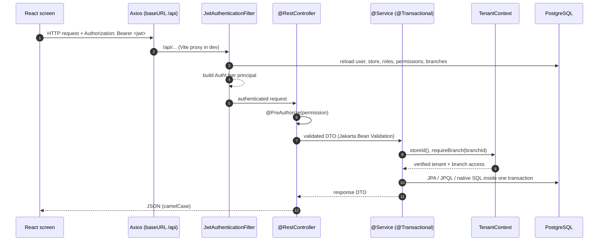
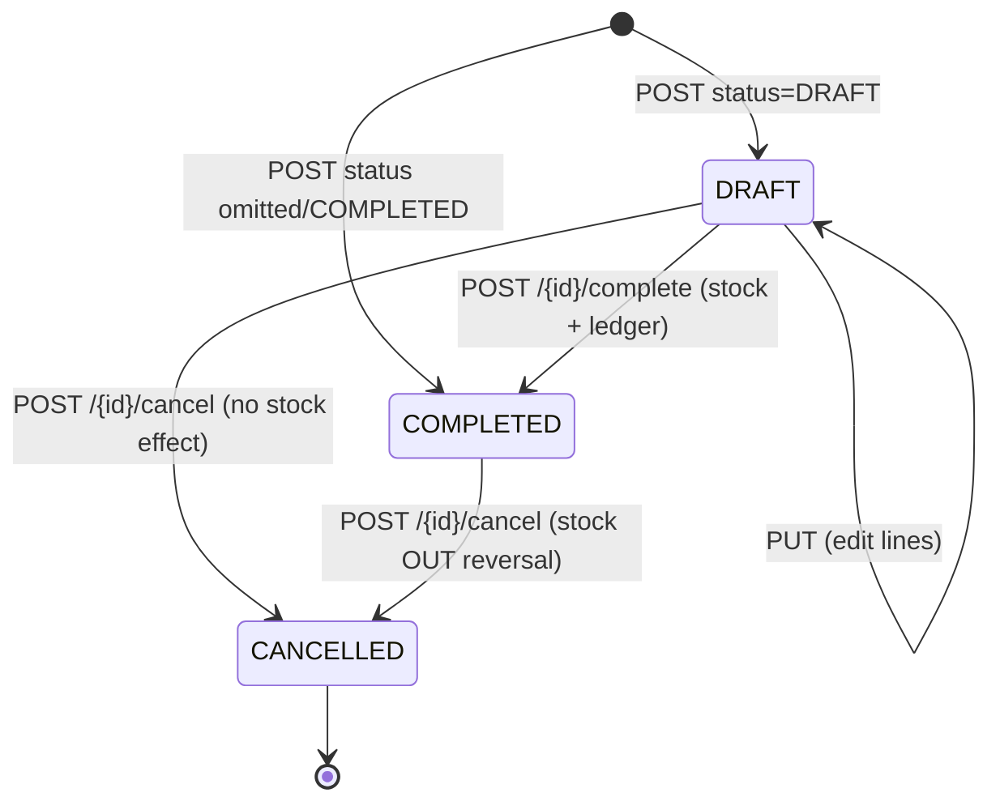
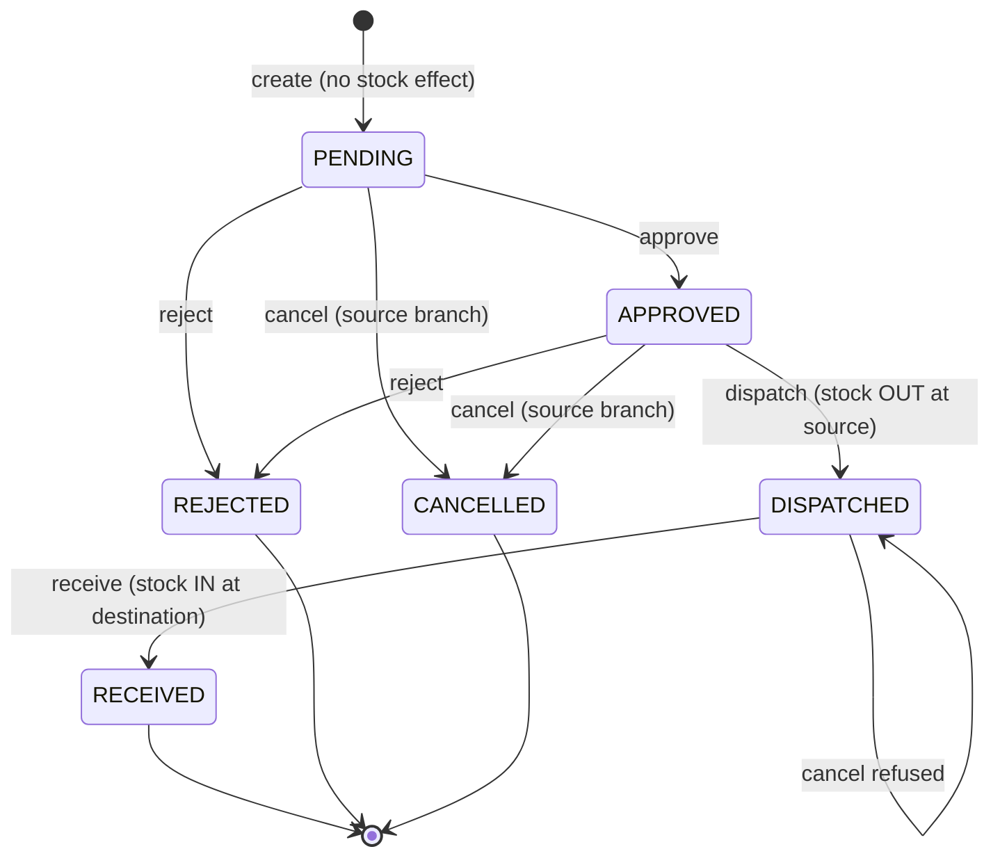

# 9–13. Business Flows, Stock Calculation, Purchase/Sales, POS/Billing and GST

> **Documentation status.** Every statement below was checked against the source in
> this repository (`src/main/java/com/itemmanagement/...`, the Flyway migrations and
> `docs/sql/*.sql`). Nothing in this file was executed. No application code, schema,
> configuration, package or migration was changed while writing it.
>
> Status labels used throughout: **Implemented** = code path exists and is wired to the
> UI; **Partial** = exists with a real limitation; **Not implemented** = does not exist.
> Where the actual behaviour differs from what an operator might assume, the difference
> is called out explicitly under **Actual behaviour** and collected in section 24.

This section follows the order required by the handover task:

| Section | Topic |
| --- | --- |
| 9 | End-to-end business flows (store, branch, masters, purchase, sales, POS, transfer, adjustment, low stock, reports, audit) |
| 10 | How stock is calculated, locked, valued and reconciled |
| 11 | Purchase and sales arithmetic, including header discount and reversal |
| 12 | POS billing behaviour and rate rules |
| 13 | GST calculation, inclusive/exclusive, intra/inter-state, snapshots and report |

---

## 9. Business Flows

### 9.1 The common request path

Every store-scoped request travels the same path. Understanding this once explains why
the flows below never pass a `storeId` from the browser.



Rules that every flow inherits:

1. **The tenant is derived, never supplied.** `TenantContext.storeId()` reads the
   `storeId` claim of the verified JWT. `TenantContext.storeId()` throws
   `403 Platform administrators cannot access store business data` when the principal
   has no store.
2. **Branch access is checked on the server.** `TenantContext.requireBranch(id)` throws
   `403 You do not have access to this branch` unless the principal is a store owner /
   store admin (`allBranches = true`) or the branch is in the user's assigned set.
3. **Permissions are enforced per endpoint** with `@PreAuthorize("hasAuthority('...')")`.
   The UI hides controls, but the API is the authority.
4. **Writes are transactional.** `create`, `complete`, `cancel`, `approve`, `dispatch`,
   `receive`, `adjust` are all `@Transactional`; a validation failure rolls the whole
   operation back, including stock and ledger rows.
5. **Money is `NUMERIC(14,2)` / `NUMERIC(12,2)` and rounded `HALF_UP` to 2 decimals.**
   Quantities are `NUMERIC(18,3)` and rounded to 3 decimals. Average cost is
   `NUMERIC(18,4)`.
6. **Master data is referenced by id inside the tenant**; every lookup is
   `findByIdAndStoreId(...)`, so a valid id from another store resolves to
   "not found"/"select a valid …", not to another tenant's row.
7. **Audit is written after the business write** with `AuditService.log(...)`; audit
   failures are logged and swallowed so they never abort a completed business action.

Error shape (from `GlobalExceptionHandler`): HTTP status plus
`{"timestamp","status","error","message","path"}`; validation errors return
`400` with the first field message.

---

### 9.2 Store registration (tenant onboarding)

**Frontend:** `/register` — `RegisterStorePage`.
**API:** `POST /api/auth/register-store` — public (`permitAll`), no JWT.
**Service:** `AuthService.registerStore` → `StoreProvisioningService.createStore`.
**Transaction:** one transaction for the entire provisioning.
**Tables written:** `stores`, `branches`, `tax_master`, `roles`, `role_permissions`,
`users`, `user_roles`, `user_branches`, `audit_logs`.

#### Request fields and validation

`RegisterStoreRequest` (all messages are the actual validation messages):

| Field | Validation |
| --- | --- |
| `storeCode` | required; `^[A-Za-z0-9_-]{3,30}$`; stored upper-case; `PLATFORM` is reserved; must be globally unique |
| `storeName` | required, ≤ 150 |
| `ownerName` | required, ≤ 150 |
| `email` | required, valid e-mail |
| `mobile` | required, ≤ 20 |
| `address` | required |
| `gstNumber` | optional, ≤ 30 |
| `state` | optional, ≤ 80 — copied to the first branch and used for GST place-of-supply |
| `username` | required, `^[A-Za-z0-9._-]{3,40}$` |
| `password` | required, 8–72 characters (BCrypt limit); hashed with BCrypt, never stored in clear |
| `branchName` | optional, ≤ 150; defaults to `Main Branch` |

#### Steps performed by the server

1. Trim and upper-case `storeCode`. Reject `PLATFORM`; reject a duplicate code with
   `409 Store code is already registered`.
2. Insert the store with `tax_inclusive = false` and `status = ACTIVE`.
3. Insert branch `MAIN` with the store address and mobile, the supplied `state`, and
   `status = ACTIVE`. This is the owner's first branch.
4. Seed the five default tax slabs for the new store (`0% EXEMPT`, `5%`, `12%`, `18%`,
   `28%`). CGST and SGST are each half of the GST rate; IGST equals the GST rate.
5. Create the four system roles and attach permissions:

   | Role | Permissions (codes) |
   | --- | --- |
   | `STORE_OWNER` | everything: dashboard, store, branch, user, role, category, item, tax, supplier, purchase, inventory, transfer (view/manage/approve), sales, reports |
   | `STORE_ADMIN` | same operational set, without `STORE_MANAGE` and `ROLE_MANAGE` |
   | `BRANCH_MANAGER` | dashboard, view catalogue/tax/supplier, purchase manage, inventory adjust, transfer manage, sales manage, reports |
   | `BRANCH_STAFF` | dashboard, view catalogue/tax/inventory/sales, sales manage |

6. Create the owner user: BCrypt hash, `STORE_OWNER` role, membership of `MAIN`, status
   `ACTIVE`. Duplicate username in the new store is rejected (practically impossible,
   but guarded).
7. Write an audit row `REGISTER_STORE / STORE` in a separate transaction.
8. Return a message containing the store code; the user then signs in at `/login`.

#### Example

```http
POST /api/auth/register-store
Content-Type: application/json

{
  "storeCode": "ACME01",
  "storeName": "Acme Retail",
  "ownerName": "Asha Rao",
  "email": "asha@acme.example",
  "mobile": "9876543210",
  "address": "12 Market Road, Bengaluru 560001",
  "gstNumber": "29ABCDE1234F1Z5",
  "state": "Karnataka",
  "branchName": "Main Branch",
  "username": "asha",
  "password": "ChangeMe123!"
}
```

`201 Created` (body: `{"message":"Store registered successfully. You can now sign in with store code ACME01."}`).
Duplicates return `409`; validation returns `400` with the first failing message.

#### Failure behaviour

All eight writes are in one transaction. If any step throws (duplicate code, duplicate
username, missing `PLATFORM_ADMIN` reference data), nothing is left behind — no orphan
store, branch, role or user. The platform administrator account itself is **not**
created here; it is seeded on application start by `DataSeeder` (see 9.3 note).

---

### 9.3 Sign-in, session and tenant selection

**Frontend:** `/login` — store code + username (or e-mail) + password.
**API:** `POST /api/auth/login` — public.
**Implemented.**

1. `storeCode` is matched case-insensitively. `PLATFORM` selects a platform user
   (`store_id IS NULL`); any other value must match an active store.
2. The user is resolved by username, then by e-mail, within that store only.
3. BCrypt verifies the password. User status and store status must be `ACTIVE`
   (`403` otherwise). A missing store/user and a wrong password all return the same
   `401 Invalid store code, username or password` (no account enumeration).
4. The session is built from database data, not from client input:
   - roles and the union of their permission codes;
   - `allBranches = true` for `STORE_OWNER` and `STORE_ADMIN`;
   - otherwise only branches assigned in `user_branches` **that are still active**;
   - platform users have `storeId = null` and `allBranches = false`.
5. A signed JWT is issued with `sub`, user id, store id, store code, roles,
   permissions, branch ids, `allBranches`, `jti`, `iat`, `exp`. Its lifetime is
   `app.jwt.expiration-ms` (default `43200000` ms = 12 hours).
6. An audit row `LOGIN / USER` is written with `REQUIRES_NEW` so it survives even
   though login itself is read-only.

`GET /api/auth/me` rebuilds the profile from the database without issuing a token;
`POST /api/auth/refresh` blacklists the current `jti` and issues a new token;
`POST /api/auth/logout` blacklists the current `jti`. The blacklist is in memory and is
lost on restart (see section 24).

> **Actual behaviour — first platform login.** On first start, `DataSeeder` creates a
> platform user `platform` with password `Admin@123` if no platform user exists. This
> default credential is a deployment risk and must be changed manually; there is no
> self-service password change endpoint. See section 24.

---

### 9.4 Branch creation

**Frontend:** `/branches` — Branch Master.
**API:** `POST /api/branches` — permission `BRANCH_MANAGE`.
**Tables:** `branches`, `audit_logs`.
**Implemented.**

Steps:

1. Tenant comes from the JWT; the request body has no `storeId`.
2. `branchCode` is trimmed and upper-cased; uniqueness is per store
   (`uq_branches_code`), duplicates return `409`.
3. `branchName`, `address`, `contactNumber` are required by the DTO; `state` is optional
   but **important**: it is compared with the supplier/customer state to decide
   CGST+SGST vs IGST. Missing state means every transaction is treated as intra-state.
4. New branches default to `ACTIVE`. Deactivating a branch (`PATCH /api/branches/{id}/status`)
   removes it from login branch lists, dashboards, POS branch selection and new
   transactions, but historical rows keep the branch id and name.
5. A branch cannot be deleted through the API; there is no delete endpoint (historical
   purchases, sales and transfers reference it).

**Branch-scoped users:** after creating a branch, an owner/admin assigns it to a user on
`/users` (roles + branches). That assignment is the only way a non-owner user receives
access. The branch list and permissions are embedded in the JWT at login, and the filter
only re-checks that the user and store are still active; a changed assignment therefore
takes effect on the user's next login or `POST /api/auth/refresh`, not immediately on the
current token. Deactivating the user or the store does take effect on the next request.

---

### 9.5 Category creation

**Frontend:** `/categories`.
**API:** `POST /api/categories` — `CATEGORY_MANAGE`.
**Tables:** `categories`, `audit_logs`.
**Implemented.**

- Name is trimmed, uniqueness is per store (`uq_categories_name`), duplicate → `409`.
- Description optional; status defaults to `ACTIVE`.
- Delete is allowed **only when no item references the category**; otherwise
  `400 This category is used by N item(s). Move those items to another category before deleting.`
  Preferred alternative: deactivate.
- The response includes `itemCount`, computed per request.

```sql
INSERT INTO categories (store_id, category_name, description, status)
VALUES (:storeId, 'Dairy', 'Milk, curd and chilled dairy', 'ACTIVE')
RETURNING id;
```

---

### 9.6 Tax master creation

**Frontend:** `/taxes` — Tax Master.
**API:** `POST /api/taxes` — `TAX_MANAGE`.
**Tables:** `tax_master`, `audit_logs`.
**Implemented.**

The operator supplies **only** the name, description, GST percentage and type
(`GST` or `EXEMPT`). The server derives the split (`TaxMasterService.apply`):

| Derived column | Rule |
| --- | --- |
| `gst_percentage` | `0.00` when type is `EXEMPT`, otherwise the supplied rate scaled to 2 dp |
| `cgst_percentage` | `gst / 2`, `HALF_UP` to 2 dp |
| `sgst_percentage` | `gst − cgst` (the remainder), 2 dp — guarantees `cgst + sgst = gst` |
| `igst_percentage` | equal to `gst` |
| `tax_type` | `EXEMPT` forced when the type is exempt; otherwise `GST` |

- Names are unique per store; duplicates → `409`.
- Deletion is blocked when any item, purchase line or sales line references the tax;
  the error reports the three counts and advises deactivation.
- Deactivating a tax does not affect existing items; it only blocks new assignments
  (`ItemService.tax` rejects an inactive tax unless it is the item's current tax).
- New stores receive five slabs automatically (0/5/12/18/28); the UI shows them
  immediately.

```sql
INSERT INTO tax_master (store_id, tax_name, description, gst_percentage,
                        cgst_percentage, sgst_percentage, igst_percentage,
                        tax_type, status)
VALUES (:storeId, 'GST 5%', 'Standard 5% GST slab',
        5.00, 2.50, 2.50, 5.00, 'GST', 'ACTIVE')
RETURNING id;
```

> **Note.** Changing a tax rate later does **not** rewrite history: every purchase and
> sale line stores `tax_id`, `tax_name_snapshot`, `gst_percentage`,
> `cgst_percentage`, `sgst_percentage` and `igst_percentage` at the time of posting.
> Reports read the snapshots, so old invoices keep their original GST.

---

### 9.7 Supplier creation

**Frontend:** `/suppliers`.
**API:** `POST /api/suppliers` — `SUPPLIER_MANAGE`.
**Tables:** `suppliers`, `audit_logs`.
**Implemented.**

- Fields: name (required), mobile (required), address (required), state, GSTIN, e-mail.
- `state` drives intra/inter-state tax on purchases.
- Delete endpoint does not exist (purchases reference the supplier). Deactivate instead.
- The supplier detail view lists the latest 20 purchases (`GET /api/suppliers/{id}/purchases`),
  filtered to branches the current user can access.

---

### 9.8 Item creation with one master rate

**Frontend:** `/items`.
**API:** `POST /api/items` — `ITEM_MANAGE`.
**Tables:** `items`, `audit_logs`.
**Implemented** after migration `V3__item_rate.sql`.

An item carries **exactly one price**: `items.rate`. This is the default POS selling
price. There is no `default_purchase_price` or `default_selling_price` column any more —
V3 dropped them and back-filled `rate` from the old selling price.

| Field | Rule |
| --- | --- |
| `itemCode` | required; trimmed and upper-cased; unique per store (`uq_items_code`); duplicate → `409` |
| `itemName` | required |
| `categoryId` | must exist in the same store |
| `taxId` | must exist in the same store; an inactive tax is rejected unless it is already the item's tax |
| `baseUnit` | one of `LITER, ML, KG, GRAM, PIECE, PACKET, BOX, BOTTLE, DOZEN` |
| `rate` | `NUMERIC(12,2)`, `>= 0`; the single master rate |
| `minStockLevel` | `NUMERIC(18,3)`, `>= 0`; default 5 |
| `status` | `ACTIVE` (default) or `INACTIVE` |

```sql
INSERT INTO items (store_id, category_id, tax_id, item_code, item_name,
                   base_unit, rate, min_stock_level, status)
VALUES (:storeId, :categoryId, :taxId, 'MILK-1L', 'Milk 1L',
        'LITER', 60.00, 10, 'ACTIVE')
RETURNING id;
```

- **Inactive items** cannot be purchased, sold, transferred or adjusted; the service
  rejects them by name. They remain visible in historical documents.
- **Item code annotation mismatch.** `Item.itemCode` is annotated `@Column(unique = true)`
  but Flyway's unique constraint is `(store_id, item_code)`; under
  `ddl-auto=validate` the annotation has no runtime effect, so two stores may legitimately
  use the same code. See section 24.
- **Deleting items** is not supported (ledger and line tables reference them); use
  deactivation.

#### The three rates and where each is captured

| Context | Rate source | Stored on |
| --- | --- | --- |
| POS billing (`pos = true`) | **Server forces `items.rate`**; a rate sent by the browser is ignored | `sales_details.selling_rate` |
| Normal sales screen (`pos` absent/false) | Operator enters the selling rate per line | `sales_details.selling_rate` |
| Purchase screen | Operator enters the purchase rate per line | `purchase_details.purchase_rate` |

Because every line stores its own rate, later edits to `items.rate` never change posted
documents. POS is the only path that reads the master rate, and it reads it on the
server at posting time.

---

### 9.9 Purchase workflow

**Frontend:** `/purchases`, `/purchases/new`.
**API:** `GET /api/purchases`, `GET /api/purchases/{id}`, `POST /api/purchases`,
`PUT /api/purchases/{id}`, `POST /api/purchases/{id}/complete`,
`POST /api/purchases/{id}/cancel` — permissions `PURCHASE_VIEW` / `PURCHASE_MANAGE`.
**Tables:** `purchases`, `purchase_details`, `branch_inventory`, `inventory_transactions`,
`audit_logs`.
**Implemented** with the limitations described under *Reversal*.

#### Status machine



- `POST` defaults to `COMPLETED` when `status` is omitted; `CANCELLED` is rejected at
  creation.
- A **DRAFT** writes header and lines only — **no stock, no ledger, no inventory rows**.
  This is what satisfies "do not update inventory when a purchase fails or is unfinished".
- `PUT` is allowed only for `DRAFT`: it recomputes everything and replaces the detail
  rows (delete + insert) inside the same transaction.
- `complete` requires at least one line, requires the branch to still be active, and
  posts stock line by line.
- `cancel` on a `DRAFT` just flips the status. On `COMPLETED` it posts a
  `PURCHASE_REVERSAL` stock-out per line before flipping the status.

#### Server-side computation (`PurchaseService.compute`)

1. Resolve branch, supplier, store tax mode, and `interState = branch.state != supplier.state`
   (case/space-insensitive; missing state → intra-state).
2. For each line:
   - reject duplicates of the same item;
   - item must exist in the tenant and be `ACTIVE`;
   - unit defaults to the item's base unit when omitted; convert to base quantity
     (`LITER↔ML`, `KG↔GRAM`, `PIECE↔DOZEN`; other units are standalone);
   - `gross = quantity × purchaseRate`, rounded 2 dp;
   - line discount cannot exceed gross.
3. Reject a header discount larger than the subtotal.
4. Allocate the header discount **proportionally by gross**:
   `share = headerDiscount × lineGross / subtotal` (`HALF_UP`, 2 dp); the **last line
   receives the remainder** so the allocated total equals the header discount exactly.
5. Per line, call `GstCalculator.calculate(gross, lineDiscount, gst%, store.inclusive, interState)`.
6. `grandTotal = taxable + tax`, rounded 2 dp. Negative totals are rejected.
7. Paid amount: omitted → `grandTotal` for `COMPLETED`, `0` for `DRAFT`; explicit value
   is rounded 2 dp and must not exceed the grand total. `balance = grand − paid`.
8. Persist header and lines. Only for `COMPLETED`, per line:
   - `lockOrCreate(store, branch, item)`;
   - `unitCost` = `taxableAmount / baseQuantity` (4 dp); if taxable is zero/missing,
     fall back to `totalAmount / baseQuantity`; if base quantity is zero, the raw
     purchase rate;
   - `applyStockIn(..., PURCHASE_IN, "PURCHASE", purchaseId, number, ...)`, which posts
     the ledger row and updates weighted average cost;
   - `purchase_price` on `branch_inventory` is set to this unit cost (last purchase wins).

#### Worked example (the same numbers as script 06)

Purchase 50 L milk at ₹48.00, GST 5%, no discount, intra-state:

| Quantity | Gross | Discount | Taxable | GST | CGST | SGST | IGST | Total |
| --- | --- | --- | --- | --- | --- | --- | --- | --- |
| 50 L | 2400.00 | 0.00 | 2400.00 | 120.00 | 60.00 | 60.00 | 0.00 | 2520.00 |

Stock unit cost = `2400.00 / 50 = 48.0000`, even though the header total is 2520 —
GST is not capitalised into inventory value. With an opening stock of 100 L at average
cost 45, the new average is `(100×45 + 50×48) / 150 = 46.0000`.

#### SQL actually written (abridged from `06_sample_business_flow.sql`)

```sql
INSERT INTO purchases
    (store_id, branch_id, supplier_id, purchase_number, invoice_number,
     purchase_date, subtotal, discount, tax, grand_total,
     taxable_amount, cgst_amount, sgst_amount, igst_amount,
     paid_amount, balance_amount, notes, status, created_by)
VALUES
    (:store, :main, :supplier, 'PUR-1001', 'INV-2026-001',
     CURRENT_DATE, 2400.00, 0.00, 120.00, 2520.00,
     2400.00, 60.00, 60.00, 0.00,
     2520.00, 0.00, NULL, 'COMPLETED', NULL)
RETURNING id;

INSERT INTO purchase_details
    (store_id, purchase_id, item_id, quantity, unit, base_quantity,
     purchase_rate, discount, tax, total_amount, tax_id, tax_name_snapshot,
     gst_percentage, cgst_percentage, sgst_percentage, igst_percentage,
     taxable_amount, cgst_amount, sgst_amount, igst_amount, tax_amount)
VALUES
    (:store, :purchase, :milk, 50, 'LITER', 50,
     48.00, 0.00, 120.00, 2520.00, :tax, 'GST 5%',
     5.00, 2.50, 2.50, 5.00,
     2400.00, 60.00, 60.00, 0.00, 120.00);

UPDATE branch_inventory
SET current_stock = current_stock + 50,
    avg_cost = ROUND(((current_stock * avg_cost) + (50 * 48.00))
                     / (current_stock + 50), 4),
    purchase_price = 48.00,
    updated_at = now()
WHERE store_id = :store AND branch_id = :main AND item_id = :milk;

INSERT INTO inventory_transactions
    (store_id, branch_id, item_id, transaction_type, reference_type,
     reference_id, reference_number, quantity_in, quantity_out,
     balance_after, notes, created_by)
VALUES
    (:store, :main, :milk, 'PURCHASE_IN', 'PURCHASE', :purchase,
     'PUR-1001', 50, 0, 150, 'Purchase from supplier', :userId);
```

(In the real code the insert into `branch_inventory` is `INSERT … ON CONFLICT DO NOTHING`
followed by `SELECT … FOR UPDATE`, then `applyStockIn`; the effect is identical to the
`UPDATE` above but concurrency-safe.)

#### Reversal rules

- Cancelling a `COMPLETED` purchase posts `PURCHASE_REVERSAL` stock-out for each line.
  It uses the **current** average cost and does **not** restore the previous average
  cost or `purchase_price`. If the stock has already been sold or transferred, the
  reversal fails with `Insufficient stock for …` and the whole cancel rolls back.
- There is no partial return and no purchase-return document. Cancellation is the only
  reversal; the original rows are never deleted.

---

### 9.10 Normal sales workflow

**Frontend:** `/sales`, `/sales/new`.
**API:** `GET /api/sales`, `GET /api/sales/{id}`, `POST /api/sales`,
`POST /api/sales/{id}/cancel` — `SALES_VIEW` / `SALES_MANAGE`.
**Tables:** `sales`, `sales_details`, `branch_inventory`, `inventory_transactions`,
`audit_logs`.
**Implemented.**

#### Steps (`SaleService.create`)

1. Branch must be accessible and active; items must belong to the store and be active.
2. For each line: reject duplicate items; pick the unit (supplied or item base);
   convert to base quantity; take `rate = line.sellingRate` because `pos` is not true.
3. `gross = quantity × rate`; line discount ≤ gross.
4. Header discount ≤ subtotal, allocated proportionally by gross with the last-line
   remainder (identical algorithm to purchases).
5. GST per line via `GstCalculator.calculate(gross, lineDiscount, itemTax.gst%, inclusive, interState)`
   where `interState = branch.state != customerState` (missing customer state →
   intra-state). The item **must** have a tax; otherwise
   `400 Tax is not configured for <item>`.
6. `grand = taxable + tax`. If negative → `400 Total discount cannot exceed the sale amount`.
7. Payment:
   - method defaults to `CASH`;
   - paid omitted → `grand` for `CASH/UPI/CARD`, `0` for `CREDIT`;
   - explicit paid must not exceed grand; `balance = grand − paid`.
8. Save the sale as `COMPLETED`.
9. For each line: `lockOrCreate`, **snapshot `cost_rate = branch_inventory.avg_cost`**,
   then `applyStockOut(... SALE_OUT, "SALE", ...)`, which rejects the sale when stock is
   insufficient and writes the ledger row.
10. Audit `CREATE / SALE`.

#### Worked example (script 06)

10 L milk sold at a manually entered ₹70.00, GST 5%, customer in Karnataka:

| Quantity | Gross | Discount | Taxable | GST | CGST | SGST | Total |
| --- | --- | --- | --- | --- | --- | --- | --- |
| 10 L | 700.00 | 0.00 | 700.00 | 35.00 | 17.50 | 17.50 | 735.00 |

Cost snapshot = 46.0000 (the average after the purchase). COGS = `10 × 46 = 460`;
gross profit on the line (excluding tax) = `700 − 460 = 240`.

#### Header discount example

Lines: 10 L milk @70 (gross 700) and 5 packets curd @40 (gross 200); subtotal 900;
header discount 45.

- Line 1 share = `45 × 700 / 900 = 35.00` → net 665.00, GST 5% = 33.25, total 698.25.
- Line 2 share = `45 − 35 = 10.00` (remainder) → net 190.00, GST 9.50, total 199.50.
- Header totals: subtotal 900.00, discount 45.00, taxable 855.00, tax 42.75,
  grand 897.75 — exactly the sum of the line totals.

#### Stock and failure behaviour

- Stock is checked and decremented **inside the same transaction** as the sale insert, in
  ascending item-id order per request. If any line fails, the sale, all its lines and all
  stock movements roll back — there is no partial sale.
- Insufficient stock message: `Insufficient stock for <item>. Available: X <unit>, required: Y <unit>`.
- Selling is never allowed to drive `current_stock` below zero; the database also has
  `CHECK (current_stock >= 0)`.

#### Cancellation

`POST /api/sales/{id}/cancel`:

- rejects an already-cancelled sale;
- requires access to the sale's branch;
- posts `SALE_REVERSAL` stock-in for every line with no unit cost (average cost is left
  unchanged);
- sets `status = CANCELLED`, keeps all rows, writes audit `CANCEL / SALE`.

The sale remains visible with its original totals; reports that filter `COMPLETED`
exclude it.

---

### 9.11 POS billing flow

**Frontend:** `/pos`.
**API used:** `GET /api/items/pos?branchId=&categoryId=&search=`,
`POST /api/sales` with `"pos": true`.
**Implemented.**

1. The cashier selects an accessible active branch. The server verifies branch access and
   that the branch is active, then returns active items with `availableStock`, the master
   `rate` (`items.rate`), tax name/rate/type and the store's `taxInclusive` flag.
2. The cashier adds items and quantities. The UI computes a preview, but the preview is
   **not trusted**.
3. On checkout the UI posts the same `SaleRequest` with `pos: true`. For each line the
   server **ignores `sellingRate` and uses `item.getRate()`** (the current master rate at
   posting time). Tax is resolved from the item's tax master, never from the request.
4. Stock is validated and decremented exactly as a normal sale; the cost snapshot and
   ledger row are identical.
5. Payment defaults: cash/UPI/card settle the full grand total; credit leaves the full
   balance outstanding.

#### Worked example (script 06)

5 packets curd at the master rate ₹40.00, GST 5%, intra-state:

| Quantity | Gross | Taxable | GST | CGST | SGST | Total |
| --- | --- | --- | --- | --- | --- | --- |
| 5 PKT | 200.00 | 200.00 | 10.00 | 5.00 | 5.00 | 210.00 |

Cost snapshot 28.0000 → COGS 140.00; line margin 60.00 before overheads.

#### What POS deliberately does not do

- No discounts beyond the normal per-line/header fields; no rounding-to-nearest-rupee
  setting.
- No split payments, no change calculation stored, no card/UPI reference number.
- No offline queue.
- No separate POS receipt table; a sale is the receipt.

These are "Not implemented" and are listed in section 24 rather than implied to exist.

---

### 9.12 Stock transfer workflow

**Frontend:** `/transfers`.
**API:** `GET /api/transfers`, `GET /api/transfers/{id}`, `POST /api/transfers`,
`POST /api/transfers/{id}/approve`, `/dispatch`, `/receive`, `/reject`, `/cancel` —
`TRANSFER_VIEW` / `TRANSFER_MANAGE` / `TRANSFER_APPROVE`.
**Tables:** `stock_transfers`, `stock_transfer_details`, `branch_inventory`,
`inventory_transactions`, `audit_logs`.
**Implemented**, with an unused `DRAFT` value in the check constraint.

#### State machine



#### Steps

1. **Create:** source and destination must differ (`CHECK` also enforces it), both must be
   active and in the tenant; the user must have access to the **source**. Lines are
   de-duplicated, items must be active, units converted to base. Status is `PENDING`;
   **no stock moves**. Number `TRF-<seq>`.
2. **Approve:** `PENDING → APPROVED`; no stock movement; audit only.
3. **Dispatch:** requires `APPROVED` and access to the **source**. Each line is processed
   in ascending item-id order: lock the source inventory, `applyStockOut(... TRANSFER_OUT)`.
   Insufficient stock aborts the whole dispatch (transaction rollback, status stays
   `APPROVED`).
4. **Receive:** requires `DISPATCHED` and access to the **destination**. For each line the
   server reads the **source branch's current `avg_cost`** and posts
   `applyStockIn(... TRANSFER_IN, unitCost)`. This updates the destination's weighted
   average cost and `purchase_price` is **not** changed (only `PURCHASE_IN` sets it).
5. **Reject:** `PENDING` or `APPROVED → REJECTED`; no stock effect.
6. **Cancel:** only before dispatch; requires access to the source; `DISPATCHED` cannot be
   cancelled — it must be received (there is no "lost in transit" resolution flow).

#### Cost behaviour and its limitation

The destination cost is the source average **at receive time**, not at dispatch time, and
no transfer cost is stored on the detail row. If the source average changes between
dispatch and receive (for example a purchase is posted in between), the destination
receives the newer cost. Transfers do not create accounting entries beyond the two
ledger rows. This is documented as a limitation in section 24; it does not break stock
quantity.

#### Worked example (script 06)

20 L milk MAIN → SEC after the sale:

- MAIN stock before transfer: `100 + 50 − 10 = 140`; after dispatch: `120`.
- MAIN average cost remains 46.0000 (stock-out does not change average cost).
- SEC is created with 20 L at average cost 46.0000; ledger `TRANSFER_IN` balance 20.
- MAIN average cost at the later adjustment remains 46.0000; after `ADJUSTMENT OUT 2 L`,
  MAIN stock is 118.

---

### 9.13 Manual stock adjustment

**Frontend:** `/inventory` — Adjust stock dialog.
**API:** `POST /api/inventory/adjustments` — `INVENTORY_ADJUST`.
**Tables:** `stock_adjustments`, `branch_inventory`, `inventory_transactions`, `audit_logs`.
**Implemented.**

- Type is `IN` or `OUT` (validated by regex), quantity > 0, reason required (≤ 255).
- Unit defaults to the item's base unit; the base quantity is computed and stored.
- `IN` calls `applyStockIn` with **no unit cost**, so quantity rises but average cost is
  unchanged (the addition is implicitly valued at the current average). `purchase_price`
  is unchanged.
- `OUT` calls `applyStockOut`; it can never take stock below zero and therefore never
  creates negative inventory.
- A separate `stock_adjustments` document row is written for traceability, with an
  `ADJ-<seq>` number; the ledger row points at it (`reference_type = ADJUSTMENT`,
  `reference_id = NULL`, `reference_number = ADJ-…`).
- Adjustment does not require approval and has no status; it is immediate and audited.

```sql
INSERT INTO stock_adjustments
    (store_id, branch_id, item_id, adjustment_number, adjustment_type,
     quantity, base_quantity, unit, reason, created_by)
VALUES (:store, :main, :milk, 'ADJ-1007', 'OUT', 2, 2, 'LITER',
        'Spillage during handling', :userId);
```

> **Actual behaviour.** Adjustment-out reduces quantity at the current average cost but
> does not post a value difference anywhere; there is no shrinkage/expense account.

---

### 9.14 Low-stock flow

**Frontend:** dashboard widget, `/inventory` filter, `/reports` low-stock report.
**APIs:** `GET /api/inventory?lowOnly=true`, `GET /api/inventory/low-stock`,
`GET /api/reports/low-stock`.
**Implemented.**

- The rule is `current_stock <= minimum_stock`, inclusive on both sides. A stock equal to
  the minimum is "low"; zero is low.
- The minimum used is `branch_inventory.minimum_stock` when a row exists; otherwise it
  falls back to `items.min_stock_level`. New inventory rows are created with the item's
  minimum as the seed (`lockOrCreate`).
- Low stock is computed from the live inventory table, not from the ledger, and it is
  scoped to active branches the user can access.
- The dashboard shows the count, the first 8 rows and a per-branch count.

### 9.15 Reports flow

**Frontend:** `/reports` with tabs (sales, purchase, GST, stock, low stock, profit,
store/branch summary).
**API:** `GET /api/reports/{sales,purchases,gst,stock,low-stock,profit,store,branches}` —
`REPORT_VIEW`.
**Implemented**, with the definition limitations below.

All reports:

1. Derive the tenant and the accessible, active branch set. If the set is empty, return an
   empty report rather than an error.
2. Default the period to **first day of the current month → today**; an explicit
   `from > to` returns `400 From date cannot be after to date`.
3. Include only `COMPLETED` purchases/sales. Cancelled documents are excluded by the
   repository query.
4. Filter item-level rows by category, item id and a case-insensitive search on item name
   or code.

| Report | Source tables | Logic |
| --- | --- | --- |
| Sales | `sales`, `sales_details`, `items`, `branches` | one row per line in the period; quantity sums `base_quantity`; amount sums `total_amount` (tax-inclusive); customer blank → "Walk-in customer" |
| Purchase | `purchases`, `purchase_details`, `suppliers` | one row per line; amount `total_amount`; shows the manually entered purchase rate |
| GST | `sales`, `sales_details` | groups by branch + tax-name snapshot + GST rate; taxable = `total_amount − tax`; sums CGST/SGST/IGST/tax; counts distinct invoices; optional exact `taxRate` filter |
| Stock | `branch_inventory`, `inventory_transactions`, `items`, `categories` | per branch+item: opening = `current_stock − net movements in period`; columns for purchased, sold, transfer in/out, adjustment in/out, current; value = `current_stock × avg_cost` |
| Low stock | inventory service | see 9.14 |
| Profit | `sales_details` | revenue = `total_amount − tax`; COGS = `base_quantity × cost_rate` (snapshot); profit = revenue − COGS; grouped by item and by branch |
| Store / branch | purchases, sales, sales details, inventory | totals plus a per-branch row: purchase amount, sales amount, items sold, stock value, low-stock count |

**Important definition notes:**

- GST report is **output tax only** (sales). Purchase input tax is stored on lines but not
  reported. Cancelled sales are excluded.
- Stock report "opening" is derived, not stored. It is exact only if every movement since
  the beginning is in the ledger; a manually edited inventory row without a ledger entry
  (not possible through the API) would distort it.
- Profit uses the cost snapshot taken at sale time. Later purchase prices and average
  costs do not rewrite historical profit.
- Stock value uses `avg_cost`, not `purchase_price`.

### 9.16 Audit flow

**Table:** `audit_logs`. **API:** none exposed (no audit viewer endpoint).
**Implemented as write-only.**

- `AuditService.log` resolves the current principal and inserts `store_id`, `user_id`,
  `username`, `action`, `entity_type`, `entity_id`, `details` (truncated to 1000 chars),
  `created_at`.
- `logFor` runs with `REQUIRES_NEW` for events without a tenant context (registration,
  login) so the row commits independently.
- Failures inside audit never fail the business transaction; they are logged at WARN.
- Audited actions include: register store, login, create/update/activate/deactivate for
  masters, purchase create/update/complete/cancel, sale create/cancel, transfer
  create/approve/dispatch/receive/reject/cancel, inventory adjust and pricing update.
- **Gap:** no read API or UI, no retention policy, no audit of failed authorization
  attempts. See section 24.

---

## 10. Stock Calculation

### 10.1 The single source of truth

`branch_inventory` holds one row per `(store_id, branch_id, item_id)`:

| Column | Meaning |
| --- | --- |
| `current_stock` | on-hand quantity in the item's **base unit**, `>= 0` |
| `minimum_stock` | low-stock threshold for this branch/item |
| `purchase_price` | last purchase unit cost (informational, set only by `PURCHASE_IN`) |
| `selling_price` | branch selling price hint (informational; POS uses `items.rate`) |
| `avg_cost` | weighted average cost per base unit, 4 dp |

There is no stock column on `items`; stock is always per branch.

### 10.2 Transaction quantities and unit conversion

`UnitConverter` converts the entered quantity to the item's base unit:

| Family | Conversion |
| --- | --- |
| `LITER` ↔ `ML` | × / ÷ 1000 |
| `KG` ↔ `GRAM` | × / ÷ 1000 |
| `PIECE` ↔ `DOZEN` | × / ÷ 12 |
| `PACKET`, `BOX`, `BOTTLE` | standalone; no conversion |

Stock, ledger and availability are always in base units. The document keeps both the
entered quantity/unit and the base quantity, so an invoice can show "2 DOZEN" while stock
moves 24 pieces. An unknown or omitted unit falls back to the item's base unit.

### 10.3 Concurrency-safe creation and locking

Two cashiers must not oversell the same row. `InventoryService.lockOrCreate`:

1. runs a native `INSERT INTO branch_inventory ... VALUES (..., 0, ...) ON CONFLICT
   (store_id, branch_id, item_id) DO NOTHING`, seeding minimum/purchase/selling prices
   from the item;
2. then selects the row with `SELECT ... FOR UPDATE` (`findForUpdate`).

The row lock is held until the surrounding transaction commits, so a second sale on the
same branch/item waits, then re-reads the updated `current_stock`. The stock-out check
(`current < quantity → reject`) and the decrement happen under that lock. This is the
mechanism that satisfies "prevent concurrent sales from overselling stock"; the database
`CHECK (current_stock >= 0)` is the last line of defence.

> **Operational caveat.** A purchase locks item rows in the order the request lists them;
> a sale locks them in ascending item-id order. Two multi-item transactions that touch the
> same items in opposite orders can deadlock under PostgreSQL; PostgreSQL aborts one
> transaction with a serialization/deadlock error, so no data is corrupted, but the
> request fails. Retrying is safe. See section 24.

### 10.4 Stock in

`applyStockIn(inventory, item, quantity, unitCost, type, ...)`:

1. quantity must be > 0;
2. `oldStock = current_stock`; `newStock = oldStock + quantity`;
3. if `unitCost` is supplied and `newStock > 0`, weighted average:
   `avg_cost = (oldStock × avg_cost + quantity × unitCost) / newStock`, 4 dp HALF_UP;
4. for `PURCHASE_IN` only, `purchase_price = unitCost` (2 dp);
5. save the row, then insert a ledger row with `quantity_in`, `quantity_out = 0`,
   `balance_after = newStock`.

Callers and unit costs:

| Caller | Type | Unit cost |
| --- | --- | --- |
| Purchase completed | `PURCHASE_IN` | `taxable / baseQuantity` (fallback total / base, then rate) |
| Sale cancelled | `SALE_REVERSAL` | none (average unchanged) |
| Transfer received | `TRANSFER_IN` | source branch's current `avg_cost` |
| Adjustment IN | `ADJUSTMENT_IN` | none (average unchanged) |

### 10.5 Stock out

`applyStockOut(...)`:

1. quantity must be > 0;
2. if `current_stock < quantity` → `400 Insufficient stock for <item>. Available: …,
   required: …`; the transaction rolls back;
3. decrement, save, insert ledger row with `quantity_out`, `balance_after`;
4. **does not change `avg_cost`** — a stock-out never re-values remaining stock.

Callers: `SALE_OUT`, `PURCHASE_REVERSAL`, `TRANSFER_OUT`, `ADJUSTMENT_OUT`.

### 10.6 The ledger

`inventory_transactions` is append-only:

| Column | Meaning |
| --- | --- |
| `transaction_type` | `OPENING_STOCK`, `PURCHASE_IN`, `PURCHASE_REVERSAL`, `SALE_OUT`, `SALE_REVERSAL`, `TRANSFER_IN`, `TRANSFER_OUT`, `ADJUSTMENT_IN`, `ADJUSTMENT_OUT` |
| `reference_type` / `reference_id` / `reference_number` | document link (`PURCHASE`, `SALE`, `TRANSFER`, `ADJUSTMENT`, `OPENING`); polymorphic, no FK |
| `quantity_in` / `quantity_out` | exactly one is non-zero |
| `balance_after` | the row's stock after the movement |
| `notes`, `created_by`, `transaction_date` | context and actor |

The invariant, for every branch/item, ordered by time/id:

```text
balance_after(n) = balance_after(n-1) + quantity_in(n) - quantity_out(n)
```

`docs/sql/05_database_validation.sql` checks exactly this with a running-window query and
also compares the last `balance_after` with `branch_inventory.current_stock`.

### 10.7 Opening stock and current stock

Stock can enter the system only by:

1. a completed purchase (`PURCHASE_IN`),
2. a transfer in (`TRANSFER_IN`),
3. an adjustment in (`ADJUSTMENT_IN`),
4. a sale cancellation (`SALE_REVERSAL`),
5. direct `OPENING_STOCK` rows — used by the demo seed and by script 06. There is **no
   API** to post opening stock; the application has no opening-stock screen.

Current stock is maintained incrementally by the service; it is not recomputed from the
ledger on each read. The stock report derives opening as `current − net movements in the
selected period`, which is why the ledger and the row must agree.

### 10.8 Low stock, stock value and availability

- Low stock: `current_stock <= minimum_stock` (see 9.14).
- Stock value: `current_stock × avg_cost` (4 dp average, summed then rounded 2 dp).
- POS availability: `GET /api/pos/items` returns the live stock and a `lowStock` flag;
  the server still re-checks at posting time. The UI may show an item with zero stock,
  but adding it and checking out will fail with the insufficient-stock message.
- There is no reservation/hold: stock is only committed at sale posting.

---

## 11. Purchase and Sales Arithmetic

### 11.1 Line arithmetic (both directions)

For a line with entered quantity `q`, unit price `p`, line discount `d`:

```text
gross     = round(q × p, 2)
net       = gross − d                     (d ≤ gross enforced)
taxable   = net                           (exclusive tax mode)
tax       = round(taxable × gst% / 100, 2)
total     = taxable + tax                 (tax-inclusive payable)
```

In inclusive mode:

```text
taxable   = round(net / (1 + gst%/100), 2)
tax       = net − taxable
total     = net
```

If `gst% = 0` (or the tax is `EXEMPT`): `taxable = net`, `tax = 0`.

The line total is what the customer/supplier pays for that line; the header
`grand_total` is the sum of line totals and is recomputed from taxable + tax, not by
adding rounded line totals, so header/line totals agree to the paisa.

### 11.2 Header discount allocation

```text
share(i) = round(headerDiscount × gross(i) / subtotal, 2)   for i < last
share(last) = headerDiscount − Σ share(i)
```

This is deliberate: rounding each share independently would lose or create paise. The
last line absorbs the difference. The allocated share is added to that line's own
discount and stored in `purchase_details.discount` / `sales_details.discount`; the header
`discount` is the header amount only (the sum of both kinds equals the total discount).

Validation:

- line discount > gross → `400 Discount cannot exceed the line amount for <item>`;
- header discount > subtotal → `400 Total discount cannot exceed the sale/purchase amount`;
- if tax math still yields a negative grand total → rejected.

### 11.3 Paid amount and balance

| Case | Paid | Balance |
| --- | --- | --- |
| Purchase `COMPLETED`, paid omitted | grand total | 0 |
| Purchase `DRAFT`, paid omitted | 0 | grand total |
| Purchase explicit paid | as sent (≤ grand) | grand − paid |
| Sale `CASH/UPI/CARD`, paid omitted | grand total | 0 |
| Sale `CREDIT`, paid omitted | 0 | grand total |
| Sale explicit paid | as sent (≤ grand) | grand − paid |

There is no payment table and no partial-payment history: only the current
`paid_amount`/`balance_amount` on the document. Later settlement is not modelled (see
section 24). The `customers` table exists but is unused; sales store customer name,
mobile and state as text on the sale.

### 11.4 Historical rate preservation

| Data | Stored on the line | Why |
| --- | --- | --- |
| Purchase rate | `purchase_details.purchase_rate` | the negotiated cost at that time |
| Sale rate | `sales_details.selling_rate` | manual rate, or the master rate forced by POS |
| Cost at sale | `sales_details.cost_rate` | profit is not rewritten by later purchases |
| Tax | all five percentage columns + tax name snapshot + tax id | rate/name changes never alter old invoices |
| Unit and base quantity | `unit`, `quantity`, `base_quantity` | reproducible conversion |

Editing a document is possible only for purchase `DRAFT`; completed documents are
immutable apart from cancellation. There is no "edit sale" endpoint.

### 11.5 Reversal summary

| Document | Allowed cancellation | Stock effect | Money effect |
| --- | --- | --- | --- |
| Purchase `DRAFT` | yes | none (never posted) | status only |
| Purchase `COMPLETED` | yes, if stock still available | `PURCHASE_REVERSAL` out per line | status only; totals retained |
| Sale `COMPLETED` | yes | `SALE_REVERSAL` in per line | status only; totals retained |
| Transfer `PENDING/APPROVED` | yes | none | status only |
| Transfer `DISPATCHED` | no | — | — |
| Transfer `RECEIVED` | no | — | — |
| Stock adjustment | no cancel | — | — |

No completed document is ever hard-deleted, satisfying the SRS rule.

---

## 12. POS and Billing Behaviour

### 12.1 Screen contract

`GET /api/items/pos` returns, per active item:

```json
{
  "id": 12,
  "itemCode": "MILK-1L",
  "itemName": "Milk 1L",
  "categoryId": 3,
  "categoryName": "Dairy",
  "unit": "LITER",
  "rate": 60.00,
  "availableStock": 118.000,
  "lowStock": false,
  "taxId": 2,
  "taxName": "GST 5%",
  "gstPercentage": 5.00,
  "taxType": "GST",
  "taxInclusive": false
}
```

`rate` is `items.rate`; it is not the branch `selling_price`, and it is not editable in
the POS catalogue endpoint.

### 12.2 Checkout contract

```http
POST /api/sales
Authorization: Bearer <token>

{
  "branchId": 4,
  "salesDate": "2026-10-30",
  "customerName": "POS Customer",
  "customerMobile": null,
  "customerState": "Karnataka",
  "discount": 0,
  "paymentMethod": "UPI",
  "paidAmount": 210.00,
  "pos": true,
  "items": [
    { "itemId": 7, "quantity": 5, "unit": "PACKET", "sellingRate": 1, "discount": 0 }
  ]
}
```

The `sellingRate: 1` above is deliberately wrong: with `pos: true` the server posts
₹40.00 (the master rate). This is the security property required by the final change
request — the browser cannot choose the POS price.

If `paidAmount` is omitted, UPI/cash/card settle the grand total. If it exceeds the grand
total, the request fails; the API does not compute change.

### 12.3 Rounding and display

- Line gross and all money columns are 2 dp HALF_UP.
- Tax is computed per line, not on the invoice total. Summing line tax can differ by a
  paisa from computing tax on the summed taxable amount; the stored header follows the
  line sums, so documents and GST report agree.
- Quantities are stored and displayed to 3 dp; unit conversion may produce fractions
  (e.g. 250 ML of a LITER item = 0.250).

### 12.4 What the POS reuses

POS is not a separate backend: it is the normal sale endpoint with a server-enforced rate
flag. Therefore stock validation, GST snapshots, cost snapshots, numbering, audit,
cancellation and reports all behave identically. This is intentional and keeps one
invariant path.

### 12.5 POS-related gaps

No cash drawer/session, no hold/park bill, no table or token number, no printer
integration, no barcode scanner endpoint (search is by name/code), no offline mode, no
split tender, no refund/return document. See section 24.

---

## 13. GST Calculation

### 13.1 Single implementation

All GST maths lives in `GstCalculator`; purchases, sales, POS and the tax master use it.
Inputs: line `gross`, line `discount`, `gstPercentage`, store `taxInclusive`, and the
`interState` flag.

### 13.2 Exclusive vs inclusive

| Mode | Store setting | Formula | Example (gross 105, GST 5%) |
| --- | --- | --- | --- |
| Exclusive | `stores.tax_inclusive = false` (default) | taxable = 105; tax = 5.25; total = 110.25 | price is pre-tax |
| Inclusive | `stores.tax_inclusive = true` | taxable = 105 / 1.05 = 100.00; tax = 5.00; total = 105.00 | price already contains tax |

Inclusive taxable uses a divisor computed to 8 dp (`1 + gst/100`), then rounds taxable to
2 dp; tax is `net − taxable`, so `taxable + tax` always equals the entered net exactly.
There is no UI to switch `tax_inclusive` after store creation (the column is read from the
store and shown in the POS response).

### 13.3 Intra-state vs inter-state

```text
interState = normalize(branch.state) != normalize(party.state)
             && both states are present
```

`normalize` trims, collapses whitespace and lower-cases. A missing branch state or a
missing customer/supplier state means **intra-state** (the safe default for walk-in
customers).

| Case | CGST | SGST | IGST |
| --- | --- | --- | --- |
| Intra-state | `tax / 2` (HALF_UP) | `tax − cgst` | 0 |
| Inter-state | 0 | 0 | `tax` |

Example, intra-state, tax 35.00 → CGST 17.50, SGST 17.50, IGST 0.
Example, inter-state, tax 35.00 → IGST 35.00, CGST/SGST 0.

The split guarantees `cgst + sgst = tax` to the paisa, including odd amounts
(e.g. tax 0.05 → CGST 0.03, SGST 0.02).

### 13.4 Tax master snapshots

Every line stores:

```text
tax_id, tax_name_snapshot, gst_percentage,
cgst_percentage, sgst_percentage, igst_percentage,
taxable_amount, cgst_amount, sgst_amount, igst_amount, tax_amount
```

The header stores `tax`, `taxable_amount`, `cgst_amount`, `sgst_amount`, `igst_amount`
as the sums of the lines. Consequences:

- Renaming or re-rating a tax master affects only future documents.
- Deleting a tax is blocked while any line references it.
- A GST report for an old period reproduces the rates that were actually charged.

### 13.5 GST report semantics

- Scope: tenant + accessible branches, `COMPLETED` sales only, sale date within range,
  optional exact GST-rate filter (`taxRate` compared to the snapshot value, not to the
  master).
- Group key: `branchId | taxNameSnapshot | gst%`.
- Taxable = `total_amount − tax` per line (tax-inclusive payable minus tax). This is
  correct in both inclusive and exclusive modes.
- Invoice count = distinct `sales_id` contributing to the group.
- No input-tax credit, no HSN summary, no B2B/B2C split, no e-invoice fields. The report
  is an output-tax summary, not a statutory GSTR-1 export.
- Purchases store the same tax snapshots, so input tax could be reported later, but no
  endpoint does so today.

### 13.6 Worked combined example

Store: exclusive, branch Karnataka. Sale lines: 10 L milk @70 (5% GST) and 5 PKT curd @40
(5% GST), header discount 0, customer Karnataka.

| Line | Gross | Taxable | CGST | SGST | Total |
| --- | --- | --- | --- | --- | --- |
| Milk | 700.00 | 700.00 | 17.50 | 17.50 | 735.00 |
| Curd | 200.00 | 200.00 | 5.00 | 5.00 | 210.00 |
| Header | 900.00 | 900.00 | 22.50 | 22.50 | 945.00 |

If the customer state were Maharashtra, the tax would be IGST 45.00 and CGST/SGST zero.
If the store were inclusive, the same entered prices would produce taxable 857.14 and tax
42.86 (5% of 857.14) for the 900.00 total.

---

## Cross-references

- Table-by-table definitions and sample rows: `docs/02-database.md` sections 6–8.
- Exact SQL used for the example flows: `docs/sql/06_sample_business_flow.sql`.
- Security mechanics behind every flow: `docs/04-security.md` (section 14).
- Endpoint-by-endpoint contract: `docs/05-api-reference.md` (section 15).
- Database setup, migration and operations: `docs/06-postgresql-setup.md` (sections 16–21).
- Manual rebuild order and tests: `docs/07-manual-development.md` (sections 22–23).
- Defects and missing features referenced above: `docs/08-known-issues.md` (section 24).
