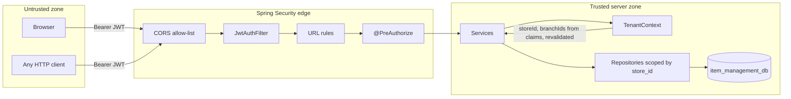

# 14. Multi-Store and Branch Security

> **Superseded 2026-11-01.** The authentication/security hardening described in
> `PROJECT_DOCUMENTATION/KNOWN_ISSUES_AND_RECOMMENDATIONS.md` (K-01–K-27) is not reflected in this
> older section. Use `PROJECT_DOCUMENTATION/ADMIN_DEPLOYMENT_GUIDE.md` and
> `PROJECT_DOCUMENTATION/API_DOCUMENTATION.md` as the current source of truth. This file is retained
> for historical context.

> **Documentation status.** This section was written by reading the security classes,
> services, repositories, controllers and migrations in this repository. Nothing was
> executed or changed. Findings marked **Needs correction** are real defects in the
> current code, not hypothetical risks; they are repeated with remediation in
> `docs/08-known-issues.md` (section 24).

---

## 14.1 Security model in one page



Five independent layers protect tenant data:

1. **Authentication** — a signed JWT proves who the caller is.
2. **Live account check** — the filter re-loads the user and store on every request and
   rejects tokens for deactivated accounts or mismatched stores.
3. **Permission check** — `@PreAuthorize` on every non-public controller method.
4. **Tenant derivation** — services never accept `storeId` from the client; they call
   `TenantContext.storeId()` and every repository query filters by it.
5. **Data constraints** — composite foreign keys `(store_id, id)` and unique keys
   `(store_id, …)` make cross-store references impossible even if a service check is
   bypassed.

The frontend is treated as untrusted. It hides controls for usability only; removing the
UI does not grant access.

---

## 14.2 Authentication

### 14.2.1 Password storage

- `BCryptPasswordEncoder` (Spring Security default strength 10) hashes every password.
- Only `users.password_hash` is stored; plaintext never reaches the database or logs.
- Password length is validated 8–72 characters at registration (72 is the BCrypt input
  limit). User updates enforce a minimum of 8.
- There is no password reset, no self-service password change, and no "change password"
  endpoint. An owner/admin changes another user's password through
  `PUT /api/users/{id}` with a `password` field. The seeded platform password can only be
  changed by an administrator through a database/seed change (see 14.13).

### 14.2.2 Login

`POST /api/auth/login` (public):

| Input | Behaviour |
| --- | --- |
| `storeCode` = `PLATFORM` (any case) | user must have `store_id IS NULL` **and** the `PLATFORM_ADMIN` role; otherwise `401` |
| any other `storeCode` | store must exist; user resolved by username, then e-mail, **within that store**; inactive store → `403` |
| wrong store code, user or password | identical `401 Invalid store code, username or password` |
| inactive user | `403 This user account is inactive` |
| no role assigned | `403 No role is assigned to this account` |

The session is built from the database at login, not from request fields:

```text
roles        = role codes from user_roles
permissions  = union of role_permissions of those roles
allBranches  = roles contains STORE_OWNER or STORE_ADMIN
branchIds    = all ACTIVE branches of the store            if allBranches
               assigned branches ∩ ACTIVE branches          otherwise
storeId      = user.store_id (null for platform users)
```

The login response contains the token, its type (`Bearer`), expiry seconds, user profile,
store profile (including `taxInclusive`), accessible branch profiles, roles, permissions,
`allBranches` and `platformAdmin`.

### 14.2.3 Token format

- Library: JJWT 0.12.6, HMAC-SHA with a key derived as `SHA-256(app.jwt.secret)`.
- Lifetime: `app.jwt.expiration-ms`, default `43200000` (12 hours).
- `jti` is a random UUID and is the revocation handle.
- `sub` is the user id.

Decoded payload example:

```json
{
  "jti": "0f4c1a6e-5a8d-4c19-9c2b-1b7f0f9a2d31",
  "sub": "7",
  "storeId": 1,
  "username": "asha",
  "fullName": "Asha Rao",
  "email": "asha@acme.example",
  "mobile": "9876543210",
  "storeCode": "ACME01",
  "storeName": "Acme Retail",
  "roles": ["STORE_OWNER"],
  "permissions": ["DASHBOARD_VIEW", "STORE_VIEW", "STORE_MANAGE", "..."],
  "branchIds": [1, 2],
  "allBranches": true,
  "iat": 1793318400,
  "exp": 1793361600
}
```

There is no `iss`, `aud`, `nbf` or key id. The token is a bearer credential: anyone who
obtains it can use it until expiry or logout.

### 14.2.4 Refresh and logout

| Endpoint | Behaviour |
| --- | --- |
| `GET /api/auth/me` | rebuilds the profile from the database; issues no token; returns `token: null` |
| `POST /api/auth/refresh` | revokes the current `jti`, rebuilds the profile from the database and issues a new token |
| `POST /api/auth/logout` | revokes the current `jti`; returns `{"message":"Signed out"}` |

Revocation is held in `TokenBlacklistService`, a `ConcurrentHashMap<jti, expiry>` in
process memory. It is pruned lazily when a revoked token is presented after expiry. It is
**not shared between instances and is lost on restart**, so a logged-out token becomes
valid again after a restart until its natural expiry. See 14.13.

---

## 14.3 Request authentication filter

`JwtAuthFilter` runs before `UsernamePasswordAuthenticationFilter` and does the following
for requests carrying `Authorization: Bearer <token>`:

1. Parse and verify the signature and expiry (`JwtService.parse`). Any failure clears the
   context and the request continues unauthenticated.
2. Reject if `jti` is in the blacklist.
3. Convert claims into an `AuthUser` principal.
4. **Re-load the user** by id and require:
   - the account exists and is `ACTIVE`;
   - `account.storeId` equals the `storeId` claim (prevents token reuse after a move).
5. **Re-load the store** when `storeId != null` and require `ACTIVE`.
6. Add authorities `ROLE_<role>` for each role and the raw permission codes.
7. Set the `SecurityContext`.

**What the filter does not re-read:** roles, permissions, `branchIds` and `allBranches`
remain whatever was signed at login/refresh. Consequences:

| Change after login | Effect on the current token |
| --- | --- |
| User deactivated | rejected on the next request |
| Store deactivated | rejected on the next request |
| User's store id changed | rejected (claim mismatch) |
| Password changed | **still valid** until expiry (no password-version claim) |
| Role permissions changed | unchanged until refresh/login |
| Role removed/replaced | unchanged until refresh/login |
| Branch added to user | not visible until refresh/login |
| Branch removed from user | **still accessible** until refresh/login |
| Branch deactivated | token still lists it; writes reject "branch is inactive", reads may still show it |

This is a deliberate performance trade-off but a security gap for revocation: a dismissed
employee keeps access until the 12-hour token expires unless the account is deactivated
(which does take effect immediately). Deactivating the account is the correct offboarding
action.

---

## 14.4 Authorization

### 14.4.1 URL-level rules

`SecurityConfig`:

- CSRF disabled (stateless bearer API, no cookies).
- Sessions `STATELESS`.
- CORS enabled with an explicit origin allow-list from `app.cors.allowed-origins`
  (default `http://localhost:5173`, `http://127.0.0.1:5173`, `http://localhost:4173`).
  Methods: GET, POST, PUT, PATCH, DELETE, OPTIONS. Headers: any. No credentials.
- Public: `POST /api/auth/login`, `POST /api/auth/register-store`, `/error`.
- Everything else: authenticated.
- Custom JSON `401 Authentication required` and
  `403 You do not have permission to perform this action`.

### 14.4.2 Method-level rules

`@EnableMethodSecurity` and `@PreAuthorize("hasAuthority('<CODE>')")` on every
non-public controller method. The permission catalogue (28 codes, seeded by V1 + V2):

| Code | Meaning |
| --- | --- |
| `DASHBOARD_VIEW` | dashboard |
| `PLATFORM_MANAGE` | list/create/update/disable any store — **platform only** |
| `STORE_VIEW` / `STORE_MANAGE` | view / edit the current store |
| `BRANCH_VIEW` / `BRANCH_MANAGE` | view / create-edit branches |
| `USER_VIEW` / `USER_MANAGE` | view / create-edit users, branch assignment |
| `ROLE_VIEW` / `ROLE_MANAGE` | view / create-edit roles and permissions |
| `CATEGORY_VIEW` / `CATEGORY_MANAGE` | categories (manage includes delete) |
| `ITEM_VIEW` / `ITEM_MANAGE` | items |
| `TAX_VIEW` / `TAX_MANAGE` | tax master (manage includes delete) |
| `SUPPLIER_VIEW` / `SUPPLIER_MANAGE` | suppliers |
| `PURCHASE_VIEW` / `PURCHASE_MANAGE` | purchases (manage includes create/complete/cancel) |
| `INVENTORY_VIEW` / `INVENTORY_ADJUST` | stock, ledger, adjustments, branch pricing |
| `TRANSFER_VIEW` / `TRANSFER_MANAGE` / `TRANSFER_APPROVE` | transfers |
| `SALES_VIEW` / `SALES_MANAGE` | sales and POS |
| `REPORT_VIEW` | all reports |

### 14.4.3 Default role matrix

Created for every store by `StoreProvisioningService`:

| Permission | OWNER | ADMIN | MANAGER | STAFF |
| --- | :-: | :-: | :-: | :-: |
| `DASHBOARD_VIEW` | ✓ | ✓ | ✓ | ✓ |
| `STORE_VIEW` | ✓ | ✓ | — | — |
| `STORE_MANAGE` | ✓ | — | — | — |
| `BRANCH_VIEW` | ✓ | ✓ | — | — |
| `BRANCH_MANAGE` | ✓ | — | — | — |
| `USER_VIEW` | ✓ | ✓ | — | — |
| `USER_MANAGE` | ✓ | ✓ | — | — |
| `ROLE_VIEW` | ✓ | ✓ | — | — |
| `ROLE_MANAGE` | ✓ | — | — | — |
| `CATEGORY_VIEW` | ✓ | ✓ | ✓ | ✓ |
| `CATEGORY_MANAGE` | ✓ | ✓ | — | — |
| `ITEM_VIEW` | ✓ | ✓ | ✓ | ✓ |
| `ITEM_MANAGE` | ✓ | ✓ | — | — |
| `TAX_VIEW` | ✓ | ✓ | ✓ | ✓ |
| `TAX_MANAGE` | ✓ | ✓ | — | — |
| `SUPPLIER_VIEW` | ✓ | ✓ | ✓ | — |
| `SUPPLIER_MANAGE` | ✓ | ✓ | — | — |
| `PURCHASE_VIEW` | ✓ | ✓ | ✓ | — |
| `PURCHASE_MANAGE` | ✓ | ✓ | ✓ | — |
| `INVENTORY_VIEW` | ✓ | ✓ | ✓ | ✓ |
| `INVENTORY_ADJUST` | ✓ | ✓ | ✓ | — |
| `TRANSFER_VIEW` | ✓ | ✓ | ✓ | — |
| `TRANSFER_MANAGE` | ✓ | ✓ | ✓ | — |
| `TRANSFER_APPROVE` | ✓ | ✓ | — | — |
| `SALES_VIEW` | ✓ | ✓ | ✓ | ✓ |
| `SALES_MANAGE` | ✓ | ✓ | ✓ | ✓ |
| `REPORT_VIEW` | ✓ | ✓ | ✓ | — |
| `PLATFORM_MANAGE` | — | — | — | — |

`PLATFORM_ADMIN` (a store-less role seeded by V1) has `PLATFORM_MANAGE`, `STORE_VIEW`,
`STORE_MANAGE`.

Notes on the matrix:

- A **branch manager cannot approve or reject a transfer** (no `TRANSFER_APPROVE`), but
  **can create, dispatch, receive and cancel** one in an assigned source branch.
  Approval and rejection need an owner or store admin.
- `BRANCH_STAFF` can cancel any sale in an assigned branch (`SALES_MANAGE`), not only
  their own; there is no cashier identity check.
- Custom roles are allowed per store. Their permission set is chosen freely through
  `POST /api/roles` — see the escalation defect in 14.13.
- A user has exactly one role in practice: the admin UI supports one role per create/update
  (`UserService.create`/`update` clear and add a single role). The schema supports many.

### 14.4.4 Role administration defects (Needs correction)

1. **`PLATFORM_MANAGE` can be granted by a store role.** `POST /api/roles` and
   `PUT /api/roles/{id}` accept any permission codes, including `PLATFORM_MANAGE`, without
   checking the caller's scope. A store owner (has `ROLE_MANAGE`) can create a role with
   `PLATFORM_MANAGE`, assign it to a new user (`USER_MANAGE`), sign in as that user and
   call `GET /api/stores`, `PUT /api/stores/{id}` or
   `PUT /api/stores/{id}/status` — reading and modifying **other tenants** and disabling
   their stores. The platform endpoints rely only on `@PreAuthorize` and
   `StoreService.list/find` is not tenant-scoped.
2. **Role rank is not enforced.** A `STORE_ADMIN` has `USER_MANAGE` but not
   `ROLE_MANAGE`; they can still edit their own user (or another) and assign the
   `STORE_OWNER` role, acquiring `ROLE_MANAGE` and `STORE_MANAGE`. Within one tenant, but
   an unintended escalation.
3. **`GET /api/permissions` returns the full catalogue including `PLATFORM_MANAGE`** to
   any role with `ROLE_MANAGE`, making the first defect discoverable and easy to abuse.

Remediation (not applied, documentation only):

- Reject `PLATFORM_MANAGE` (and any platform-only code) in store role create/update.
- Add `if (TenantContext.user().isPlatformAdmin())` guards to `/api/stores` platform
  endpoints in addition to `@PreAuthorize`.
- Forbid assigning a role whose permission set is not a subset of the actor's permissions,
  and forbid editing your own role/branches unless you are the owner.
- Hide platform-only permissions from the store permissions endpoint.

---

## 14.5 Tenant isolation (store level)

### 14.5.1 Identity is derived, never supplied

There is no `storeId` in any business request DTO. Services call
`TenantContext.storeId()`:

```java
public static Long storeId() {
    AuthUser user = user();
    if (user.storeId() == null) {
        throw ApiException.forbidden("Platform administrators cannot access store business data");
    }
    return user.storeId();
}
```

Therefore:

- a store user can never act on another store by changing a request field;
- a platform administrator cannot reach store business data at all, even though the
  account is authenticated;
- the platform is a separate plane: it manages store lifecycle, not inventory.

### 14.5.2 Repository scoping

Every tenant-owned repository method used by a service includes `storeId`:

| Pattern | Examples |
| --- | --- |
| `findByIdAndStoreId` | purchases, sales, transfers, items, suppliers, taxes, users, roles, categories |
| JPQL with `where x.storeId = :storeId` | list/search/report queries for purchases, sales, transfers, inventory, ledger |
| Native SQL with `store_id` in the predicate | `lockOrCreate` insert and `findForUpdate` |
| `findByStoreId…` derived queries | branches, categories, items, suppliers, taxes, inventory |

Cross-tenant rows are never loaded and then filtered in Java; they are excluded by the
query. A forged id from another store yields `404 Not found` or
`400 Select a valid …`, not another tenant's data.

### 14.5.3 Database-level tenant protection

The migrations add composite keys that make mixed-tenant references impossible even if a
future code path forgets a check:

- `(store_id, id)` unique keys on `branches`, `categories`, `items`, `suppliers`,
  `customers`, `purchases`, `sales`, `stock_transfers`.
- Child tables reference the parent with both columns, e.g.
  `purchase_details (store_id, purchase_id) → purchases (store_id, id)`,
  `sales_details → sales`, `stock_transfer_details → stock_transfers`,
  `inventory_transactions` ledger rows carry `store_id` and validate item/branch through
  service logic.
- Per-store uniqueness: `(store_id, branch_code)`, `(store_id, item_code)`,
  `(store_id, category_name)`, `(store_id, username)`, `(store_id, purchase_number)`,
  `(store_id, sales_number)`, `(store_id, transfer_number)`,
  `(store_id, adjustment_number)`, role `(COALESCE(store_id,0), code)`.

A row whose `store_id` differs from its parent's cannot be inserted; PostgreSQL rejects
it. This is the strongest guarantee in the system.

### 14.5.4 Store isolation in practice

| Attempt | Result |
| --- | --- |
| Store A user calls `GET /api/sales/{id}` with Store B's sale id | `404 Sale not found` (`findByIdAndStoreId`) |
| Store A user creates a sale using Store B's item id | `400 Select a valid item` |
| Store A user passes Store B's branch id | `400 Select a valid branch` then `403` if the id were valid but unassigned |
| Store A user lists stores | `403` unless the escalation defect above is exploited |
| Store A user requests Store B's report | scope uses the JWT store; no parameter exists to change it |
| Platform admin calls any business endpoint | `403 Platform administrators cannot access store business data` |
| Store A user registers a user with Store B's branch id | `400 One or more branches do not belong to this store` |

---

## 14.6 Branch-level enforcement

Two mechanisms work together:

1. **Explicit target checks.** Any endpoint that writes or reads a specific branch calls
   `TenantContext.requireBranch(id)` (or an equivalent in the service):
   - purchases, sales, transfers, inventory adjust/pricing, POS catalogue, branch get;
   - document `get` methods check the document's branch;
   - transfer `get` allows either the source or destination branch.
2. **Implicit list scoping.** List/report queries pass
   `user.allBranches() ? null : user.branchIds()`, producing
   `(:branchIds is null or branch_id in :branchIds)`. A branch user with an empty
   assignment therefore sees no rows, not all rows.

`AuthUser.canAccessBranch(id)` is `allBranches || branchIds.contains(id)`.

Branch-scoped data versus store-scoped data:

| Store-scoped (all roles with the permission) | Branch-scoped (filtered/required) |
| --- | --- |
| categories, items, tax master, suppliers, users, roles, store settings | purchases, sales, inventory, ledger, transfers, POS, reports, dashboard |

A branch manager can edit a store-wide item (if given `ITEM_MANAGE`), but can only buy,
sell, transfer and report for assigned branches. This is intentional: the catalogue is
shared, stock is not.

**Transfer nuance:** creating a transfer requires access to the source branch; receiving
requires access to the destination. A manager assigned only to branch B cannot dispatch
from branch A, even if the transfer names A. `get` is visible to either side so both
branches can track the document.

**Stale branch claims:** authority is taken from the token, so removing a branch from a
user does not remove access until refresh/login (14.3). Deactivating the branch blocks
writes but not all reads. The correct immediate revocation is to deactivate the user or
force a refresh.

---

## 14.7 Server-side business protections

Security is not only about who may call an endpoint; the SRS also requires that a
legitimate caller cannot corrupt data.

| Rule | Enforcement |
| --- | --- |
| No selling more than available stock | `applyStockOut` compares under a row lock; insufficient → `400`, transaction rollback |
| No negative inventory | same check plus `CHECK (current_stock >= 0)` |
| Concurrent sales cannot oversell | `INSERT … ON CONFLICT DO NOTHING` + `SELECT … FOR UPDATE` per branch/item, held to commit |
| Failed purchase does not change stock | a purchase is `DRAFT` until `complete`; `complete` posts header, lines and stock in one transaction |
| Purchase/sale atomicity | `@Transactional` covers header, lines, inventory and ledger |
| No hard delete of completed documents | no delete endpoints for purchases/sales/transfers; cancellation keeps rows |
| POS price cannot be chosen by the browser | `pos=true` forces `items.rate` on the server |
| Tax cannot be chosen by the browser | resolved from `items.tax_id` and the place of supply |
| Historical totals cannot drift | rate, tax and cost snapshots on every line |
| Units cannot be spoofed | unit is parsed against the enum; unknown falls back to base unit; base quantity is computed server-side |
| Duplicate item lines | rejected per document |
| Discount cannot exceed value | line and header checks |
| Cross-store ids | `findByIdAndStoreId` + composite FKs |
| Default deny | any path not public requires authentication; any method without `@PreAuthorize` still requires authentication |

Limits of these protections:

- Stock locks are per row; a multi-item sale takes locks in request order. Two
  overlapping multi-item transactions in opposite order can deadlock (PostgreSQL aborts
  one; retry is safe).
- Cancellation of a purchase is a stock-out at the **current** average cost; it does not
  restore the old average cost or purchase price.
- There is no idempotency key: a double-submitted `POST /api/sales` creates two sales and
  decrements stock twice (the second may fail on stock, but not by design).

---

## 14.8 Audit logging

`audit_logs` records a security-relevant trail:

| Column | Value |
| --- | --- |
| `store_id` | tenant (null for platform/registration events) |
| `user_id`, `username` | actor |
| `action` | `LOGIN`, `REGISTER_STORE`, `CREATE`, `UPDATE`, `ACTIVATE`, `DEACTIVATE`, `DELETE`, `COMPLETE`, `CANCEL`, `APPROVE`, `DISPATCH`, `RECEIVE`, `REJECT`, `ASSIGN_BRANCHES`, `ADJUST`, `UPDATE_PRICING` |
| `entity_type` | `STORE`, `USER`, `BRANCH`, `CATEGORY`, `ITEM`, `TAX`, `SUPPLIER`, `PURCHASE`, `SALE`, `TRANSFER`, `INVENTORY`, `ROLE` |
| `entity_id`, `details`, `created_at` | context |

Properties:

- Writes are best-effort: a failure is logged at WARN and never fails the business action.
- Login and registration use `REQUIRES_NEW` so the row commits even without an active
  tenant transaction.
- **Not audited:** failed logins, authorization failures, report views, reads, exports,
  password changes (the user update is audited, but the password value is not and the
  detail says only "Updated user X").
- **No read API or UI.** Auditors must query PostgreSQL directly. Recommended query:

```sql
SELECT created_at, store_id, username, action, entity_type, entity_id, details
FROM audit_logs
WHERE store_id = :storeId
  AND created_at >= :from
ORDER BY created_at DESC;
```

- No retention/partitioning; the table grows indefinitely.

---

## 14.9 Frontend security behaviour

- The token is persisted by Zustand in `localStorage` under `ims-auth`.
- Axios adds `Authorization: Bearer <token>` from that storage on every request.
- A `401` (except on login/register) dispatches `ims:unauthorized`; the app clears the
  session and redirects to `/login`.
- Route guards render based on the stored user/roles/permissions; they are convenience
  only, because every API call is independently authorized.
- No secret, database credential or JWT signing key exists in the frontend bundle.
- **Risk:** `localStorage` is readable by any script in the origin. A successful XSS steals
  the token. Mitigations are React's default escaping and the absence of
  `dangerouslySetInnerHTML` in the reviewed code, but there is no CSP and no HttpOnly
  cookie alternative. See 14.13.

---

## 14.10 Configuration and deployment security

| Setting | Current default | Production requirement |
| --- | --- | --- |
| `app.jwt.secret` | `ims-dev-secret-key-change-me-…` | set `JWT_SECRET` to ≥ 32 random bytes; never reuse the default |
| `app.jwt.expiration-ms` | 43,200,000 (12 h) | shorten (e.g. 1–2 h) and add refresh rotation if required |
| `app.cors.allowed-origins` | localhost dev origins | exact production origin(s); no wildcard |
| `server.port` | 8080 | behind TLS-terminating reverse proxy; do not expose plain HTTP |
| Embedded PostgreSQL | enabled, port 54329, user `postgres`, password `postgres`, **trust auth**, localhost | never in production; use the `postgres` profile |
| `postgres` profile DB credentials | env `DB_URL`, `DB_USERNAME`, `DB_PASSWORD` with fallbacks `postgres/postgres` | set all three; use `ims_app`, not the superuser |
| DB pool | Hikari max 15 | size for the database and instance count |
| Flyway | enabled at startup | keep enabled; migrations are the schema authority |
| Actuator | not included | add health/metrics deliberately, protected |
| Security headers | Spring defaults | add HSTS, CSP, `X-Content-Type-Options`, frame denial at the proxy |
| TLS to PostgreSQL | not configured | required for remote databases (`sslmode=verify-full`) |

Embedded PostgreSQL specifics: the zonky server listens on `localhost` only, uses trust
authentication for local connections, and runs with the `postgres` superuser. This is
acceptable only for a local development machine. It must not be used with production data,
and its port must not be forwarded or exposed.

No database password is stored in source code. The only credentials in the repository are
development defaults in `application.yml` (`${DB_PASSWORD:postgres}`) and the seeded
platform password — both must be overridden before any shared or production use.

---

## 14.11 Control matrix against the SRS

| SRS requirement | Status | Where |
| --- | --- | --- |
| One database for all stores/branches | Implemented | `item_management_db`; no per-tenant datasource |
| Never trust `store_id`/permissions from frontend | Implemented | `TenantContext`, JWT claims, no `storeId` in DTOs |
| Store A cannot access Store B data | Implemented at service/DB level; **Needs correction** for role-permission escalation (14.4.4) | repositories, composite FKs |
| Branch users only assigned branches | Implemented, with stale-claim delay | `requireBranch`, `canAccessBranch`, scoped queries |
| Enforce security in Spring Boot, not only UI | Implemented | URL rules + `@PreAuthorize` + service checks |
| No overselling / no negative stock | Implemented | row lock + check + `CHECK` constraint |
| Concurrent sales cannot oversell | Implemented | `ON CONFLICT` + `FOR UPDATE` |
| No inventory update when purchase fails | Implemented | `DRAFT` and single transaction |
| PostgreSQL transactions for purchase/sale | Implemented | `@Transactional` |
| No hard delete of completed documents | Implemented | no delete endpoints; cancel only |
| BCrypt password hashing | Implemented | `BCryptPasswordEncoder` |
| JWT authentication and validation | Implemented | `JwtService`, `JwtAuthFilter` |
| Role-based access | Implemented | roles → permissions → authorities |
| Secure token validation | Implemented (HS256, signature + expiry) | `parse` |
| Session expiration | Implemented | `exp` claim |
| Logout | Implemented with in-memory blacklist limitation | `TokenBlacklistService` |
| Audit logs for sensitive operations | Implemented (write-only) | `audit_logs` |
| No dummy data in final implementation | Implemented for business data; seeded platform account and optional demo data remain | `DataSeeder`, `DemoDataSeeder` |

---

## 14.12 Threats and current controls

| Threat | Control now | Residual risk |
| --- | --- | --- |
| Stolen token | signature, expiry, logout blacklist | valid up to 12 h; blacklist lost on restart; localStorage XSS |
| Cross-tenant id tampering | tenant-scoped queries, composite FKs | low |
| Role/permission escalation | `@PreAuthorize` | **high** via unrestricted role permission assignment (14.4.4) |
| Brute-force login | none | **high**; no rate limit or lockout; only successes audited |
| Password guessing after DB leak | BCrypt 10 | acceptable; consider cost 12 |
| Default platform password | none | **critical** if not changed |
| SQL injection | JPA/JPQL parameters; the only string-concatenated SQL is a sequence name from a constant whitelist (`NumberGenerator`) | low |
| XSS | React escaping; no raw HTML found | token theft possible; no CSP |
| CSRF | bearer token, no cookies, CSRF disabled | none for API usage |
| CORS abuse | explicit origin list | ensure production list is exact |
| MITM | none in-app | require TLS at proxy/DB |
| Insider deletion | no delete endpoints for documents | deactivation/update still possible; audit trail exists |
| Replay after logout | blacklist | restart clears it |
| Double submission | none | duplicate sales/purchases possible |

---

## 14.13 Security gaps requiring correction

Ordered by severity. Each item appears again in section 24 with a recommendation.

1. **Critical — `PLATFORM_MANAGE` grantable to store roles.** A store owner can create a
   role with platform permission and read/modify/disable other stores. Fix: reject
   platform-only codes in store role create/update; add an explicit
   `isPlatformAdmin()` guard in `StoreService` platform methods.
2. **Critical — seeded platform account `platform` / `Admin@123`.** Created on every
   first start; no forced change. Fix: require an env-provided initial password, force a
   change on first login, or add a flag that skips platform seeding in production and
   provision the administrator manually (today the seeder always creates the user if it
   is absent; only `SEED_DEMO` can be disabled).
3. **High — no login rate limiting or lockout.** Fix: bucket by store code + username/IP,
   temporary lock after N failures, audit failures.
4. **High — role rank not enforced.** `STORE_ADMIN` can assign `STORE_OWNER` to itself.
   Fix: subset check on assignment; only owner may grant owner.
5. **High — stale authorization claims.** Branch removal and permission changes wait for
   refresh/expiry. Fix: shorten token lifetime; re-read roles/permissions/branches in the
   filter (cache with short TTL) or add a `tokenVersion` claim bumped on security changes.
6. **Medium — in-memory token blacklist.** Logout is not durable across restarts or
   instances. Fix: store revoked `jti` in PostgreSQL/Redis with TTL.
7. **Medium — no HTTPS/TLS configuration and no security headers/CSP.** Fix at the
   reverse proxy and PostgreSQL connection (`sslmode`).
8. **Medium — token in `localStorage`.** Fix: consider an HttpOnly, Secure, SameSite
   cookie with CSRF protection, or accept the risk with a strict CSP.
9. **Medium — no self-service password change or password reset.** Users depend on an
   administrator. Fix: add `POST /api/auth/change-password` (requires current password)
   and an out-of-band reset flow.
10. **Medium — password change does not invalidate tokens.** Fix: a password-version claim
    or blacklist-by-user on change.
11. **Low — no audit read API.** Fix: read-only audit endpoint for owner/platform with
    filters.
12. **Low — no account lockout visibility.** No "last login", "failed attempts" columns.
13. **Low — CORS allow-list and JWT defaults are dev-oriented.** Documented in 14.10;
    enforce through deployment configuration.

---

## Cross-references

- How these controls appear in each business flow: `docs/03-business-flows.md` section 9.
- Exact endpoints, permissions and error codes: `docs/05-api-reference.md` section 15.
- Database users, network exposure and production hardening: `docs/06-postgresql-setup.md`
  sections 16–21.
- Remediation list and priority: `docs/08-known-issues.md` section 24.
